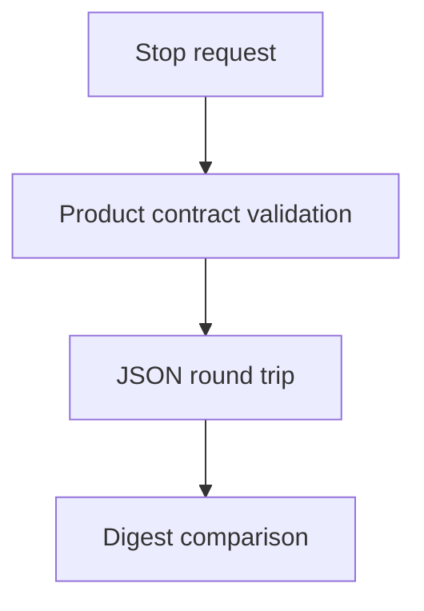

# Round-trip product payloads and check digests

Validate and round-trip a synthetic stop request through the product codec, then verify a binary terminal output chunk. The example sends no request.

This offline contributor exercise follows the development workspace at `0.1.0-beta`.



Excerpt from lines 24–43 of the [example source](../../../crates/undercurrent-protocol/examples/inspect_payload.rs#L24).

```rust
    let request = ProductRequest::StopSession(stop.clone());
    validate_product_request_contract(&request)?;
    let encoded = codec.encode_request(&request)?;
    assert_eq!(codec.decode_request(&encoded)?, request);
    println!("stop_session: contract valid; JSON round trip matched");

    let original_digest = canonical_product_request_digest(&request)?;
    let mut retry = stop.clone();
    retry.mutation.idempotency_key = Some("example-retry-key".to_owned());
    assert_eq!(
        original_digest,
        canonical_product_request_digest(&ProductRequest::StopSession(retry))?
    );
    let mut changed = stop;
    changed.expected_revision = Some(8);
    assert_ne!(
        original_digest,
        canonical_product_request_digest(&ProductRequest::StopSession(changed))?
    );
    println!("retry metadata: same digest; changed revision: different digest");
```

Excerpt from lines 45–56 of the [example source](../../../crates/undercurrent-protocol/examples/inspect_payload.rs#L45).

```rust
    let terminal_codec = TerminalOutputCodec::new(64)?;
    let chunk = TerminalOutputChunk::new(41, Arc::from(b"abc".as_slice()));
    let decoded = terminal_codec.decode(&terminal_codec.encode(&chunk)?)?;
    assert_eq!(decoded, chunk);
    assert_eq!(decoded.end_offset(), Some(44));
    let digest = execution_output_payload_digest_sha256(decoded.bytes());
    assert!(verify_execution_output_payload_digest(
        decoded.bytes(),
        &digest
    ));
    assert!(!verify_execution_output_payload_digest(b"abd", &digest));
    println!("terminal: 3 bytes at offsets 41..44; digest verified");
```

## Run the example

Run from the repository root with the [pinned Rust toolchain](../../../rust-toolchain.toml)
and the locked dependencies available offline.

```sh
cargo +1.95.0 run --locked --offline -p aixand-undercurrent-protocol --example inspect_payload
```

Observed stdout from the verified Linux execution:

```text
stop_session: contract valid; JSON round trip matched
retry metadata: same digest; changed revision: different digest
terminal: 3 bytes at offsets 41..44; digest verified
```

Changing the idempotency key preserves the canonical request digest in this example. Changing the expected revision changes the digest. For the terminal chunk, offsets count bytes and the end is exclusive. The chunk covers `[41, 44)`, and changing `abc` to `abd` fails the payload digest check. If a check fails, inspect the request fields or exact chunk bytes before retrying locally. There is no runtime state to clean up.

[Complete source](../../../crates/undercurrent-protocol/examples/inspect_payload.rs) · [Crate documentation](../../../crates/undercurrent-protocol/docs/README.md) · [Offline examples](README.md)
