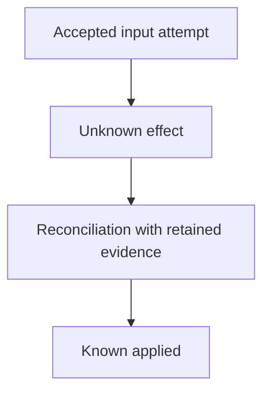

# Model a session and reconcile an uncertain attempt

Follow a synthetic session from creation to running, then reconcile a separate input attempt using simulated retained evidence. The example creates no process.

This offline contributor exercise follows the development workspace at `0.1.0-beta`.



Excerpt from lines 98–113 of the [example source](../../../crates/undercurrent-domain/examples/model_walkthrough.rs#L98).

```rust
    attempt.settle(
        fence,
        EffectCertainty::Unknown,
        None,
        TimestampMillis::new(1_005),
    )?;
    assert!(attempt.state().requires_reconciliation());
    attempt.reconcile(
        EffectCertainty::KnownApplied,
        Some(PayloadDigest::of_bytes(b"synthetic retained receipt")),
        TimestampMillis::new(1_006),
    )?;
    println!(
        "attempt_reconciliation_required={}",
        attempt.state().requires_reconciliation()
    );
```

## Run the example

Run from the repository root with the [pinned Rust toolchain](../../../rust-toolchain.toml)
and the locked dependencies available offline.

```sh
cargo +1.95.0 run --locked --offline -p undercurrent-domain --example model_walkthrough
```

Observed stdout from the verified Linux execution:

```text
session=example-session lifecycle=running revision=4
attempt_reconciliation_required=false
output_verified=true truncated=true
```

The session checks creation at revision 1, a lifecycle revision of 3, and equality after rehydration. The foreground decision records available text interaction without making it actionable. When input effect is unknown, keep the attempt identity and reconcile against retained adapter evidence before considering another write. The output integrity check verifies the retained bytes while preserving the truncation flag. All state is in memory.

[Complete source](../../../crates/undercurrent-domain/examples/model_walkthrough.rs) · [Crate documentation](../../../crates/undercurrent-domain/docs/README.md) · [Offline examples](README.md)
