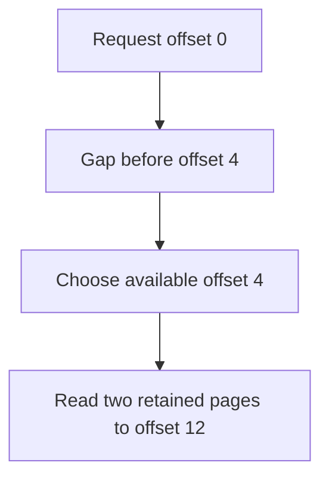

# Recover from a retained output gap

Read retained output after a byte limit evicts a prefix. The in-memory store keeps eight bytes from the twelve-byte sample and caps each replay page at four bytes.

This offline contributor exercise follows the development workspace at `0.1.0-beta`.



Excerpt from lines 31–54 of the [example source](../../../crates/undercurrent-application/examples/output_gap.rs#L31).

```rust
    let mut checkpoint = OutputOffset::ZERO;
    loop {
        match store.replay(
            &session,
            checkpoint,
            4,
            OutputGapRecovery::RestartAtAvailableOffset,
        )? {
            OutputReplay::Gap {
                requested,
                available_from,
                next_offset,
                ..
            } => {
                println!(
                    "gap: requested={}, available={}, end={}",
                    requested.value(),
                    available_from.value(),
                    next_offset.value()
                );
                // This example explicitly accepts the lost prefix. An audit
                // consumer could instead stop and report incomplete history.
                checkpoint = available_from;
            }
```

Excerpt from lines 62–75 of the [example source](../../../crates/undercurrent-application/examples/output_gap.rs#L62).

```rust
                let bytes: Vec<u8> = slices
                    .iter()
                    .flat_map(|slice| slice.bytes().iter().copied())
                    .collect();
                println!(
                    "data: {}..{} = {}",
                    from.value(),
                    to.value(),
                    std::str::from_utf8(&bytes)?
                );
                checkpoint = to;
                if !has_more {
                    break;
                }
```

## Run the example

Run from the repository root with the [pinned Rust toolchain](../../../rust-toolchain.toml)
and the locked dependencies available offline.

```sh
cargo +1.95.0 run --locked --offline -p undercurrent-application --example output_gap
```

Observed stdout from the verified Linux execution:

```text
gap: requested=0, available=4, end=12
data: 4..8 = efgh
data: 8..12 = ijkl
```

The gap covers `[0, 4)`. This example accepts the lost prefix and advances to the first available byte. A consumer that needs complete history can stop and report the gap. Check the exact byte ranges and contents below. The example removes its in-memory session after replay.

[Complete source](../../../crates/undercurrent-application/examples/output_gap.rs) · [Crate documentation](../../../crates/undercurrent-application/docs/README.md) · [Offline examples](README.md)
