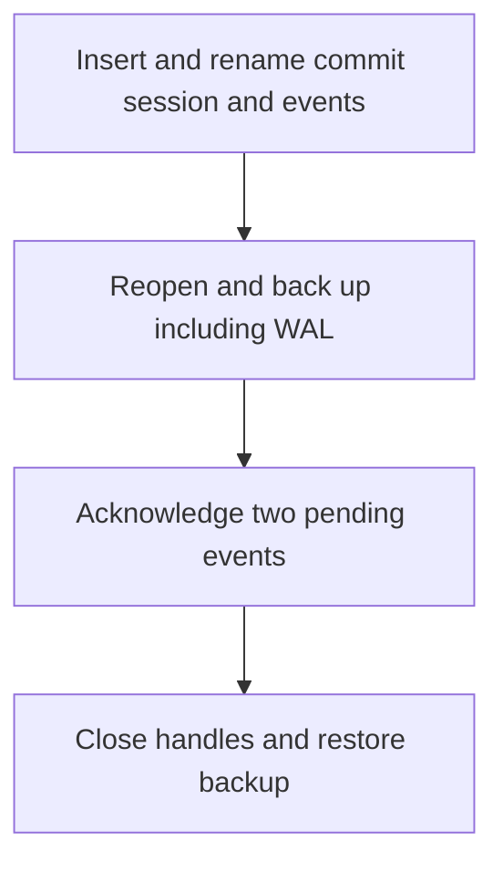

# Restore a SQLite session and its pending outbox

Commit and reopen a synthetic session, then restore a backup containing pending events. The program creates its own temporary directory and never launches the stored command.

This offline contributor exercise follows the development workspace at `0.1.0-beta`.



Excerpt from lines 44–62 of the [example source](../../../crates/undercurrent-store-sqlite/examples/repository_roundtrip.rs#L44).

```rust
    let expected_revision = session.revision();
    let renamed = session
        .rename(SessionName::new("renamed")?, TimestampMillis::new(2))?
        .ok_or("rename should produce a domain change")?;
    assert_eq!(
        block_on(repository.commit(&session, expected_revision, &[event(&session, renamed)]))?,
        CommitSessionOutcome::Committed
    );
    drop(repository);

    let repository = SqliteSessionRepository::open(config(&path)?)?;
    assert_eq!(
        block_on(repository.load(session.id()))?,
        Some(session.clone())
    );
    let pending = block_on(repository.read_pending(8))?;
    assert_eq!(pending.len(), 2);
    assert_eq!(pending[0].snapshot.as_ref(), Some(&original));
    assert_eq!(pending[1].snapshot.as_ref(), Some(&session));
```

Excerpt from lines 82–105 of the [example source](../../../crates/undercurrent-store-sqlite/examples/repository_roundtrip.rs#L82).

```rust
    // In this isolated example, inspection is the only event consumer.
    // A daemon must publish and activate observations before acknowledging.
    let through = pending[1].sequence;
    assert_eq!(
        block_on(repository.acknowledge_through(through))?,
        OutboxAcknowledgeOutcome::Acknowledged {
            records: 2,
            through
        }
    );
    assert!(block_on(repository.read_pending(8))?.is_empty());
    drop(repository); // Restore requires all target handles to be closed.

    let restored = restore_sqlite_database(&backup_path, &path)?;
    assert!(restored.replaced_existing_database);
    assert_eq!(restored.source, restored.installed);
    let repository = SqliteSessionRepository::open(config(&path)?)?;
    assert_eq!(block_on(repository.load(session.id()))?, Some(session));
    assert_eq!(block_on(repository.read_pending(8))?.len(), 2);
    drop(repository);
    let verified = verify_sqlite_database(&path)?;
    assert_eq!(verified.session_count, 1);
    assert_eq!(verified.outbox_count, 2);
    assert_eq!(verified.next_outbox_sequence, 3);
```

## Run the example

Run from the repository root with the [pinned Rust toolchain](../../../rust-toolchain.toml)
and the locked dependencies available offline. Run with write access to the system temporary directory.

```sh
cargo +1.95.0 run --locked --offline -p undercurrent-store-sqlite --example repository_roundtrip
```

Observed stdout from the verified Linux execution:

```text
reopened: name=renamed, sessions=1, pending_events=2
verified backup: release=0.1.0-beta, identities=1
restored: sessions=1, pending_events=2, next_sequence=3
temporary repository removed
```

The reopened outbox contains the original and renamed snapshots in order. The backup is taken while the source is open. Acknowledging through the second sequence empties the live outbox. Restoring the earlier backup brings both pending events back and keeps the next sequence at 3. If restore fails, confirm all target handles are closed before retrying in a disposable directory. A real daemon must publish and activate observations before acknowledging. The example closes the repository and explicitly removes its temporary directory.

[Complete source](../../../crates/undercurrent-store-sqlite/examples/repository_roundtrip.rs) · [Crate documentation](../../../crates/undercurrent-store-sqlite/docs/README.md) · [Offline examples](README.md)
