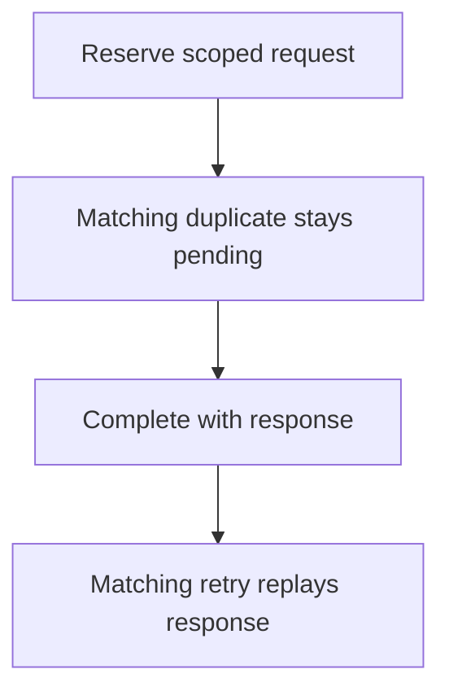

# Reuse the retained result of a duplicate request

Exercise a bounded in-memory request cache with opaque bytes. The example models a lost response and reuses its retained result without repeating a process effect.

This offline contributor exercise follows the development workspace at `0.1.0-beta`.



Excerpt from lines 26–51 of the [example source](../../../crates/undercurrent-transport-core/examples/retained_result.rs#L26).

```rust
    assert_eq!(
        store.reserve(scope.clone(), request.clone())?,
        RequestIdempotencyReservation::Reserved
    );
    // A duplicate while execution is unresolved does not own another execution.
    assert_eq!(
        store.reserve(scope.clone(), request.clone())?,
        RequestIdempotencyReservation::Pending
    );
    let deadline = Instant::now() + Duration::from_secs(30);
    assert_eq!(
        store.complete(&scope, response.clone(), deadline)?,
        RequestIdempotencyCompletion::Completed
    );

    // Simulated lost response: retry the same bytes without repeating an effect.
    let RequestIdempotencyReservation::Completed { response: replayed } =
        store.reserve(scope.clone(), request)?
    else {
        return Err("completed result was not retained".into());
    };
    assert_eq!(replayed, response);
    assert_eq!(
        store.reserve(scope, Arc::from(&b"different mutation"[..]))?,
        RequestIdempotencyReservation::PayloadConflict
    );
```

## Run the example

Run from the repository root with the [pinned Rust toolchain](../../../rust-toolchain.toml)
and the locked dependencies available offline.

```sh
cargo +1.95.0 run --locked --offline -p aixand-undercurrent-transport-core --example retained_result
```

Observed stdout from the verified Linux execution:

```text
reserved -> pending -> completed -> replayed -> expired
```

The scope combines client ID and idempotency key. A pending duplicate has no second execution reservation, and a retry with different bytes yields `PayloadConflict`. Keep the original scope and bytes when investigating a lost response. After expiration this cache no longer provides the retained result. The example sweeps at its supplied deadline and checks that retained bytes return to zero.

[Complete source](../../../crates/undercurrent-transport-core/examples/retained_result.rs) · [Crate documentation](../../../crates/undercurrent-transport-core/docs/README.md) · [Offline examples](README.md)
