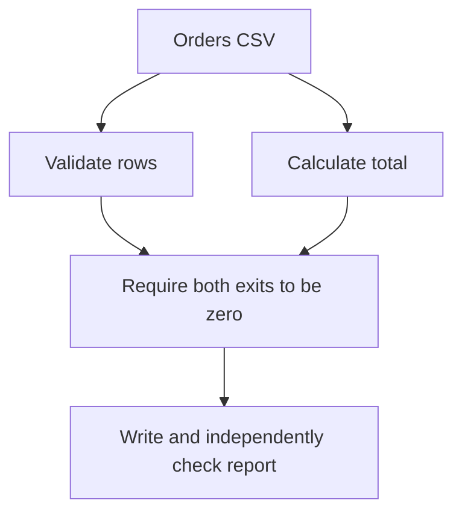

# Coordinate parallel jobs and verify a report

Run CSV validation and totals concurrently. Generate a report only after both
prerequisites exit zero. The actual terminal recording uses this maintained
coordinator and its fixture jobs; the application owns dependency decisions.



## Run the recorded workflow

From the source checkout, complete [runtime setup](runtime/setup.md). With VHS,
ttyd, ffmpeg, ffprobe and Chromium available:

```sh
python3 scripts/docs/render_demos.py orchestration --bin-dir "$RUNTIME_BIN"
```

The runner copies the fixture into an isolated workspace, selects a private
runtime home and stops its own sessions and daemon. See the [recording guide](../assets/demos/README.md)
for browser selection and retained failure evidence. To run a standalone SDK
program without recording tools, use the [parallel report](runtime/parallel-report.md)
and its [failed-prerequisite case](runtime/failed-prerequisite.md).

## Follow the coordinator

This excerpt comes from [orchestrate.py](../assets/demos/fixtures/orchestrate.py).
It needs the fixture jobs, helper, CSV and runner environment shown above.

```python
async with asyncio.TaskGroup() as tasks:
    starts = [tasks.create_task(client.start(
        [sys.executable, "-u", "job.py", name], name=name,
        detection=False, labels={"demo": "orchestration"},
    )) for name in ("check", "total")]
sessions = [task.result() for task in starts]
for session in sessions:
    await wait_for_line(client, session, f"READY: {session.name}")
snapshots = [await client.inspect(session) for session in sessions]
if any(snapshot.lifecycle != "running" for snapshot in snapshots):
    raise RuntimeError("Both jobs must be running before release")
print("RUNNING: two independent jobs", flush=True)
for snapshot in snapshots:
    print(f"  {snapshot.name:<8} {snapshot.lifecycle}", flush=True)
Path("parallel-snapshot.json").write_text(json.dumps([s.raw for s in snapshots]))
# Keep the live jobs visible long enough to read the recording.
await asyncio.sleep(3)
Path("begin-work").touch()
print("WAIT: both jobs must exit successfully", flush=True)
results = await asyncio.gather(*(require_success(client, s) for s in sessions))
Path("prerequisite-exits.json").write_text(json.dumps(results))
print("START: dependent report", flush=True)
report = await client.start(
    [sys.executable, "-u", "job.py", "report"], name="report",
    detection=False, labels={"demo": "orchestration"},
)
await require_success(client, report)
```

The fixture barrier ensures the independent workers overlap. An unsuccessful
prerequisite prevents report creation. A terminal state without a zero exit code
does not satisfy this application's gate.

## Check the observed artifact

The freshly executed recording produced:

```text
Validated orders: 4
Order total: 35.50
```

The runner independently recomputes the total from `orders.csv`, checks both
prerequisite exits, overlapping worker lifetimes and report start ordering.
A launch receipt alone satisfies none of these checks. Failure evidence stays
in the runner's reported directory; inspect it before repeating or removing state.
