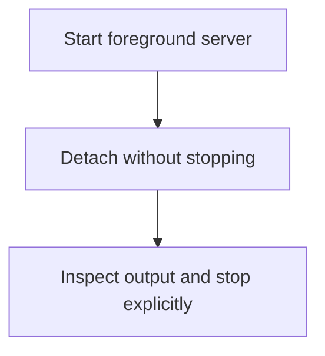

# Keep a development server available

Keep your development server running while you work. Give it a name, open its terminal when you need it, or check its output and status without attaching.




## Prerequisites

An installed Undercurrent CLI and an npm project with dependencies installed and a dev script that keeps the server in the foreground. Run these commands from that project directory, using an unused session name.

## Workflow

- **Start:** Run npm in a named session
- **View:** Attach live or peek once
- **Check:** See status with uc ls
- **Investigate:** Read errors in the output

## 1. Start your server

The CLI starts the local daemon when needed, launches your dev script, and returns control to your terminal. The server keeps running in the my-server session.

```sh
uc start my-server -- npm run dev
```

## 2. Open its terminal or take a quick look

Attach to see live output and interact with the server. To leave it running, press Alt-U, release it, then press d. Use peek from your original terminal for a one-time view of the current screen.

```sh
uc attach my-server

# Or view the current screen without attaching
uc peek my-server
```

## 3. Check its status

List your sessions to see whether the process is running, stopped, or has exited. The HEALTH column reflects configured checks; a running process alone does not prove the server is ready.

```sh
uc ls
```

## 4. Find errors when something goes wrong

Errors printed by the server appear in its terminal output. Attach to watch them live, peek at the current screen, or read retained logs for earlier output. Inspect shows session details and exit status. Application errors affect HEALTH only when you configure a matching health rule, such as an HTTP endpoint or log-error pattern.

```sh
uc logs my-server --max-bytes 4096
uc inspect my-server
```

## 5. Restart or stop when you are done

Restart uses the saved command and working directory. Stop ends the server. The graceful option lets the process handle its stop signal before Undercurrent escalates if needed.

```sh
# Restart after changing startup configuration
uc restart my-server --graceful

# Stop when you no longer need the server
uc stop my-server --graceful
```

## Verify the outcome

Your development server has a stable name, a terminal you can return to, and retained output you can inspect when a request or build fails.

> Peek shows the current screen, not the full log history. To make readiness and service failures visible in uc ls, continue with the server health guide.

## Related reading

- [Session commands](https://github.com/Aixand/undercurrent/blob/main/docs/guides/cli/sessions.md)
- [Status and output](https://github.com/Aixand/undercurrent/blob/main/docs/guides/cli/status-and-output.md)
