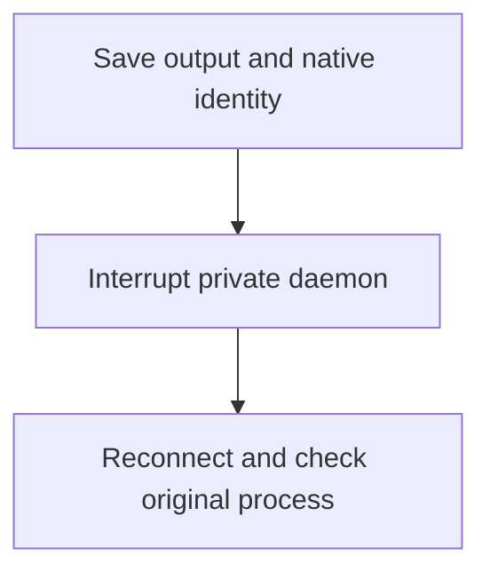

# Recover a process after a daemon crash

Crash only the private daemon, start its replacement and recover the same managed process. Preserve the earlier output yourself and observe the retained-output boundary.



## Run and inspect

Complete [runtime setup](setup.md). From the Undercurrent checkout with the
SDK environment active and a fresh work directory:

```sh
python docs/examples/runtime/workflows.py daemon-reconnect \
  --work /tmp/uc-daemon-reconnect --bin-dir "$RUNTIME_BIN"
```

This intentionally sends SIGKILL to the demo-owned daemon. Graceful daemon shutdown intentionally stops sessions and is a different operation. The helper and runtime home belong solely to this run.

## Follow the SDK flow

This is an excerpt from [workflows.py](workflows.py), with imports and the
isolated runtime context omitted. [worker.py](worker.py) implements the bounded
fixture application.

```python
# Crash this owned daemon; graceful shutdown intentionally stops its sessions.
app.daemon.kill()
await asyncio.to_thread(app.daemon.wait, 20)
app.log.close()
os.kill(native_pid, 0)
show('Daemon interrupted', native_process_alive=True)
await app.start_daemon()
async with app.client() as replacement:
    recovered = await replacement.inspect(identity)
    assert recovered.id == identity and recovered.lifecycle == 'running'
    os.kill(native_pid, 0)
    (app.root / 'finish').touch()
    ended = await app.ended(replacement, recovered)
    assert ended.lifecycle == 'exited' and ended.raw['lifecycle'].get('code') == 0
    gap_start = None
    try:
        await replacement.read_output(recovered, from_offset=0)
    except OutputGap as gap:
        gap_start = gap.available_from
    page = await replacement.read_output(recovered, from_offset=checkpoint)
    output = (app.root / 'before-crash.bin').read_bytes() + page.data
    assert b'Worker ready' in output and b'Worker finished' in output
    (app.root / 'recovered-output.bin').write_bytes(output)
    show('Recovered', same_session=True, same_native_pid=True,
         archived_prefix_bytes=checkpoint, available_after_crash=gap_start, exit_code=0)
```

## Check the observed result

Actual Linux execution produced:

```text
Daemon interrupted: {"native_process_alive": true}
Recovered: {"archived_prefix_bytes": 14, "available_after_crash": 14, "exit_code": 0, "same_native_pid": true, "same_session": true}
Cleanup verified: {"daemon_exited": true, "owned_sessions_stopped": true}
```

Process survival does not imply complete output retention. The observed run reports `OutputGap` at offset 0 with bytes available from 14. The coordinator saved that 14-byte prefix before interruption and reads subsequent bytes from its checkpoint. It does not manufacture or hide a missing prefix. Host recovery is revision- and platform-specific; this run qualifies Linux only.

The work directory retains `run.json`, session references, workflow artifacts and
`cleanup.json`. Cleanup observes terminal session states and waits for its daemon
to exit. Keep the directory if cleanup fails; investigate its exact owned IDs
before removing evidence.
