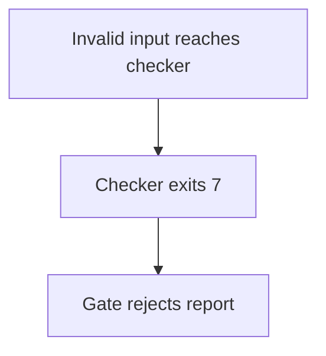

# Reject a report after a prerequisite fails

Give the same pipeline an invalid quantity. Observe exit 7 and prove that the dependent report never starts.



## Run and inspect

Complete [runtime setup](setup.md). From the Undercurrent checkout with the
SDK environment active and a fresh work directory:

```sh
python docs/examples/runtime/workflows.py failed-prerequisite \
  --work /tmp/uc-failed-prerequisite --bin-dir "$RUNTIME_BIN"
```

A terminal lifecycle alone is insufficient. The gate requires both `exited` and code zero. The program also queries the session catalog to prove no report session was created.

## Follow the SDK flow

This is an excerpt from [workflows.py](workflows.py), with imports and the
isolated runtime context omitted. [worker.py](worker.py) implements the bounded
fixture application.

```python
check, total = await asyncio.gather(
    app.start(client, 'check', 'check'), app.start(client, 'total', 'total'))
async def both_ready():
    return all((app.root / (name + '.ready')).exists() for name in ['check', 'total'])
await until(both_ready)
snapshots = await asyncio.gather(*(client.inspect(s) for s in [check, total]))
assert all(s.lifecycle == 'running' for s in snapshots)
show('Parallel', workers=2, both_running=True)
(app.root / 'release').touch()
ended = await asyncio.gather(app.ended(client, check), app.ended(client, total))
codes = [s.raw['lifecycle'].get('code') for s in ended]
successful = all(s.lifecycle == 'exited' and s.raw['lifecycle'].get('code') == 0 for s in ended)
if not successful:
    assert fail and codes == [7, 0]
    assert not (app.root / 'report.txt').exists()
    assert not any(s.name == 'report' for s in await client.list())
    show('Gate rejected', exit_codes=codes, report_started=False)
    return
assert not fail
report = await app.start(client, 'report', 'report')
assert (await app.ended(client, report)).raw['lifecycle'].get('code') == 0
artifact = (app.root / 'report.txt').read_text()
assert artifact == 'Rows: 2; total cents: 4500\n'
save(app.root / 'accepted.json', {'exit_codes': codes, 'artifact': artifact, 'sha256': hashlib.sha256(artifact.encode()).hexdigest()})
show('Report verified', rows=2, total_cents=4500, prerequisite_exits=codes)
```

## Check the observed result

Actual Linux execution produced:

```text
Parallel: {"both_running": true, "workers": 2}
Gate rejected: {"exit_codes": [7, 0], "report_started": false}
Cleanup verified: {"daemon_exited": true, "owned_sessions_stopped": true}
```

Inspect the checker output and fix the input before a fresh run. A validation failure is an application result; do not treat it as a transport retry.

The work directory retains `run.json`, session references, workflow artifacts and
`cleanup.json`. Cleanup observes terminal session states and waits for its daemon
to exit. Keep the directory if cleanup fails; investigate its exact owned IDs
before removing evidence.
