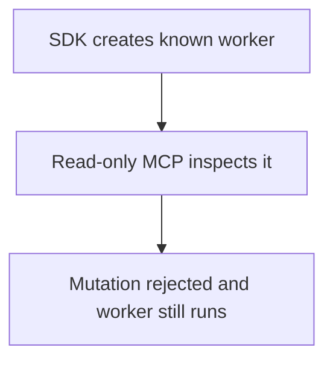

# Observe through a read-only MCP adapter

Start one managed worker, discover the read-only MCP tools and inspect that exact session. Attempt a forbidden mutation and verify the worker remains running.



## Run and inspect

Complete [runtime setup](setup.md). From the Undercurrent checkout with the
SDK environment active and a fresh work directory:

```sh
python docs/examples/runtime/workflows.py mcp-observer \
  --work /tmp/uc-mcp-observer --bin-dir "$RUNTIME_BIN"
```

This uses the maintained standard-library MCP probe from the source checkout. It is real stdio and a real SDK connection, not a mocked MCP call. Tool discovery does not require an LLM.

## Follow the SDK flow

This is an excerpt from [workflows.py](workflows.py), with imports and the
isolated runtime context omitted. [worker.py](worker.py) implements the bounded
fixture application.

```python
observer = await asyncio.to_thread(MCP, app.bin / 'uc-mcp', app.home, read_only=True)
try:
    tools = (await asyncio.to_thread(observer.request, 'tools/list', {}))['result']['tools']
    names = {t['name'] for t in tools}
    assert {'inspect_session', 'read_output', 'list_sessions'} <= names
    assert not {'start_session', 'send_input', 'stop_session'} & names
    detail = await asyncio.to_thread(observer.call, 'inspect_session', session_id=session.id)
    assert detail['summary']['id'] == session.id
    denied = await asyncio.to_thread(observer.call_raw, 'stop_session', session_id=session.id)
    assert denied.get('error') or denied.get('result', {}).get('isError')
    assert (await client.inspect(session)).lifecycle == 'running'
    show('Observer verified', readonly=True, expected_session=True, mutation_rejected=True, process_running=True)
finally:
    await asyncio.to_thread(observer.close)
```

## Check the observed result

Actual Linux execution produced:

```text
Observer verified: {"expected_session": true, "mutation_rejected": true, "process_running": true, "readonly": true}
Cleanup verified: {"daemon_exited": true, "owned_sessions_stopped": true}
```

Check the selected home, matching `uc-mcp` build and native peer connection when inspection fails. Read-only tool filtering does not isolate mutually untrusted processes sharing an OS account.

The work directory retains `run.json`, session references, workflow artifacts and
`cleanup.json`. Cleanup observes terminal session states and waits for its daemon
to exit. Keep the directory if cleanup fails; investigate its exact owned IDs
before removing evidence.
