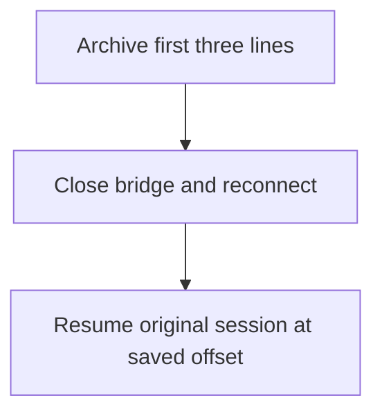

# Resume a byte-exact output archive

Archive six numbered lines across two independent SDK connections. Persist byte offsets after syncing captured bytes, then check the exact final file.



## Run and inspect

Complete [runtime setup](setup.md). From the Undercurrent checkout with the
SDK environment active and a fresh work directory:

```sh
python docs/examples/runtime/workflows.py output-checkpoint \
  --work /tmp/uc-output-checkpoint --bin-dir "$RUNTIME_BIN"
```

The application owns its archive. Closing a client detaches; it does not terminate the managed process. Continue at `from_offset + len(data)`, not the producer head in `next_offset`.

## Follow the SDK flow

This is an excerpt from [workflows.py](workflows.py), with imports and the
isolated runtime context omitted. [worker.py](worker.py) implements the bounded
fixture application.

```python
async with app.client() as resumed:
    session = await resumed.inspect(reference)
    assert session.id == reference
    assert (await app.ended(resumed, session)).raw['lifecycle'].get('code') == 0
    checkpoint = json.loads(target.with_suffix('.checkpoint.json').read_text())
    assert checkpoint['session_id'] == reference and target.stat().st_size == checkpoint['offset']
    end = await archive(resumed, session, target, checkpoint['offset'])
expected = ''.join(f'entry-{i:03d}\r\n' for i in range(1, 7)).encode()
assert target.read_bytes() == expected
show('Archive verified', bytes=end, lines=6, same_session=True, duplicates=0)
```

## Check the observed result

Actual Linux execution produced:

```text
Checkpoint saved: {"client_closed": true, "offset": 33}
Archive verified: {"bytes": 66, "duplicates": 0, "lines": 6, "same_session": true}
Cleanup verified: {"daemon_exited": true, "owned_sessions_stopped": true}
```

The fixture controls output timing and makes no arbitrary crash-recovery claim. If a write and checkpoint disagree, stop and reconcile. On `OutputGap`, preserve the missing interval and require an explicit recovery policy; never silently skip bytes.

The work directory retains `run.json`, session references, workflow artifacts and
`cleanup.json`. Cleanup observes terminal session states and waits for its daemon
to exit. Keep the directory if cleanup fails; investigate its exact owned IDs
before removing evidence.
