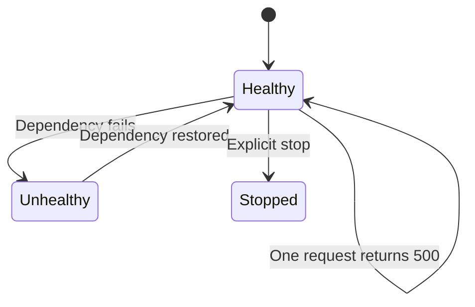

# Distinguish service health from error history

Run a real npm API with an HTTP health rule. Observe an isolated request error,
a dependency failure, and recovery without losing the earlier errors.



## Run the complete demonstration

Complete [runtime setup](runtime/setup.md), then install Node.js 22+, npm, curl,
VHS, ttyd, ffmpeg, ffprobe and Chromium. From the Undercurrent checkout:

```sh
python3 scripts/docs/render_demos.py server-health --bin-dir "$RUNTIME_BIN"
```

The maintained runner uses the [fixture API](../assets/demos/fixtures/server/server.mjs),
a free loopback port and a private runtime home. It verifies HTTP responses and
fresh health observations, then checks successful shutdown and listener closure.
Its printed evidence directory retains failure logs. This is a bounded demo
server, with no database, external dependency or provider account.

## Follow the CLI flow

These are excerpts from the recording. `APP` is the runner's selected loopback
URL; the runner prepares the sample npm project as its working directory.

```sh
uc start api --healthy-when "http:$APP/health" -- npm start
uc wait api --health healthy --timeout 15s
curl -sS "$APP/orders?demo_error=1"
curl -sS -X POST "$APP/demo/fail"
uc wait api --health unhealthy --timeout 15s
curl -sS -X POST "$APP/demo/recover"
uc wait api --health healthy --timeout 15s
uc logs api --max-bytes 4096
uc stop api --graceful
```

| Stage | HTTP evidence | Managed state |
| --- | --- | --- |
| Initial service | Orders 200, health 200 | Running and healthy |
| Isolated request error | One order request 500, next order 200 | Still healthy; error retained |
| Dependency disabled | Orders 503, health 503 | Running and unhealthy |
| Dependency restored | Orders 200, health 200 | Healthy; both earlier errors retained |
| Explicit stop | Listener closes | Stopped |

A wait timeout does not stop the process. If health does not change, inspect the
endpoint response and configured rule before resubmitting commands. Application
readiness, process lifecycle and historical error output have separate meanings.

[Health-rule reference](../reference/cli-commands.md#health-rules) · [Status and output](../guides/cli/status-and-output.md)
