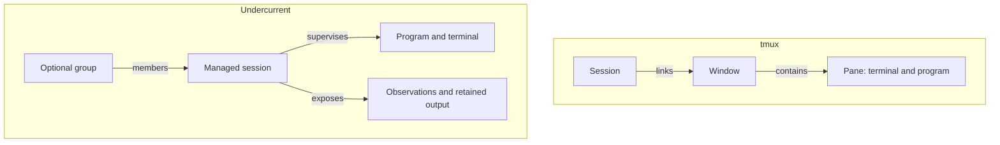

# Undercurrent and tmux

**Both tools support interactive terminals and automation.** Undercurrent is a
programmable process multiplexer that brings session control, foreground
observations, health checks, and retained output into one interface. Its value
is the process information your tools can share when supervising interactive
programs, servers, and other long-running processes.

tmux provides terminal workspaces and extensive scripting primitives, including
[formats](https://github.com/tmux/tmux/wiki/Formats),
[hooks and control-mode notifications](https://github.com/tmux/tmux/wiki/Control-Mode).
Programmability, detaching, and sending keys are capabilities of both tools.

This comparison covers the **Undercurrent 0.1.0-beta source checkout**
and **[tmux 3.7c](https://github.com/tmux/tmux/releases/tag/3.7c)**, reviewed on
2026-10-05. See [Undercurrent compatibility](../reference/compatibility.md) for
package and platform scope. tmux's moving wiki also describes newer features;
use the [3.7c manual](https://raw.githubusercontent.com/tmux/tmux/3.7c/tmux.1)
and your installed `tmux -V` when comparing exact commands.

## Choose by the work you need to do

| Your requirement | A good starting point |
| --- | --- |
| A terminal workspace, keyboard navigation, and a few automation scripts | **tmux**, especially if your existing setup already meets the need. |
| Detect when a process is requesting input, and expose the same observation to people and software | **Undercurrent**, with a detection profile verified against that program's terminal UI. |
| Monitor service health alongside lifecycle and logs | **Undercurrent**, with checks that express the service's actual readiness requirements. |
| Launch a separate command using a managed shell's observed directory and captured exports | **Undercurrent's `exec`**, with current shell integration. |
| Coordinate tasks, decide retries, or schedule work across machines | **Your orchestration layer**, using either tool's process controls. |

These are fit recommendations. Compare Undercurrent with the tmux scripts,
libraries, and detectors you would actually use, including what you would need
to maintain around them.

## The session models differ

A tmux session groups windows; windows contain panes with terminals and programs.
Windows can be linked into multiple sessions. See tmux's
[session, window, and pane model](https://github.com/tmux/tmux/wiki/Getting-Started#sessions-windows-and-panes).

An Undercurrent session is the managed process unit targeted by `uc start`,
`uc inspect`, and `uc stop`. Optional groups organize sessions; attached panes
are views of them.



*An Undercurrent session is closest to a tmux pane plus management state. This
is a conceptual comparison, not a one-to-one migration mapping.*

Undercurrent's [direct attachment](../guides/cli/interactive.md#split-and-focus-panes)
supports side-by-side and stacked panes. Layouts belong to that CLI view.
[Saved groups](../guides/cli/groups.md) retain membership and shell restoration
recipes; they do not save pane layouts or running shell memory.

## Capabilities that overlap

These are related operations, not interchangeable commands. tmux command behavior
is documented in its [3.7c manual](https://raw.githubusercontent.com/tmux/tmux/3.7c/tmux.1).
Undercurrent's [CLI reference](../reference/cli-commands.md) owns its exact flags.

| Task | tmux | Undercurrent |
| --- | --- | --- |
| Launch and return to a terminal | `new-session`, `new-window`, `split-window`, attach/detach | `uc start`, `uc attach`, detach |
| Restart a workload | `respawn-pane`, `respawn-window` | `uc restart` |
| Send text or keys | `send-keys`, paste buffers | `uc send` |
| Read terminal content | `capture-pane`; `pipe-pane` for output logging | `uc peek` for the current screen; `uc logs` for retained bytes |
| Inspect objects | List/display commands and formats; stable object IDs during their lifetime | `uc ls`, `uc inspect`, session IDs, JSON output |
| React to changes | Hooks and control mode | `uc watch`; SDK subscriptions |
| Keep finished work for inspection | `remain-on-exit` | Finished session records until `uc clean`, subject to output retention |
| Program through a library | Third-party [libtmux](https://libtmux.git-pull.com/) provides Python objects | First-party [blocking Rust and async Python SDKs](../sdk/README.md), with different API coverage |

## What Undercurrent adds to your workflow

### Recognize when a process needs input

Undercurrent separates **process lifecycle**, **foreground execution**,
**interaction**, and **health**. `uc ls` shows these together; `uc explain`
provides the observation evidence and health results.

An interactive process may request confirmation or provide a prompt that accepts
input. A detection profile maps matching terminal evidence to interaction states
such as `requested` and `available`. The active profile must recognize the
program's terminal UI. See [profile selection and verification](../guides/configuration/profiles.md).

With an existing managed process session named `task` and a profile that
recognizes its input requests, use these read-only commands:

```sh
uc wait task --interaction requested --timeout 30s
uc explain task --json
uc peek task
```

The wait can match an already-present observation. It does not require a new
transition or a stability window, and timing out does not stop the process.
An available input prompt does not prove the application's work is finished.
Your controller checks the result and decides whether and how to respond. The
[state and output guide](../guides/cli/status-and-output.md) explains the contract.

tmux 3.7c's `wait-for` supplies channel signaling and locking. Undercurrent's
`wait` tests session observations such as interaction or health. tmux also has
hooks and notifications; its [3.8 events guide](https://github.com/tmux/tmux/wiki/Events)
describes additional event and monitor features. The useful distinction is
Undercurrent's supplied observation model, not the mere ability to wait.

### Keep service health separate from request errors

Undercurrent can evaluate [configured health rules](../reference/cli-commands.md#health-rules)
while the process keeps running. The [npm server recording](../assets/demos/README.md#check-an-npm-server-and-find-errors)
uses an HTTP health endpoint and demonstrates:

| Event | Lifecycle | Health in that example |
| --- | --- | --- |
| One request fails; ordinary requests still succeed | Running | Healthy |
| An essential dependency fails and `/health` returns 503 | Running | Unhealthy |
| The dependency recovers; earlier errors remain in `uc logs` | Running | Healthy |

Health reflects the checks you configure. A log-error rule explicitly makes a
matching error relevant to health; merely retaining an error in the logs does
not do so. `healthy` means the configured checks passed, not that every request
or background task succeeded.

### Run a separate command in observed shell context

`uc exec` starts a **separate process** using the session's observed directory
and latest captured root-shell exports by default. Live exports require current
[shell hooks](../guides/cli/shell-integration.md). Missing live context causes
an error; `--dir-launch` and `--env-launch` explicitly select launch settings.
Aliases, unexported variables, shell functions, and jobs are not cloned.
See [exec semantics](../reference/cli-commands.md#run-a-separate-command-with-exec).

Sending a command into an existing tmux shell already uses that shell's context.
For newly launched processes, tmux combines its stored global and session
environments; that is distinct from capturing exports changed later inside a
running shell. Its [environment documentation](https://raw.githubusercontent.com/tmux/tmux/3.7c/tmux.1)
defines those stored environments.

## Persistence and orchestration have boundaries

| Requirement | What to account for |
| --- | --- |
| Detach and return | Both tools support it. Undercurrent detachment leaves the session running; closing an SDK client does too. |
| Survive daemon or host failure | Undercurrent has a separate process host and startup reconciliation. Recovery depends on surviving runtime identity and evidence; see [state ownership](../architecture/README.md) and [host recovery](../../crates/undercurrent-runtime/docs/internals/host/recovery.md). tmux's [FAQ](https://github.com/tmux/tmux/wiki/FAQ#tmux-says-no-sessions-when-i-try-to-attach-but-i-definitely-had-sessions) distinguishes a missing socket from an exited server and lost sessions. |
| Keep complete output or every state change | Undercurrent retention is bounded; gaps and coalesced observations are possible. Follow the [output guide](../guides/cli/status-and-output.md) and [stream recovery](../sdk/recovery.md#restore-a-stream-baseline). |
| Retry a command after losing its response | Reconnection does not authorize repeating an uncertain mutation. Input-delivery records survive daemon replacement until session deletion, but unresolved outcomes remain indeterminate; see [mutation recovery](../sdk/recovery.md). |

Your application owns task dependencies, authorization to answer prompts,
success criteria, and retry decisions. Undercurrent supplies process controls
and observations; use application acknowledgements or result checks to establish
completion. A native application API may provide stronger task semantics than
terminal interaction. Local IPC access also does not provide process sandboxing
or isolation between hostile tenants; see [endpoint protection](../../crates/undercurrent-transport-local/docs/internals/endpoints.md).

This comparison makes no performance ranking. Evaluate both setups with your
workload, including detection accuracy, missing context, reconnect behavior,
and integration maintenance.

## Try the relevant workflow

- [Install Undercurrent](installation.md) and complete [your first session](first-session.md).
- [Watch the process and server recordings](../assets/demos/README.md).
- [Choose an SDK](../sdk/README.md) for a controller that shares these observations.
- [Use tmux's getting-started guide](https://github.com/tmux/tmux/wiki/Getting-Started)
  for its terminal workflow.

[Getting started](README.md) · [Documentation index](../README.md)
