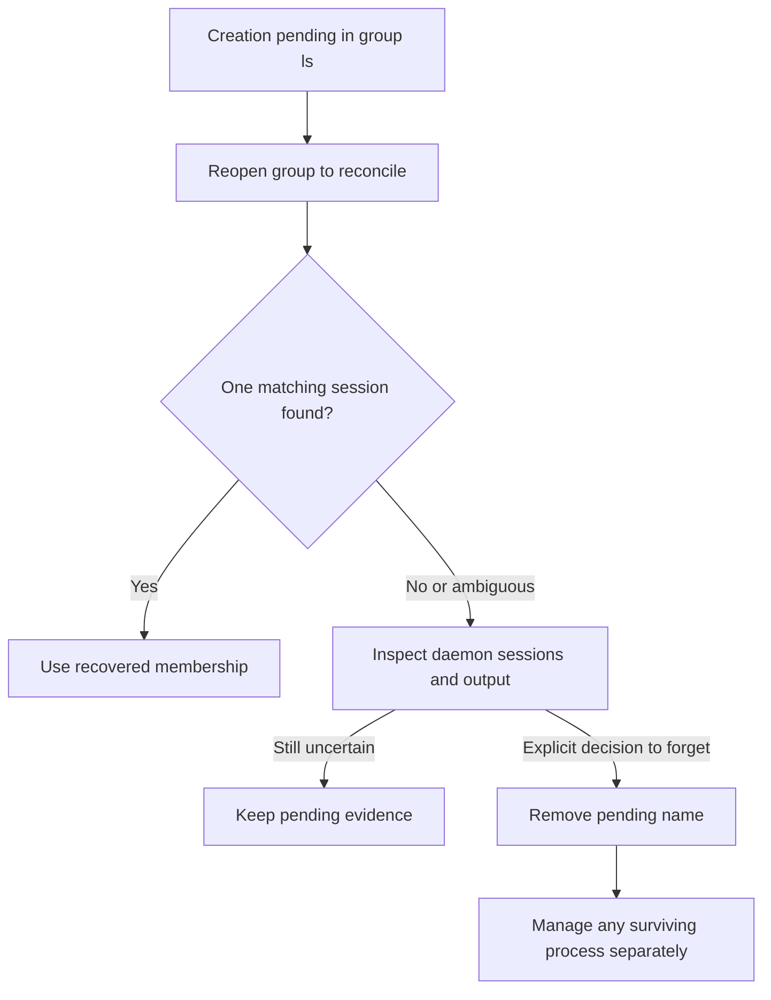

# Save, restore, and delete groups of shells

Use a saved group to reopen a named collection of managed shells. This guide
covers CLI package 0.1.0-beta. Install the [matching native binaries](../../getting-started/installation.md),
select your `UNDERCURRENT_HOME`, and run commands as its owning OS user from
your project directory. Opening a group requires terminal stdin/stdout and text
output. The [attachment guide](interactive.md#use-shortcuts-panes-history-and-copy)
explains the prefix, history, and copy controls shared by group views.

## Create and reopen a saved group

Applications using `GroupClient` can set `with_launch_context(labels, metadata)`
before creating shells. The caller's attributes are validated during preparation
and retained in new saved-shell recipes; summaries omit private metadata.
Existing sessions, recipes, and pending starts retain their original context.
The `uc.*` namespace belongs to group identity and cannot be supplied through
this application API. Use matching rebuilt CLI and bridge binaries when adding
this support; older CLI binaries cannot read recipes with context fields.

1. Choose a unique name containing 1–48 ASCII letters, digits, underscores, or
   hyphens, and run from the directory where the first shell should start:

   ```sh
   uc group new project --cwd .
   ```

   This saves the group, starts its first interactive shell, and opens its view.
   The directory must exist and is canonicalized. Add `--shell /absolute/path/to/shell`
   to select another shell.
2. With the default Alt-U prefix, use prefix then `c` for another shell, `n/p`
   to switch, and `d` to detach. Detaching leaves the shells running.
3. Verify the saved membership, then reopen its selected member:

   ```sh
   uc group ls --json
   uc group attach project
   ```

`group new` enables persistence by default; `--no-persist` disables shell
restoration. In the bare `uc group` picker, press `c` to create a saved group
or `t` to create a temporary group. The name prompt labels the selected mode.
Both named creation paths now save shell recipes by default; existing groups
retain their own persistence setting.

Group and member pickers accept Up/Down or `k`/`j` to move, `h`/`l` for the
previous/next screenful, Enter to open, and `q` or Escape to close. While entering
a new group name, these letters are ordinary text; Escape cancels name entry.

Persistence saves a shell recipe, stable restoration slot, membership, and
selection. It does not checkpoint shell memory, jobs, aliases, unexported
variables, or a pane layout. New shells start from the saved recipe and the
daemon's latest retained root-shell directory, when available. Directory
tracking is daemon-owned and works without installed detection hooks; a nested
shell's temporary directory is not the root shell's restoration directory.

### Change membership

For a script managing existing service sessions, create an empty group without
opening a terminal or starting an extra shell:

```sh
uc group create services --cwd .
uc group add services backend
uc group inspect services --json
```

`group create` defaults to no shell restoration; add `--persist` to retain recipes
for shells subsequently created in the group. Adopted services keep their own
launch configuration. `group inspect` reports saved member names and session
identities without restoring anything or exposing private launch environments.
Use those identities to skip existing members on repeated runs and remove stale
membership after a service session is recreated.

With an existing managed session named `dev`, choose the membership change:

| Task | Command |
| --- | --- |
| Add `dev` | `uc group add project dev` |
| Remove `dev` from this group | `uc group remove project dev` |

An adopted session is attachment-only: adding it does not create a restoration
recipe. One session belongs to at most one group within the endpoint namespace.
Removing membership leaves the process running, and can also use a retained
session ID or name after the daemon session has disappeared.

Only one interactive view can hold a particular group's view lock. Metadata
updates use a separate registry lock. Another view or deletion may report
`group is busy`; detach the existing view and retry the intended operation.
Do not remove lock files to bypass ownership.

## Understand restoration and pending operations

Restoration runs when you attach a persistent group and when an open persistent
view observes a changed daemon epoch during reconnection. It does not repeatedly
restart a shell merely because that shell exits while the view stays open.

| Observed state | Automatic restoration decision |
| --- | --- |
| Starting, running, or restart scheduled | Keep the existing session |
| Stopping | Show unresolved stop; do not create a replacement |
| Stopped, exited, or explicitly stopped | Mark the saved slot closed; do not recreate automatically |
| Retained failed session with an open saved slot | May restore using retained directory and shell recipe |
| Removed failed session with suitable removal evidence and no explicit stop | May restore, including older slots incorrectly marked closed |
| Missing session without retained removal evidence | Keep uncertainty visible; request explicit restoration |
| Missing directory, unavailable executable, unrelated session occupying the name | Keep the slot and show a notice |
| Pending creation or deletion | Reconcile or resolve it before further restoration |

`uc group restore project SAVED_NAME_OR_SESSION_ID` explicitly requests one
saved terminal. It still skips a currently running or scheduled session and
does not override an unresolved stop, pending creation, or deletion. If a
terminal record still owns the old name, a replacement gets a generated launch
name while the group's displayed name and stable slot remain unchanged. Check
`uc ls --json` for its current daemon name and ID.

A start can succeed even when its reply is lost. The CLI saves pending creation
before sending a request and reconciles it by a unique creation label. It does
not automatically resend an uncertain start. Only an explicit server
`known_absent` rejection clears a rejected creation immediately. An empty label
query is insufficient evidence. If registry publication fails after success,
the accepted process remains available through `uc ls`. The maintainer guide
shows the [separate commit points](../../../crates/undercurrent-cli/docs/internals/groups-and-recovery.md#publish-intent-before-starting-a-shell).

### Resolve a pending creation

This decision view turns the pending fields into an operator task.



*Reopening searches for evidence. Forgetting an entry is a separate decision
that does not undo a possible start.*

`group ls` exposes `pending_creation`, `pending_session`, and `deletion_pending`.
Reopen to reconcile a pending creation. After independently inspecting the
daemon state, `uc group remove project PENDING_NAME` explicitly forgets that
intent; it does not stop a possible process. Forgetting an uncertain replacement
also removes its saved restoration slot. Preserve a malformed or newer registry
for investigation; the CLI rejects it instead of replacing it with an empty one.

## Delete a group or stop its members

```sh
uc group delete project
```

This forgets membership and restoration intent while leaving sessions running.
To stop members before forgetting the group:

```sh
uc group delete project --stop
```

The CLI first saves `deletion_pending`, disabling restoration. It reconciles
pending creation, stops active members concurrently within the configured CLI
bulk concurrency bound, and checks their state. `--stop` is immediate; `--force`
is an explicit spelling of that default. Add `--graceful` to allow each session's
configured stop signal and timeout before escalation. A partial or uncertain
result retains the group. Resume with the same `--stop` command after inspecting
the listed unresolved sessions. The group is forgotten only after every member is absent or in a
terminal state without a scheduled restart. This is a sequence of operations,
not an atomic multi-session transaction.

To verify deletion, run `uc group ls --json`: the group should be absent. If you
used deletion without `--stop`, its sessions still need their own
[stop and cleanup](sessions.md#stop-restart-and-remove) when you are finished.
A successful `--stop` deletion forgets the group but does not clean terminal
session records. Inspect those sessions and clean the ones you no longer need.

[Group implementation and recovery](../../../crates/undercurrent-cli/docs/internals/groups-and-recovery.md)
· [CLI reference](../../reference/cli.md) · [Documentation index](../../README.md)
