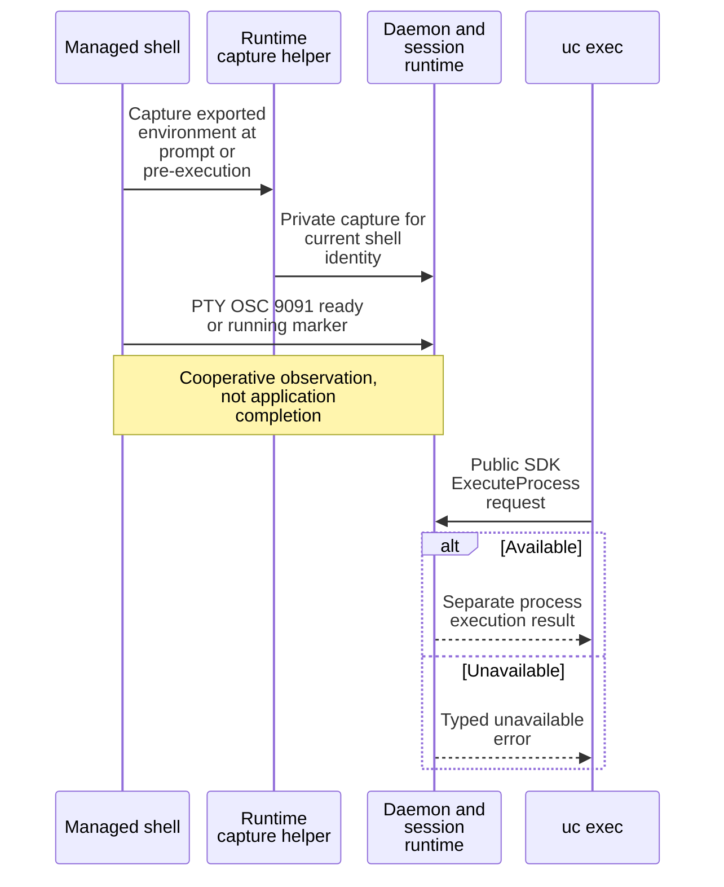

# Install shell hooks and identify a managed session

Use `uc init` to install detection hooks for Bash, Zsh, Fish, or PowerShell.
This guide describes the hooks embedded in CLI package 0.1.0-beta. It assumes an
installed `uc` and an interactive shell that loads the selected startup file.
Run installation commands from any directory as the user who owns that file.
Installation is local and does not connect to or start a daemon.

## Preview, install, and verify

### 1. Select the shell's actual startup file

Use the default below only if your shell loads it. Otherwise pass its absolute
path with `--profile`. Installation in the wrong file will not activate hooks.

| Shell | Default startup file |
| --- | --- |
| Bash | User home `/.bashrc` |
| Zsh | User home `/.zshrc` |
| Fish | User home `/.config/fish/config.fish` |
| PowerShell on Windows | User home `/Documents/PowerShell/Microsoft.PowerShell_profile.ps1` |
| PowerShell elsewhere | User home `/.config/powershell/Microsoft.PowerShell_profile.ps1` |

Here “user home” means `HOME` on Unix and `USERPROFILE` on Windows.
`UNDERCURRENT_HOME` selects daemon/configuration state; it does not relocate
shell startup files. Custom `ZDOTDIR`, Fish configuration paths, and redirected
Documents folders may load a different file from these defaults. In PowerShell,
use this installation command in step 2 to target the profile you actually load:

```powershell
uc init powershell --profile "$PROFILE" --prompt session
```

`--profile` selects an absolute startup path for any of the supported shells.
For customized shell setups, target the file your shell actually loads, or use
`--print` to review the document before incorporating it. Preserve one complete
marked block. `--print` requires text output and emits shell source; combining
it with `--json` or `--jsonl` is an error.

### 2. Preview and install

For Bash using its default startup file:

```sh
uc init bash --print
uc init bash --prompt session
```

The first command prints the exact hook document without editing a file. The
second reports `installed`, `updated`, or `already installed`. Repeat with the
same options to verify idempotence. Substitute `zsh`, `fish`, or `powershell`
for another supported shell, adding `--profile` when needed for installation.

### 3. Verify in a new managed shell

Open a **new managed shell** so that its startup file runs with `UC_SESSION`
already present. For example, after installing Bash hooks, from your project
directory run:

```sh
uc start hook-demo --interactive --shell /bin/bash --attach
```

Use the absolute path to your installed Bash if it is elsewhere. Inside that
shell, run `uc context`. It should report the session ID and, when the daemon
lookup succeeds, `hook-demo`. With `--prompt session`, the prompt includes a
sanitized session label. These are expected results, not captured test output.
Detach with Alt-U then `d`; verify externally with `uc inspect hook-demo`.

### 4. Clean up the demonstration

When done, `uc stop hook-demo` followed by `uc clean hook-demo --yes` removes
the demonstration session.

### If the hook is still inactive

Hooks are inactive outside a managed session and guarded against being sourced
twice within the same shell. Installing an updated block does not replace
functions already loaded into an existing shell; start a fresh managed shell
to verify the update. Bash uses `PS0` for its pre-execution hook, so that feature
requires a Bash version supporting `PS0`; the repository's shell tests use the
installed interpreter and do not establish support for every historical Bash.

## Choose prompt decoration

| `--prompt` value | Behavior |
| --- | --- |
| `off` (default) | Keep prompt decoration disabled; detection hooks still run |
| `simple` | Prefix the existing prompt with `[uc]` |
| `session` | Resolve the name once at hook initialization, sanitize and bound it, and prefix `[uc:NAME]`; fall back to `[uc]` if unavailable |

`UC_PROMPT` in the managed shell overrides the installed default. Name decoration
does not query the daemon for every prompt and can retain an old name after a
rename. Hooks preserve the existing prompt and command status through their
wrapper paths. PowerShell wraps `PSConsoleHostReadLine` only when that function
exists; hosts using a different input function do not get that wrapper's
pre-execution signal.

## Understand what hooks report

The following diagram separates cooperative shell observations from public CLI
requests. The environment capture helper is supplied by the runtime, not a
remote CLI endpoint or a user configuration flag. The **Available** and
**Unavailable** branches refer to the current live execution context.



*Takeaway: shell observations help the daemon describe foreground activity and
resolve execution context; they do not make an arbitrary command successful.*

The embedded hooks emit bounded `ready` and `running` OSC 9091 markers, without
embedding the entered command text. When `UC_SHELL_HELPER` is available, they
invoke it with the shell PID to capture exported environment values privately.
Helper failures suppress helper output and preserve the prompt's saved status.
The environment may contain secrets; absence of values from diagnostic output
does not mean the runtime never holds them.

`uc exec SESSION -- PROGRAM ARG...` launches a **separate process**, not text in
the attached shell. Its default live directory and root-shell export snapshot
must belong to the current process. If unavailable, the daemon rejects the
request rather than silently switching to launch context. Update hooks and
open a fresh managed shell, or deliberately select `--dir-launch` and/or
`--env-launch`; see [exec semantics](../../reference/cli-commands.md#run-a-separate-command-with-exec).
Shell functions and unexported variables are not an execution environment.

Directory retention for persistent groups is daemon-owned and does not require
these hooks. Old `UC_GROUP_*` reporting variables are not used by the current
documents; the hidden `uc group report` compatibility command succeeds without
changing a registry or connecting. See [group restoration](groups.md#understand-restoration-and-pending-operations).

## Use context checks in scripts

```sh
if uc context --quiet; then
    printf '%s\n' 'This shell inherited a UC session ID'
fi
uc context --json
```

`context --quiet` in text mode reads only nonempty `UC_SESSION`, emits nothing,
and exits 0 inside or 1 outside. It does not validate that the daemon session
still exists. Ordinary `context` and JSON output attempt name resolution when
an ID is present, without automatic daemon startup. They retain the ID and a
`name_lookup_error` if resolution fails, still exiting 0 for inherited context.
`context --name` instead fails on an unsuccessful name lookup. Quiet does not
suppress explicit JSON or its lookup. Human context output escapes controls;
name-only text returns the raw name for the caller to handle safely.

## Repair or remove an installation

The installer reads at most 1 MiB and replaces exactly one block between
`# >>> uc detection hooks >>>` and `# <<< uc detection hooks <<<`. It preserves
unrelated bytes and existing permissions. New Unix files/directories are
owner-only. It writes and syncs a same-directory temporary file before rename;
Unix also syncs the parent directory. A failure after rename can mean the new
contents are already present, so inspect the file before deciding to repeat.

| Installation failure | Recovery |
| --- | --- |
| Duplicate, reversed, or incomplete markers | Back up the startup file and repair one complete marked block |
| Unsafe path, symlink, or nonregular file | Inspect the destination; for managed dotfiles, use `--print` and update the actual source through your dotfile workflow |
| Startup file larger than 1 MiB | Preserve it and choose a supported startup-file arrangement within the bound |
| Failure after rename | Inspect the file before repeating; new contents may already be present |

To remove integration, remove the complete marked block from the selected
startup file and open a new shell. There is no automatic uninstall command.
Managed sessions and daemon state remain separate.

The implementation lives in [shell integration](../../../crates/undercurrent-cli/src/shell_integration.rs),
[embedded hook documents](../../../crates/undercurrent-cli/src/shell_hooks/), [local command routing](../../../crates/undercurrent-cli/src/local.rs),
and [session context](../../../crates/undercurrent-cli/src/session_context.rs). Verification entry points are
their inline tests, [context integration tests](../../../crates/undercurrent-cli/tests/session_context.rs),
[PowerShell tests](../../../crates/undercurrent-cli/tests/powershell_integration.rs), and
[Windows home tests](../../../crates/undercurrent-cli/tests/windows_home.rs). Continue with
[output and failures](../../reference/cli-output.md) when scripting these commands.
