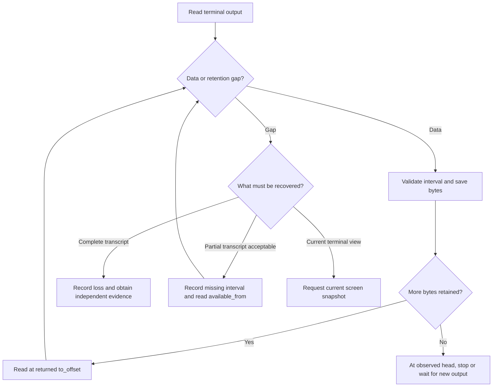

# Determine what is running and what it produced

Use these tasks with an installed `uc`, the same OS user and home as the daemon,
and an existing session. Commands run from any directory. Replace `dev` with
your session name. Create a disposable session through the
[first-session tutorial](../../getting-started/first-session.md)
if you need one; the reads below do not create or stop a managed process.

## Choose the evidence you need

| Question | Read | Interpretation |
| --- | --- | --- |
| Which sessions match? | `uc ls --label project=demo --json` | One server-filtered bounded page; not necessarily the whole catalog. |
| What is this session's current state? | `uc inspect dev --json` | Authorized detail and current summary, with stable ID and revisions. |
| Why was it classified this way? | `uc explain dev --json` | WorkContext, foreground evidence, and health results. |
| What bytes remain available? | `uc logs dev --max-bytes 32768 --json` | One retained byte page or an explicit gap. |
| What does its terminal look like now? | `uc peek dev` | Current VT screen rendered as text, not a transcript. |
| Has a condition been observed? | `uc wait dev --lifecycle exited --timeout 30s --json` | First matching summary, without a stability window or implicit process cancellation. |
| What changes now? | `uc watch dev --jsonl` | Bounded query snapshots and deltas; intermediate observations may coalesce. |

`uc top` gives an interactive bounded dashboard. `uc events` lists diagnostic
event *names*; it does not subscribe to live session events. Read the
[CLI reference](../../reference/cli.md) for filters and output shapes.

For a complete session catalog, use the [SDK paging path](../../reference/cli-commands.md#cursor-lifetime-across-invocations);
CLI query cursors do not survive into a new invocation.

Human session tables show separate `LIFECYCLE` and `EXECUTION` columns.
`running` with `unknown` execution means the process is alive but available
evidence cannot establish its activity. Running alone does not imply `active`.
Execution observations can remain after a process stops; use lifecycle to
determine whether it is still running. `INTERACTION` independently reports
observed input availability or requests.

Lifecycle, foreground execution, interaction, health, and WorkContext answer
different questions. A quiescent process can be waiting for input or blocked;
healthy means configured checks passed, not that the application finished its
work. Exit code zero is a process result, whose application meaning depends on
the program. See [observations and output](../../architecture/observations-and-output.md).

## Save a retained transcript

1. Start at offset zero and request a bounded page:

   ```sh
   uc logs dev --from-offset 0 --max-bytes 4096 --json
   ```

   Expect `result: data` with byte fields, or `result: gap` with recovery
   information. These are expected shapes, not captured output. JSON bytes
   are numeric arrays; human logs preserve terminal controls. Keep stdout and
   stderr separate in scripts.

   Use an explicit byte bound. The CLI's raw-byte default can exceed the encoded
   response limit; see [response budgeting](../../reference/cli-output.md#bound-encoded-responses).
   If a large read returns generic `Internal`, reduce `--max-bytes` and retry
   the same unconsumed offset. This applies in human mode too.
2. For a data page, verify `from_offset` equals the requested offset. Save the
   bytes, then advance to **`to_offset`**, the exclusive end of the returned
   interval. Persist continuation only after your output handling succeeds.
   While `has_more` is true, require forward progress and request another page.

   Do not advance to `next_offset`: that is the producer head and can skip
   retained data beyond a short page. A false `has_more` means you reached the
   head at this read; a running process may emit more later.
3. For a gap, record the missing interval. Continue at `available_from` only if
   incomplete history is acceptable. Reconnecting cannot recover evicted bytes.
   A screen can repair a view but cannot complete an audit transcript.

For an automated byte-preserving copy, use the maintained
[Python output example](../../sdk/python/streams.md#read-retained-output).
Its SDK setup and stable-ID requirement are declared there. Python's wrapper
omits `to_offset`, so it derives the returned end from
`page.from_offset + len(page.data)` and validates continuity before writing.
Do not decode each page independently if UTF-8 characters can span boundaries.

## Follow live output or restore a view

`uc logs dev --max-bytes 32768 --follow --jsonl` prints a bounded seed, then opens a terminal
subscription. Interrupt it when finished; follow does not promise to end when
the process exits. Ending the observer does not stop the session.

Follow opens at the seed's delivered end (`to_offset`), so unread retained
bytes remain eligible for the stream. After a seed gap, it opens at
`available_from`. Retention can still evict output before the stream opens;
handle an explicit gap when complete history matters.

This decision view distinguishes recovering a view from recovering history.



*Takeaway: byte continuity and current screen correctness are separate goals.*
Opaque capture retains bytes without a screen model, so snapshot recovery is
unavailable. Session and attached-view scrollback are bounded independently of
raw-output retention; [interactive history](interactive.md) explains their limits.

## Interpret failure and finish

Machine-mode failures go to stderr. Inspect `result_category`, any
`product_error_category`, `error_disposition`, and `effect_certainty` rather
than inferring a mutation's outcome from its numeric exit code. A successful
finite read can return a gap; a successful lint request can return invalid
profile findings. [Error reference](../../reference/errors.md) describes these
distinctions and [troubleshooting](../troubleshooting.md) gives recovery steps.

Read commands need no session cleanup. Close continuing observers when done,
remove any transcript files you created when no longer needed, and stop/clean
only sessions created for your own demonstration.

Evidence owners: [output replay](../../../crates/undercurrent-application/src/terminal_output.rs),
[wire presentation](../../../crates/undercurrent-daemon/src/presentation/feed.rs),
[CLI logs flow](../../../crates/undercurrent-cli/src/native.rs), and
[Python mapping](../../../python/src/undercurrent/client.py).

[Documentation index](../../README.md)
