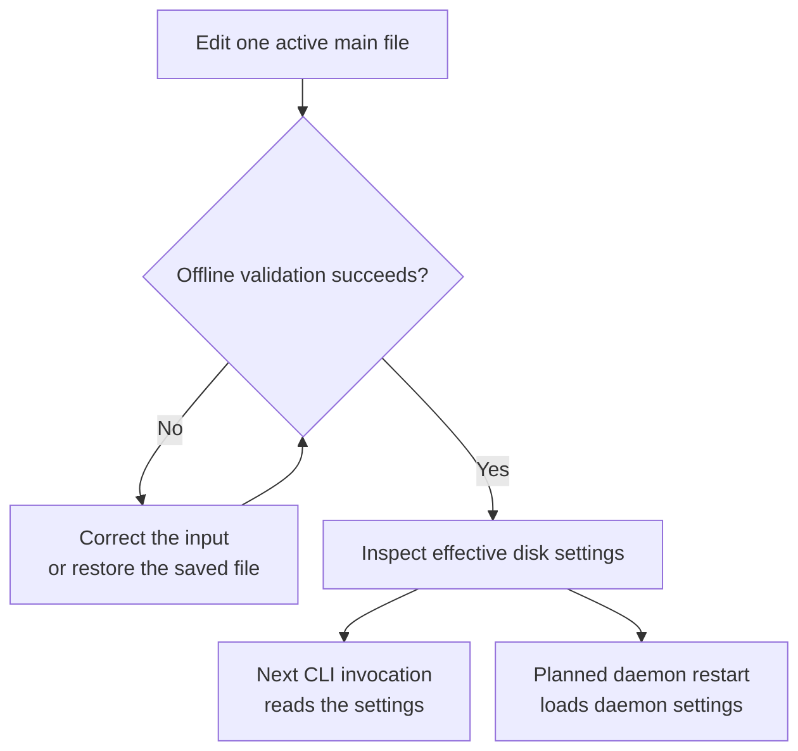

# Configure one local installation

Use this guide to change configuration release 0.1.0-beta settings and verify them before the next
CLI invocation or daemon restart. You need matching installed binaries and
access to the selected user's product home. Commands run from any directory;
`config show` and `config validate` are offline and do not start a daemon.

## Select the home and active file

The native CLI can save local connections with `uc settings profiles` and
`uc settings set profile NAME`; see [connection settings](../cli/connections.md).
These CLI preferences do not change daemon or SDK home discovery.

1. Select the installation you intend to change. The default home is
   `$HOME/.aixand/undercurrent` on Linux/macOS and
   `%USERPROFILE%\.aixand\undercurrent` on Windows. A nonempty absolute
   `UNDERCURRENT_HOME` selects a complete other installation, including its
   configuration and state; it does not move existing data. XDG variables do
   not select current storage. If startup rejects existing state, follow
   [home-layout diagnosis](diagnose.md#resolve-a-legacy-home-rejection).
2. Find the active `config.yaml`, `config.yml`, or `config.toml` under that home.
   Keep exactly one active name. If none exists, the loader uses defaults and
   you can create `config.yaml`. Files are never merged, and two active names
   fail even when one is empty.
3. For an existing file, save a known-good copy under a noncandidate name such
   as `config.yaml.bak`, then edit the active file. To switch formats, move the
   old file to a noncandidate name before validating the replacement.

Independent config, database, lock, profile-directory, and endpoint overrides
are retired. Check the [rejected inputs](../../reference/configuration-fields.md#retired-inputs)
if loading fails before your file is read; retired variables cause failure
even when empty.

### Home directory contents

| Current location | Purpose |
| --- | --- |
| Exactly one `config.yaml`, `config.yml`, or `config.toml` | Main configuration |
| `profiles/` | Editable detection profiles |
| `state/undercurrent.db` and SQLite sidecars | Durable repository |
| `state/session-host/` and `state/execution-output/` | Host recovery and execute-output files |
| `state/group/` | Saved CLI groups |
| `run/` | Instance ownership and native endpoints |
| `logs/` | Structured logs and diagnostics |

CLI, daemon, and SDK clients must select the same home. Public connections use
protected Unix sockets on Linux/macOS and named pipes on Windows. WebSocket,
TCP, and direct browser connections are unsupported; remove retired token/TLS
and endpoint settings, including empty environment variables. Private host
channels remain separate from the public SDK endpoint.

Use matching CLI, daemon, session-host, and bridge builds. Follow the maintained
[Rust connection example](../../sdk/rust/connect-and-query.md) or
[Python setup](../../sdk/python/quickstart.md), then check `uc daemon status`
and `uc ls`. SDKs do not start the daemon. See [compatibility](../../reference/compatibility.md)
for the independently versioned contracts and [request recovery](../../sdk/recovery.md)
before retrying an uncertain mutation.

## Configure terminal input size

The default `services.max_input_bytes` is 5 MiB (5,242,880 bytes) per complete
sequence. It counts UTF-8 bytes and estimated terminal encoding: automatic text
or paste adds 12 bytes, and each named key adds 16. A paste followed by Enter
therefore allows 5,242,852 text bytes. Oversized input is rejected without splitting.

For example, to lower the allowance to 1 MiB, add this to the active YAML file:

```yaml
services:
  max_input_bytes: 1048576
```

To allow up to 10 MiB, including worst-case JSON escaping, coordinate the
independent budgets explicitly:

```yaml
services:
  max_input_bytes: 10485760
process:
  input_queue_bytes_per_process: 16777216
requests:
  request_bytes: 67107036
transport:
  max_frame_bytes: 67108864
  connection_queue_bytes: 268435456
  stream_queue_bytes: 67108864
  replay_item_bytes: 67108864
  replay_bytes_per_stream: 67108864
  replay_bytes_per_connection: 134217728
```

Run `uc config validate` and inspect `uc config show`, then restart the daemon
with `uc daemon restart`. Existing explicit values are preserved; changing
the input allowance does not automatically resize the other budgets. The CLI
uses the configured request bound. Rust and Python clients require their own
[request options](../../architecture/decisions/0004-input-size-limits.md#configuration-and-client-behavior).
The daemon's service limit still applies to every client.

The [decision record](../../architecture/decisions/0004-input-size-limits.md)
explains the 5 MiB choice, measurements, memory tradeoffs and remaining
blocked-write/retry-retention limitations. This setting does not reserve
resources for unrelated requests or guarantee a completion time.

## Edit and inspect

1. Save the settings in the selected file. The smallest new YAML document is
   `schema_version: 0.1.0-beta`. For a 45-second command timeout, smaller list pages,
   and a Ctrl-A attachment prefix, use:

   ```yaml
   schema_version: 0.1.0-beta
   cli:
     command_timeout_millis: 45000
     list_page_size: 25
   shortcuts:
     prefix: ctrl-a
   ```

   In an existing file, edit these keys in place; do not append a second
   `cli` or `shortcuts` mapping. Use spaces and ordinary YAML scalars/mappings.
   Anchors, aliases, tags, merge keys, duplicate keys, and multiple documents
   are rejected. Omitted fields use defaults; unknown fields and generations
   other than 2 fail. Equivalent TOML fields are supported in the single
   active TOML file. See [formats and limits](../../reference/configuration-fields.md#formats-and-parser-budgets).

2. Validate and inspect from any working directory:

   ```sh
   uc config validate
   uc --json config show
   ```

   Expected: validation exits successfully. In the show report's `effective`
   object, `settings.cli.command_timeout_millis` is `45000`,
   `settings.cli.list_page_size` is `25`, and `settings.shortcuts.prefix` is
   `ctrl-a`; omitted fields have their defaults. The [inspection guide](diagnose.md#check-an-existing-installation-with-the-cli)
   explains the report and source category.

   If validation fails, fix the named field or restore the saved file, then
   validate again. Use the [rejection guide](diagnose.md#diagnose-a-rejection)
   for selection, format, and coupled-capacity errors. No daemon restart is
   needed to check a repair.

3. Apply validated settings at the relevant boundary. Subsequent CLI
   invocations read the file; a prefix change affects new CLI views. Apply
   daemon settings through a planned [daemon restart](../daemon/README.md#shut-down-or-replace-intentionally).
   Intentional shutdown affects managed sessions. Ordinary main configuration
   is not hot reloaded; editable detection profiles have a
   [separate reload workflow](../../../crates/undercurrent-daemon/docs/internals/configuration/profile-reload.md).

This flow distinguishes checking a file from applying it:



*Validation and `config show` inspect disk settings. A running daemon keeps
its previously loaded main configuration until restart.*

A legacy `shortcuts.toml` is consulted only when the main file has no explicit
prefix. See [prefix selection](../../../crates/undercurrent-config/docs/internals/loading.md#resolve-the-prefix)
if the reported prefix differs from your expectation.

## Tune the relevant resource

| Symptom or task | Settings to investigate |
| --- | --- |
| CLI default timeout/page size | `cli`, with explicit command flags taking precedence. |
| Session and attachment scrollback | `terminal.scrollback.memory_lines`; zero disables screen history, not raw-output capture. |
| Retained terminal history | `terminal` per-session/global bytes, chunks, and replay limits. |
| Process admission or input pressure | `process`, `services`, and the coupled session/output capacities. |
| Slow subscriptions or reconnect gaps | `transport`, `requests`, and receiving client limits; replay and output retention are separate. |
| Diagnostic log storage | `logging` file bytes, count, and buffering. |
| Observation cost and timing | `workers`, `services`, and the effective profile. |

Follow [configuration reference](../../reference/configuration.md) for every
section, default owner, parser budget, and required capacity relationship.
Durations ending in `_millis` are milliseconds; byte limits count bytes, not
characters. Increasing one ceiling may require increasing its receiving queue or durable
record capacity. Valid bounds do not promise that all maxima fit at once or
that a full resource is immediately available.

Use the [client configuration boundary](../../../crates/undercurrent-config/docs/internals/loading.md#client-configuration-boundary)
to determine which saved settings reach the CLI or SDK. For `default_profile`
and `telemetry`, review the [bootstrap defaults and current discrepancies](../../reference/configuration-fields.md#document-structure-and-defaults)
before relying on either field. `uc start` uses `default_profile` when
`--profile` is absent; an explicit profile takes precedence.

## Diagnose and clean up

Use the [configuration decision guide](diagnose.md#diagnose-a-rejection)
for ambiguous files, retired overrides, legacy markers, permissions, format
budgets, and coupled-field failures. Do not create a dummy database to bypass
legacy detection. `config show` redacts runtime paths but is not a universal
secret scrubber for arbitrary content you append to a report.

Configuration inspection creates no runtime state. Keep or remove only the
backup copies you made according to your configuration-management practice;
do not remove the installation's runtime directories to apply a setting.

[Daemon operation](../daemon/README.md) · [Documentation index](../../README.md)
