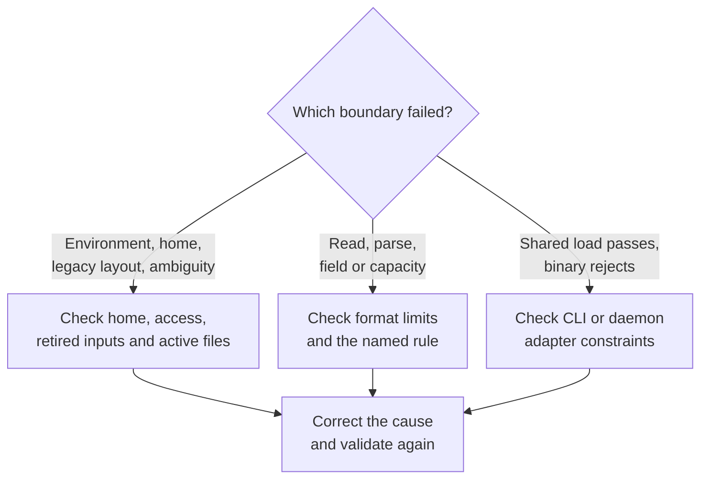

# Inspect configuration without starting a daemon

Validate a configuration change, inspect its effective defaults, and isolate a
rejected input. These tasks concern configuration release 0.1.0-beta. A successful
check describes the file on disk; it does not assert that a running daemon has
reloaded it or is healthy.

Choose [CLI inspection](#check-an-existing-installation-with-the-cli) for an
installed product, [rejection diagnosis](#diagnose-a-rejection) for a failed
command, or the [isolated Rust example](#inspect-an-isolated-home) when working
from a source checkout.

## Check an existing installation with the CLI

You need a matching `uc` binary installed on `PATH` and access to the selected
home. Run from any working directory:

```sh
uc config validate
uc --json config show
```

The commands select the normal home, or the absolute home named by
`UNDERCURRENT_HOME`. They do not connect to or start a daemon. They **do** run
CLI-owned path and retired-environment checks after shared loading. The
[CLI integration test](../../../crates/undercurrent-cli/tests/config_yaml.rs) asserts
offline show/validation and the absence of `run` in an isolated home.

Expected text for a valid home-selected file is
`configuration is valid (source: undercurrent_home)`. `config show` includes
the effective redacted document in the CLI report; the Rust example prints
that inner effective document directly. The report's `applies` field states
`next CLI invocation or daemon restart`. It is not a query of live daemon
settings. The commands create no runtime state requiring cleanup.

For edits, format changes, rollback to a saved file, and application timing,
follow [configure one installation](README.md#edit-and-inspect).

To validate a different installation without changing your shell's persistent
environment, on Linux/macOS use the following after replacing the path:

```sh
UNDERCURRENT_HOME=/absolute/path/to/undercurrent-home uc config validate
```

Do not use `UNDERCURRENT_CONFIG` or a document `paths.database` field. Both are
retired. An arbitrary explicit file path is an internal loader facility, not
the shipped CLI configuration selection described here.

## Diagnose a rejection

Start with the displayed error. The table below gives exact variants and the
checks to make; the diagram groups the recovery tasks.



*Match the failed boundary before changing settings. Shared-load success can
narrow a binary failure to its adapter, whose checks still apply.*

The error variants are defined in [load.rs](../../../crates/undercurrent-config/src/load.rs) and
[paths.rs](../../../crates/undercurrent-config/src/paths.rs). The following tables distinguish selection failures from document and projection failures:

### Selection and file access

| Failure | What it means and how to investigate |
| --- | --- |
| `Paths(HomeNotFound)` | Supply an absolute complete home or a native user home. XDG inputs alone do not supply one. |
| `Paths(InvalidEnvironment { name })` | The named home variable is empty/relative. Correct it; its value is deliberately absent from the error text. |
| `RetiredPath` | Check [retired environment and document keys](../../reference/configuration-fields.md#retired-inputs). Even an empty retired variable is rejected. |
| `LegacyLayout` | A known marker exists **or** a legacy probe failed. Inspect the [guard's roots and markers](../../../crates/undercurrent-config/docs/internals/paths.md#legacy-layout-detection) and permissions, then follow [home-layout diagnosis](#resolve-a-legacy-home-rejection). |
| `Ambiguous { files }` | Multiple candidate entries exist. Keep only one active name. Files may be directories or symlinks; the scan counts entries before read validation. |
| `Io { path, source }` | Probe/open/read failed, or input was not valid UTF-8. Display omits the path; inspect the typed source privately for permissions, missing targets, or filesystem errors. A missing explicit file fails, while no discovered candidate is valid defaults. |

### Document and projection errors

| Failure | What it means and how to investigate |
| --- | --- |
| `Invalid` at `document` or a format name | Wrong extension, nonregular file, over-limit input, wrong root type, TOML/YAML decode failure, or typed integer overflow. Fix the source using the [format budgets](../../reference/configuration-fields.md#formats-and-parser-budgets). |
| `Invalid` at `bootstrap` | A bootstrap field has the wrong type or an unknown telemetry key. Use schema string `0.1.0-beta`, an optional profile string, and telemetry booleans. |
| `Invalid` at a known field/section | Unknown nested key, wrong type, scalar limit, or [capacity relationship](../../reference/configuration-fields.md#relationships-between-settings). The named field can represent a combined rule, not necessarily the sole bad value. |
| `Invalid` at `shortcuts` | Correct the main file's shortcut settings. Separate shortcut files are ignored; prefix syntax errors name `shortcuts.prefix`. |
| `UnknownSetting` | Root table/key is unsupported, including retired `websocket` or `products`. Check the supported fields and correct the unsupported setting or typo. |
| `Invalid` at `configuration` | An internal `runtime_config<T>` projection failed. Investigate the requested target type; this is not a second file parse. |
| `Parse`, `RuntimeParse` | Retained public enum shapes holding TOML errors; the current shared loader instead maps parse failures to fixed `Invalid` messages. Do not expect these variants from its YAML/TOML pipeline. |

For example, changing `process.max_processes` can require larger durable,
terminal, and observation capacities; changing `transport.max_frame_bytes`
can require larger queue and replay-item budgets. Reducing the configured
terminal width can permit more scrollback rows within the cell budget, but
also restricts terminal sizes admitted by services. Use the relationships as
a whole rather than repeatedly increasing whichever limit appeared first.

## Resolve a legacy-home rejection

Confirm the selected absolute `UNDERCURRENT_HOME` and its access permissions.
The [path policy](../../../crates/undercurrent-config/docs/internals/paths.md#legacy-layout-detection)
lists the exact old markers and default/XDG scan roots. A custom home limits
those probes to that home. An existing `state/undercurrent.db` bypasses this
scan but does not prove that the database is valid. Probe permission errors
can also produce `LegacyLayout`.

The guard prevents silently starting an empty replacement installation.
Do not create a dummy current database or delete old markers to suppress it.
Startup does not relocate files. Preserve the complete installation and its
matching binaries, including SQLite sidecars and host recovery records.
Confirm that all owners and managed processes have stopped before arranging
any state relocation or conversion with the storage owner. There is no
automatic converter or generic safe file-move recipe.

After correcting access or completing verified offline state work, validate
configuration and check `uc daemon status`, `uc ls`, required session details,
profiles, and groups in the intended home. Moving a home does not rewrite
absolute command paths or endpoint-scoped group records. Keep the backup until
verification succeeds; use [storage diagnosis](../daemon/storage.md) if reopening
fails. Do not copy live sockets or overwrite a live target to roll back.

## Inspect an isolated home

For maintainers, the maintained [inspection example](../../../crates/undercurrent-config/examples/inspect_config.rs)
uses only `undercurrent-config` and its existing dependencies. It performs no writes and
requires no daemon. The commands below run from the **workspace root**, in
Bash or Zsh on Linux/macOS, with the pinned
[Rust 1.95.0 toolchain](../../../rust-toolchain.toml), Cargo, and the locked
dependencies available. They create and later delete only a scratch directory.
This example needs no running Undercurrent installation.

```sh
(
  set -eu
  unset UNDERCURRENT_CONFIG UNDERCURRENT_DATABASE_PATH
  unset UNDERCURRENT_INSTANCE_LOCK_PATH UNDERCURRENT_LOCAL_ENDPOINT
  config_home=$(mktemp -d "${TMPDIR:-/tmp}/uc-config-example.XXXXXX")
  trap 'rm -f "$config_home/config.yaml"; rmdir "$config_home"' EXIT
  cargo run --locked -p undercurrent-config --example inspect_config -- \
    --sample > "$config_home/config.yaml"
  cargo run --locked -p undercurrent-config --example inspect_config -- \
    "$config_home"
  test ! -e "$config_home/state"
  test ! -e "$config_home/run"
)
```

Use an absolute `TMPDIR` if one is set. The subshell keeps the environment
changes local. The example's `--sample` mode prints the single maintained YAML
sample: it changes command timeout, list page size, keyboard prefix, and local
scrollback while leaving all other fields defaulted.

Expected output is a JSON object with `scope` equal to
`on_disk_effective_configuration`, `cli_connection_profile` equal to
`compiled_standard`, and `prefix_source` equal to `main_config_or_default`.
Within `settings`, the timeout is 45,000, the list page size is 17, the prefix
is `ctrl-a`, and `terminal.scrollback.memory_lines` is 0. The unchanged
`terminal.replay_bytes` is 1,048,576. Exit status 0 and the two `test` commands verify
successful inspection with no runtime directories created. Cargo build
artifacts remain in its normal target directory; no daemon cleanup is needed.

On Windows, the Rust example accepts an absolute native home path, and the
loader uses native path rules. The shell setup/cleanup above is Unix-specific;
it is not a PowerShell recipe. The crate itself has no optional features or
OS-specific transport dependency. The broader product's supported platform
matrix is separate from this pure configuration API.

If Cargo cannot resolve the pinned toolchain/dependencies, use the existing
[repository development setup](../../development/setup.md) before retrying. Do not diagnose a compilation
failure as invalid YAML. If the example prints a configuration error, use
the [rejection guide](#diagnose-a-rejection); it exits 1 on load/report failure and 2 on incorrect
argument count. An absent main file is valid and uses defaults, still with
possible `shortcuts.toml` fallback.

## Share diagnostics without leaking paths

`LoadedConfig::redacted_report` contains default-expanded product settings,
schema generation, telemetry, an optional `[REDACTED]` default-profile marker,
application timing, the CLI profile category, and prefix provenance. It omits
the selected file path, home, and discovery-source path. It is not a blanket
redactor for arbitrary future fields: current ordinary preferences such as
`shortcuts.prefix` are included verbatim.

Prefer `Display` for errors and `redacted_report` for shared diagnostics.
`ConfigError::Debug`, its typed IO/path payloads, and `ConfigSource` can contain
paths. `LoadedConfig::Debug` hides `settings` but prints its `source`, including
the selected path. Raw document/section `Debug` output is not a redacted API.
The [redaction test](../../../crates/undercurrent-config/tests/config_loading.rs) checks private source values
and home omission from the report; it does not assert that every debug object
is safe to publish. No logs, metrics, or events are emitted by the loader.

For implementation changes, continue to [maintainer verification](../../../crates/undercurrent-config/docs/development/contributing.md).
For why validation belongs in `undercurrent-config`, read [loading and ownership](../../../crates/undercurrent-config/docs/internals/loading.md).
