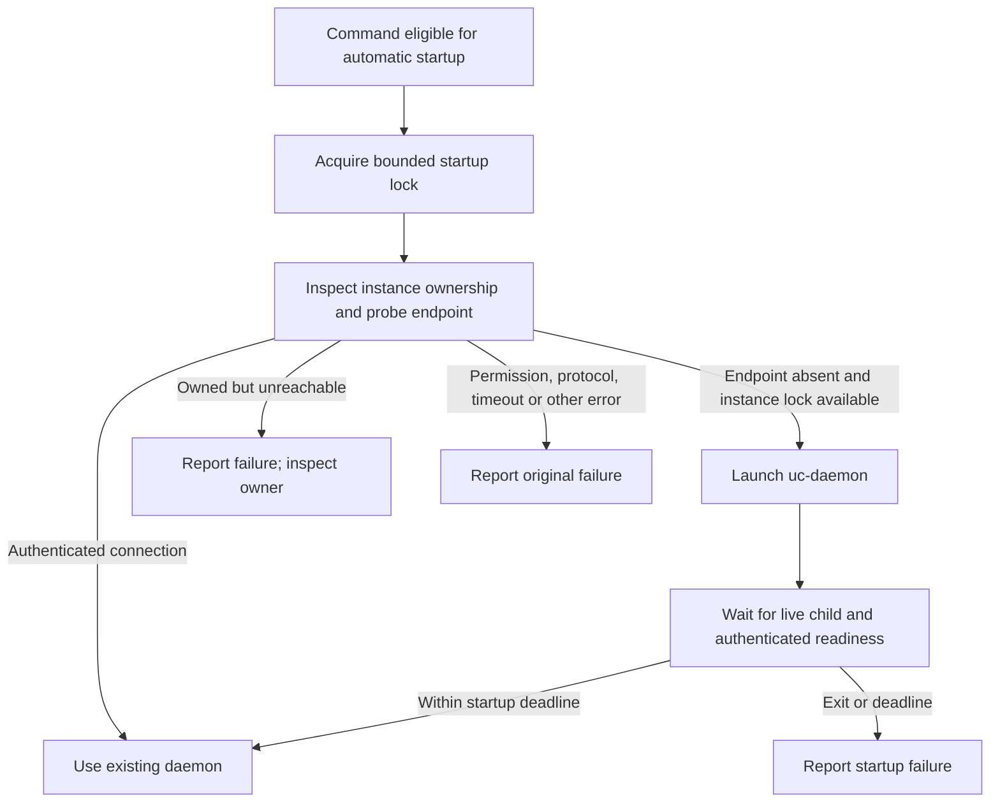
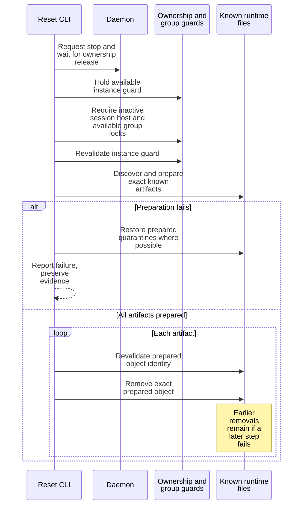

# Configure and operate the local daemon

Use this guide to choose an isolated Undercurrent home, validate configuration,
start or stop the daemon, and diagnose startup or reset failures. It covers CLI
package 0.1.0-beta with configuration schema 0.1.0-beta. Commands run from any directory with
`uc`, `uc-daemon`, and `uc-session-host` installed on the same machine. Use the
same OS user and product home for every command in an operational session.

Choose [configuration](#choose-the-home-and-inspect-configuration),
[startup](#start-and-verify-readiness), [stop or restart](#stop-or-restart-without-assuming-response-delivery),
[reset](#reset-known-runtime-artifacts), or [failure diagnosis](#diagnose-common-failures).

## Choose the home and inspect configuration

The default home is `$HOME/.aixand/undercurrent` on Unix and
`%USERPROFILE%\.aixand\undercurrent` on Windows. `UNDERCURRENT_HOME` overrides
the complete home and must be absolute. XDG variables do not relocate current
storage. See [path ownership](../../../crates/undercurrent-config/src/paths.rs).

### Select the home

For example, in a POSIX shell, select an existing deployment home:

```sh
export UNDERCURRENT_HOME=/absolute/path/to/your/undercurrent-home
uc config validate
uc config show --json
```

Replace the path before running. On PowerShell use
`$env:UNDERCURRENT_HOME = 'C:\absolute\path\to\undercurrent-home'`.
For a disposable first session, use the [isolated tutorial](../../getting-started/first-session.md).
Changing the home selects another configuration, database, endpoint, and group
namespace; it does not move an already running daemon or its sessions.

| Home-relative path | Owner and purpose |
| --- | --- |
| `config.yaml`, `config.yml`, or `config.toml` | One main configuration document; more than one is ambiguous |
| `state/undercurrent.db` | Daemon-owned durable session state; CLI operations use the SDK |
| `run/control.sock` | Home-derived local endpoint identity; native transport derives the platform connection from it |
| `run/daemon.lock` | Instance-lock scope used to derive the authoritative lock |
| `logs/daemon.jsonl` | Daemon diagnostics, with configured rotation |
| `state/group/workspaces.json` | CLI group registry; legacy `state/tui` data is not read or migrated |
| `profiles/` | Local profile configuration owned by the profile/configuration layer |

The native CLI has no `--config` or endpoint override. With no main document,
compiled defaults apply. Documents have a 1 MiB read bound, unknown settings
are rejected, and `schema_version` is `"0.1.0-beta"`. The owning schema and loader are
[document.rs](../../../crates/undercurrent-config/src/document.rs) and
[load.rs](../../../crates/undercurrent-config/src/load.rs).

### Edit and validate one configuration document

For a new home with no existing document, this minimal `config.toml` sets CLI
preferences while retaining defaults for other settings:

```toml
schema_version = "0.1.0-beta"

[cli]
command_timeout_millis = 30000
daemon_startup_timeout_millis = 10000
list_page_size = 100
logs_max_bytes = 32768

[shortcuts]
prefix = "alt-u"

[terminal.scrollback]
memory_lines = 2000
```

The sample overrides the actual `logs_max_bytes` default of 65536 with 32768
so a full raw-byte page fits the standard encoded-response budget. Use a smaller
value with lower custom limits; see [output response limits](../../reference/cli-output.md#read-retained-output-without-assuming-complete-history).

Edit the existing document if one is already present; do not create a second
format alongside it. Then run `uc config validate` and `uc config show --json`.
Validation succeeds without starting a daemon. The report describes the
effective **on-disk** configuration for the next CLI invocation or daemon
restart, not the daemon's current in-memory settings. It redacts selected paths
and profile values. Explicit CLI options override CLI preferences; the SDK
connection profile remains the compiled standard profile.

### Resolve legacy settings before startup

The configuration layer can report a legacy `shortcuts.toml` prefix source.
Use `config show` to identify it before editing shortcut preferences. Retired
`UNDERCURRENT_CONFIG`, database/lock/local-endpoint overrides, and
`UNDERCURRENT_ENDPOINT`, token-file, and TLS transport variables are rejected
instead of silently reconnecting elsewhere. Remove obsolete settings from your
invocation environment after checking their intended deployment. Detected
unsupported storage requires a separate current-release home; do not point a new daemon at an
old layout by guessing paths.

## Start and verify readiness

1. Run `uc daemon start` with the intended home selected.
2. Run `uc daemon status --json` and inspect its result to verify readiness.

`start` reports started or already running after connection and status checks.
`status` reads daemon state and does not auto-start an absent daemon. Successful
authenticated readiness is a daemon-level result; it does not mean a session's
application is healthy. Use `uc inspect`, `uc wait`, or a configured health
check for that separate question.

Session, group, and profile commands automatically start an absent local
daemon. This includes apparently read-only commands such as `uc ls` and
`uc group ls`. `debug`, `daemon status`, `daemon stop`, and `reset` do not
auto-start it. Configuration, shell integration, completion, help, and event
vocabulary are local. `context` can perform a name lookup but never auto-starts.

The startup decision protects an existing daemon from being replaced merely
because a connection failed:



*Takeaway: absence is a narrow connection classification plus available
ownership; arbitrary connection failure is not permission to replace a daemon.*

The startup lock serializes competing CLI launches. The authoritative instance
lock is separate and remains daemon ownership evidence. Native Unix names are
derived as `run/.daemon.startup.instance.lock` and
`run/.daemon.lock.instance.lock`; do not treat the scope path or a PID file as
equivalent evidence. Platform adapters validate private paths and file identity.

The launcher prefers a sibling `uc-daemon` (`uc-daemon.exe` on Windows) beside
the current executable, falling back to `PATH`. It disconnects standard streams
and isolates native process-launch details in one boundary. The default startup
budget is 10 seconds, configurable through `cli.daemon_startup_timeout_millis`.
A readiness timeout does not promise that a spawned process was killed. Check
`uc daemon status`, home-specific diagnostics, and ownership before another
operator action. `uc --diagnostic daemon start` adds payload-free CLI diagnostics
to stderr; the launcher itself does not forward daemon stderr into the caller.

## Stop or restart without assuming response delivery

Choose the operation you intend:

| Goal | Command |
| --- | --- |
| Shut down this daemon | `uc daemon stop` |
| Replace it and verify a new epoch | `uc daemon restart` |

Both immediately cancel other work, force managed process groups, and close
clients after the shutdown response write, while preserving saved state. Add
`--graceful` to drain accepted work and clients instead; `--drain-timeout DURATION`
requires that flag and defaults to `5s`. Stop closes its request client and waits
for authoritative instance-lock release. An already absent
daemon is an `already_stopped` success. Restart records the old epoch, performs
shutdown and the ownership-release wait, launches, and verifies a different
epoch in the replacement's status. It is not a single atomic operation.
If no daemon is running, restart performs a start and has no previous epoch.

The lifecycle service bounds stop/restart with a shutdown-wait budget derived
from the configured maximum drain plus request timeout. Individual requests
use remaining time. Restart shares that outer budget across its phases; it
does not get an unlimited second startup phase.

Immediate stop tolerates a lost or timed-out response only when instance
ownership is subsequently released within its deadline. Graceful stop can return
an error even if shutdown subsequently finishes. Check `daemon status` and the ownership/diagnostic evidence before
deciding whether to start a replacement. Repeating a mutation is distinct from
reconnecting. Daemon stop/restart also affects managed runtime state; do not use
it as a substitute for closing a terminal view or assume application memory
survives. [Group restoration](../cli/groups.md) describes recipe-based recovery.

## Reset known runtime artifacts

Use `uc reset --yes` only when you intend to discard this home's durable runtime
state and CLI group registry. For ordinary work, stop and clean selected sessions
instead. Verify the selected home first with your environment and configuration.
Then:

1. Run `uc config validate` to check the selected home's configuration.
2. Run `uc reset --yes`. Reset stops the daemon itself and never launches one.
3. Check the reset report. If it fails, preserve the remaining files and use
   [reset failure recovery](#recover-from-reset-failure) below. Do not use `uc ls`
   as an offline check: it can start a fresh daemon.

### How reset shuts down

After confirmation, reset uses a dedicated shutdown mode. It cancels other
requests, stops automatic restart scheduling, and retires the process host
through its durable shutdown receipt and acknowledgement. Host teardown force-
terminates owned processes and confirms process exit and output completion before
removing its retirement markers. It does not wait for application graceful-stop
periods or for watchers and SDK clients to disconnect voluntarily.

The daemon closes remaining client connections when the reset response is written
or delivery is abandoned. A stalled response has a fallback window of at most
250 ms after host retirement. `--timeout` bounds the CLI's startup-guard,
shutdown-request, and ownership-release wait together; there is no additional
maximum-drain window. Timed-out callers can leave shutdown continuing in the
daemon. A lost response permits deletion only after ownership release and the
inactive-host checks succeed.

Reset retains the startup guard until state removal finishes, so CLI commands
cannot launch a replacement during deletion. It never launches a daemon itself.
`--yes` skips confirmation; it does not select the shutdown policy. Ordinary
`uc daemon stop` and `uc daemon restart` use immediate host retirement but preserve saved state and settle in-flight
stops before exit. Their `--graceful` option
retains graceful drain behavior. Only reset removes local state.

If teardown cannot be confirmed, reset returns an error and leaves the state
files in place. An unreachable daemon or surviving private host still requires
operator recovery; reset does not guess process identities or kill by name.
Older daemons that do not understand the reset shutdown mode reject the request.

### What reset removes

Its plan covers the database and SQLite sidecars, configured daemon log files,
known group registry files in both current and legacy locations, session-host
authentication and known attempt/job/output artifacts, and recognized stale
credential-creation temporaries. It preserves configuration, profiles, unrelated
files, and the home directory. It does not recursively delete the entire home.

The sequence below shows the safety boundaries and where partial removal can
occur. The exact plan is owned by [reset.rs](../../../crates/undercurrent-cli/src/reset.rs).



*Takeaway: reset validates ownership and objects before removal, but is not a
filesystem transaction and must not be described as a reversible operation.*

Unix preparation checks private directories, ownership, regular single-link
files, and no-follow identities, then uses quarantine renames and directory
syncs. Its no-replace rename path is implemented for Linux GNU and macOS; other
Unix reset paths report unsupported behavior. Windows uses pinned private
objects and handle-based deletion; it does not claim the same directory-sync
power-loss guarantee. An active session host or group view prevents reset.

### Recover from reset failure

If reset fails, keep remaining files and the error. Some files may already be
removed, and a durability failure may leave completion uncertain. CLI error
presentation reports the stage/category, not every internal rollback counter.
Do not manually delete locks to “finish” a reset. Investigate ownership or
unsafe artifacts before another reset attempt. The report is the success check;
keep uncertain ownership and partial removal visible when diagnosing a failure.

## Diagnose common failures

| Symptom | Useful next action |
| --- | --- |
| Invalid/ambiguous configuration | Run `config validate`; keep one main document and use schema 0.1.0-beta settings |
| Daemon binary unavailable | Install all three binaries together; check sibling binary and `PATH` |
| Instance owned but endpoint unavailable | Inspect home-specific logs and actual owner; do not launch a competing daemon or delete locks |
| Permission or protocol error | Correct user/home/binary compatibility; automatic startup intentionally preserves this failure |
| Startup deadline | Check status and logs; readiness failure does not imply no child exists |
| Busy group during reset | Detach the owning group view; its lock must be released normally |
| Unsafe reset artifact | Preserve it and investigate links, ownership, and path identity |
| Mutation response lost | Follow [effect reconciliation](../../reference/cli-output.md#reconcile-a-failed-mutation-before-repeating-it) |

Maintainer entry points are [runtime configuration](../../../crates/undercurrent-cli/src/runtime_config.rs),
[client construction](../../../crates/undercurrent-cli/src/client.rs), [lifecycle orchestration](../../../crates/undercurrent-cli/src/daemon_lifecycle.rs),
[native launch](../../../crates/undercurrent-cli/src/daemon_lifecycle/process_launch.rs),
[Windows ownership](../../../crates/undercurrent-cli/src/daemon_lifecycle/windows_instance.rs), and
[Windows reset](../../../crates/undercurrent-cli/src/reset/windows.rs). Inline tests exercise failed readiness,
deadline bounds, ownership replacement, reset refusal, and partial failure.
[Automatic startup tests](../../../crates/undercurrent-cli/tests/automatic_daemon_startup.rs) and
[explicit lifecycle boundary tests](../../../crates/undercurrent-cli/tests/explicit_daemon_lifecycle.rs)
check routing and source boundaries; their existence is not a claim that every
platform has been run in this documentation pass.
