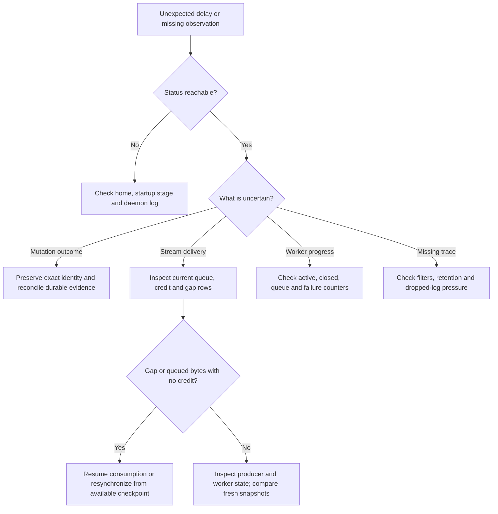

# Diagnose pressure and collect a bounded evidence bundle

Use this guide to investigate a reachable daemon without treating an old counter
or a successful status query as proof of current health. Commands use the 0.1.0-beta
CLI on a POSIX shell. Select the installation's `UNDERCURRENT_HOME` and OS user as
described in [operating the daemon](operations.md). Read-only commands can run from
any directory; bundle files below are written to the current directory.

## Collect a support report

Use this procedure when reporting a failure to the maintainer. Run it as the
same OS user and with the same `UNDERCURRENT_HOME` as the failed command.
Choose a new output filename in a writable directory; collection never replaces
an existing archive.

```sh
uc debug collect --output uc-support.zip
```

The command writes a private ZIP and reports whether it is partial. It can still
collect local evidence when configuration is invalid or the daemon is stopped.
It never starts, restarts, or repairs the daemon. Use `--offline` to skip even
the connection attempt.

New CLI failures print an error reference, also available as `incident_id` in
JSON errors. To select that invocation's retained records, replace `UC_REFERENCE`
with the complete printed `UC-` reference:

```sh
uc debug collect --incident UC_REFERENCE --output uc-support.zip
```

The archive contains a manifest, CLI build information, last-started daemon/helper
build records when available, configuration with string values redacted, recent
failure records, a projection of recent daemon log fields, and available live
diagnostic pages. `--session SESSION_ID` adds typed session state; `--profile NAME`
adds active-profile properties and rule counts. The session option takes a stable
ID, not a name. Names, paths, label maps, profile patterns, and raw parser messages
are omitted from these detail projections.

Read `manifest.json` before sharing. Every source is marked collected, unavailable,
truncated, skipped, or redacted, with a safe reason where applicable. Success means
the archive was written; it does not mean every source was available. For example,
using Python 3 from the directory containing the archive:

```sh
python3 - <<'PY'
import json, zipfile
with zipfile.ZipFile("uc-support.zip") as archive:
    manifest = json.loads(archive.read("manifest.json"))
    print("Partial:", manifest["partial"])
    print("Terminal content included:", manifest["terminal_content_included"])
    for source in manifest["sources"]:
        print(source["source"], source["status"], source["reason"])
PY
```

Terminal content and panic backtraces are excluded by default. Add
`--include-terminal-content SESSION_ID` only when the report needs one authorized
terminal page (up to 4096 bytes); it may contain application secrets. Add
`--include-backtraces` only after reviewing the private traces, which can contain
build paths. Identifiers and timestamps still describe local activity even in a
default report. Attach the reviewed archive with the original command, approximate
failure time/timezone, and reproduction steps, removing secrets from that account.

Collection is capped at 16 MiB, with at most eight daemon log files (the last
1 MiB of each), 8192 projected log records, and 64 pages/1 MiB per diagnostic
section. Continuations use one connected client. Individual sources remain
bounded and independently observed; a report is not an atomic or complete dump
of the installation. Request time is limited by `--timeout`, capped at 60 seconds,
with at most three seconds per request; local filesystem IO is not covered by a
hard wall-clock guarantee.

Failure records are captured without enabling `--diagnostic`. They retain typed
categories and OS causes; failing finite CLI requests also retain bounded SDK
event names when available. Ordinary negative answers such as being outside a
session do not become failure reports. Recording can fail on a full disk or an
unwritable home, and old records can be evicted. See
[failure evidence ownership](../../../crates/undercurrent-diagnostics/docs/README.md)
for retention and panic limits. The source revision identifies a checkout commit;
it does not certify that a local build had no uncommitted changes.

For rejected profile edits, `profile-reload.json` distinguishes the active catalog
generation from a pending or rejected disk edit. It records the failure stage and
whether the previous definition is still active. `profile lint` checks the active
catalog; it does not validate a disk edit that was rejected before activation.
The sidecar is retained historical evidence when the daemon is stopped.

Remove only the exported archive when finished: `rm -- uc-support.zip`.
The existing `uc --json debug bundle` procedure below remains a single-page RPC
with its existing output shape.

## Choose the observation that answers your question

Start with these commands. They query the selected running daemon and do not
establish that an interrupted mutation succeeded or was absent.

```sh
uc daemon status
uc --json debug supervisors
uc --json debug slow-consumers
uc --json debug persistence
uc --json debug reconciliation
```

Expected results are a daemon epoch and aggregate status, then typed diagnostic
pages with `items`, `captured_at_millis`, and a possibly non-null `next_cursor`.
These are expected shapes from the implementation, not captured output from a
live run. An error reaching status sends you to
[startup diagnosis](operations.md#diagnose-startup-and-shutdown-failures).

**`connections`** — Listener pressure and bounded rows for negotiated connections, limits, pending requests, and replay retention. Missing instantaneous pressure does not mean a registry entry vanished.

**`streams`** — Pump state, query/event/output subscription pressure, and bounded per-stream queue, credit, sequence, and gap information.

**`slow-consumers`** — Current streams with a pending gap, or queued bytes and zero credit. An old drop count or zero credit without queued bytes is insufficient. Aggregate dirty counts are pending notifications, not elapsed lag measurements.

**`output-producers`** — Hosted output retention, screen/process/input pressure, then bounded sessions ranked by **retained bytes**. This is not a throughput ranking or complete output history.

**`supervisors`** — Dispatcher, stream-independent workers, preparation, health, process, persistence, and session-mutation pressure plus bounded metric rows. A worker panic can leave its owner closed while other services remain reachable.

**`detection`** — Detection queues/caches and bounded per-session committed axis state plus selected, ignored, or unavailable evidence. The repository scan is bounded; absence from this page is not absence from the installation.

**`persistence`** — SQLite session/outbox pressure, event retention/eviction, telemetry retention/drop counts, and bounded metric aggregates. Queue emptiness does not prove every external effect is settled.

**`reconciliation`** — Retained **startup** recovery summary. It is not a fresh inventory of unresolved attempts and does not list their IDs. Use exact operation evidence and [repair](../../../crates/undercurrent-daemon/docs/internals/requests/effects-and-recovery.md#inspect-and-repair-unresolved-attempts) when investigating a mutation.

**`configuration`** — Three path-free summaries of transport, session, and terminal limits. For the complete effective configuration, use `uc --json config show`; this section is not that dump.

The [typed section/field contract](../../../crates/undercurrent-daemon/src/operations.rs) owns daemon rows; the
[product DTOs](../../../crates/undercurrent-protocol/src/dto.rs) own their wire projection.
The entries above explain interpretation; the DTOs define the complete fields.

This decision tree separates present pressure from historical evidence.



*Use the subsystem's current evidence before changing capacity or retrying work.*
Follow [stream recovery](../../../crates/undercurrent-daemon/docs/internals/output-and-streams.md) for gaps and
[background work](../../../crates/undercurrent-daemon/docs/internals/lifecycle/background-work.md) for panic and retry behavior. Closing a
subscription is distinct from cancelling its session or runtime attempt.

## Capture and inspect a bundle

### 1. Capture the default bundle

This read-only procedure writes one private JSON file and requires Python 3 for
the inspection step. Choose a new
filename in a writable directory; the redirection replaces an existing file.

```sh
umask 077
uc --json debug bundle > uc-diagnostic-bundle.json
```

If the command fails, keep the error and treat the output file as incomplete.
Resolve the reported connection or request error before collecting again.

### 2. Verify redaction and page bounds

```sh
python3 - <<'PY'
import json
from pathlib import Path
bundle = json.loads(Path("uc-diagnostic-bundle.json").read_text())
assert bundle["terminal_content_redacted"] is True
assert bundle.get("terminal_content") is None
print("Captured:", bundle["diagnostics"]["captured_at_millis"])
print("Diagnostic rows:", len(bundle["diagnostics"]["items"]))
print("Next cursor:", bundle["diagnostics"]["next_cursor"])
PY
```

Expected: both assertions pass and the script prints the capture timestamp, row
count, and continuation token (or `None`). The CLI's
JSON presentation is owned by its [presenter](../../../crates/undercurrent-cli/src/presentation/mod.rs).
This is one bounded page, not a promise to collect all daemon state. Inspect
`next_cursor` before claiming completeness. Remove the file with
`rm -- uc-diagnostic-bundle.json` when it is no longer needed; no daemon cleanup
is necessary for these read-only operations.

### 3. Include terminal content only when needed

To include one terminal page, replace `EXISTING_STABLE_SESSION_ID` below with the
stable ID from `uc --json inspect 'SESSION_NAME'` (replace `SESSION_NAME` with
the existing session name). The bundle flag passes an ID
directly; it does not resolve a session name. The output may contain user or application secrets;
inclusion is explicit and separately authorized by the application service.

```sh
uc --json debug bundle --include-terminal-content 'EXISTING_STABLE_SESSION_ID' \
  --from-offset 0 --max-bytes 4096 > uc-diagnostic-bundle-with-output.json
```

Inspect the returned page's actual offsets and gap metadata. The bundle path
uses restart-at-available-offset recovery, so evicted bytes are not reconstructed.
Terminal bytes are bounded by the request and protocol, not an unrestricted log
export. Delete this second file after use as well.

Failure to authorize the
requested content fails the operation; it does not silently grant permission.
An invalid session or output request must be corrected before collecting it.

Terminal content and diagnostics are read separately. The bundle is not an
atomic snapshot of both. [The bundle adapter](../../../crates/undercurrent-daemon/src/application_adapter/operations.rs)
owns authorization and this ordering.

## Understand snapshot and cursor limits

Each source reads its components independently. A capture timestamp identifies
the capture, not a global transaction across SQLite, workers, and queues.

The runtime divides its row budget among requested sections (at least one row per
section); the final collector rejects an excessive total or invalid/duplicate
section identities. Selecting one section gives that section more room.

The first page sorts a captured row vector by section and identity. Continuations
retain that vector and timestamp even as the live daemon changes.

| Cursor rule | Consequence for the caller |
| --- | --- |
| Opaque, process-local and owned by the logical client | Use the same client and section selection for continuation. |
| Bounded retention | The oldest cursors for a client can be evicted. |
| Connection cleanup releases cursors | Do not persist them as recovery checkpoints. |

**CLI limitation in this checkout:** although `debug` and `debug bundle` accept
`--cursor`, each new CLI connection constructs a `uc-PID-sequence` client ID in
[client.rs](../../../crates/undercurrent-cli/src/client.rs). A token from one invocation
therefore cannot be relied on in another invocation, and client cleanup removes
its snapshot.

For CLI diagnosis, request a focused section and a page size within the configured
maximum. For multi-page collection, keep the same connected Rust SDK client and
section selection while following `next_cursor`. On expiration, start a new
capture without combining it with old pages as one snapshot.

## Interpret logs and telemetry correctly

The daemon installs its process-wide JSONL subscriber before composition and
holds the logging guard for the process lifetime.

| Log file property | Rule |
| --- | --- |
| Active path | `logs/daemon.jsonl` under the selected home. |
| Rotation names | `.1` is the newest rotated file. |
| Retention count | `retained_files` includes the active file; a count of one keeps no rotated copy. |
| Access | Unix files are owner-only; the Windows opener enforces private access. |

Configuration is described in [resource bounds](../../../crates/undercurrent-daemon/docs/internals/configuration/resource-bounds.md).

The writer uses one worker and a bounded, lossy queue of complete lines to avoid
blocking application threads on disk IO. It rotates before a write would exceed
the file bound and rejects a write larger than that bound.

Queue drop counters
expose queue loss; they are not a complete count of every possible disk failure.
Flushing is not an fsync durability guarantee. A crash, full disk, or queue
pressure can leave gaps: logs are evidence, not an authoritative commit journal.

Routine daemon events carry typed identities, categories, sizes, and counts.
They omit request, environment, terminal, and arbitrary source-error bodies.
Review files before sharing: profile reload diagnostics can include file/profile
context, and identifiers still describe local activity.

| Control or observation | Meaning |
| --- | --- |
| `telemetry.debug_enabled` | Enables DEBUG process logging and retention of successful dispatch events when diagnostic retention is enabled. It is loaded at startup. |
| `telemetry.diagnostics_enabled` | Controls retained diagnostic/event records; it does not disable every log or aggregate metric. Ordinary failure events remain eligible without debug logging. |
| Dispatch `observed_events` / `unsuccessful_events` | Counts telemetry events, not distinct requests. One request emits multiple events. |
| Dispatch total/max timed duration | Covers multiple event kinds; overlapping action and request durations must not be added up as end-to-end latency. Finite RPC duration/result metrics are the appropriate operation-specific view. |
| `ActionFinished` result | Reflects cooperative cancellation state; use the finite request result for semantic success or failure. |
| Multiplex metric `latest` | Latest observation for a typed metric/class from a reporting scheduler. It is not necessarily the sum of current values across every connection. Use connection rows for those values. |
| Telemetry drops or evictions | Retention overflow or lock contention can discard observations. Zero retained events with diagnostics disabled does not prove zero activity. |

Set both telemetry booleans explicitly when supplying that section. A debug-only
section otherwise disables retention; see [telemetry defaults](../../reference/configuration-fields.md#document-structure-and-defaults).

For how sources are bounded and projected, or where to add a diagnostic, see
[diagnostic collection and telemetry](../../../crates/undercurrent-daemon/docs/internals/diagnostics.md).

[Daemon guides](README.md) · [Operating the daemon](operations.md)
