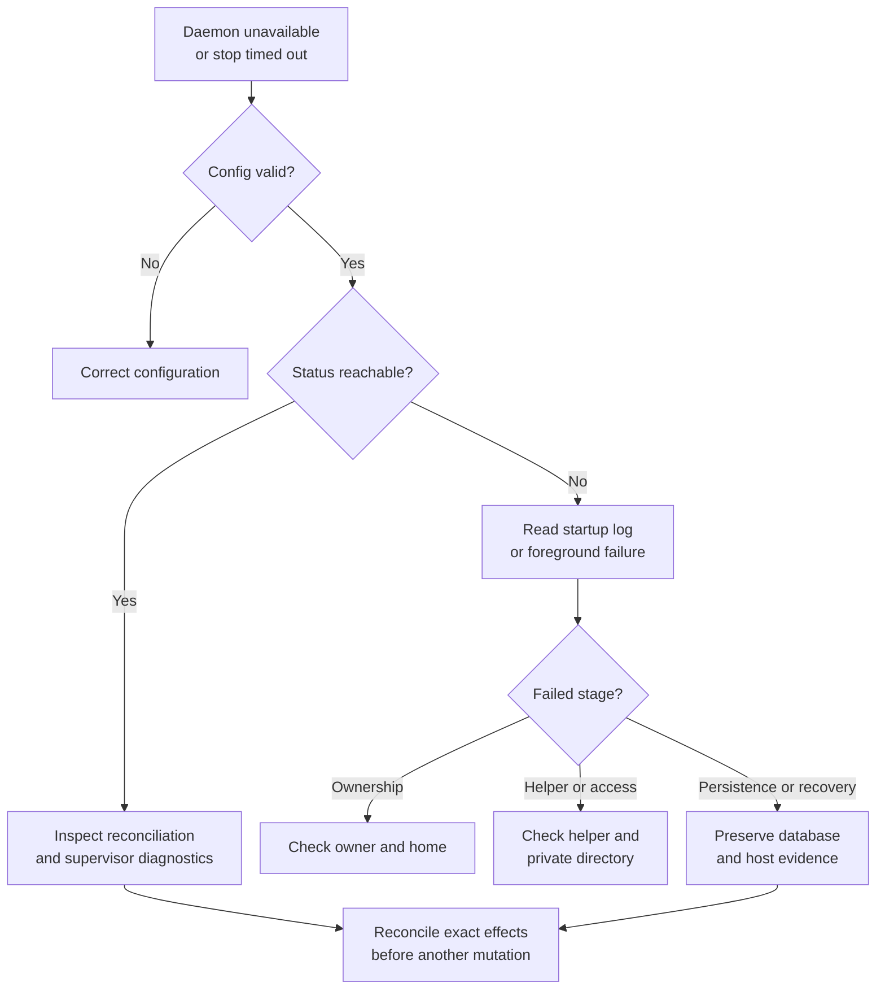

# Start, inspect, and stop a daemon

This guide assumes `uc` is installed. Run commands as the user who owns your
Undercurrent sessions. They use your current home: `UNDERCURRENT_HOME` if set,
or the default Undercurrent home otherwise. Changing that variable selects a different
installation; it does not move existing sessions or state.

## Start the daemon

Session commands such as `uc start` start the daemon automatically when needed.
To start it explicitly, for example before connecting an SDK client, run:

```sh
uc daemon start
```

Expect `daemon started`, or confirmation that a compatible daemon is already
running.

## Check status and diagnostics

```sh
uc daemon status
```

Status reports the daemon's epoch, whether it is accepting connections, and
connection, stream, and managed-session counts. This command does not start a
stopped daemon. The status request itself uses a connection, so the connection
count may be nonzero even when no other clients are connected.

For more detail, inspect the relevant diagnostic section:

```sh
uc --json debug supervisors
uc --json debug persistence
uc --json debug reconciliation
```

Reconciliation diagnostics show retained startup recovery results. See
[daemon diagnostics](diagnostics.md) for how to interpret these sections.

## Stop or restart with managed work in mind

To shut down the daemon and its supervised work, run:

```sh
uc daemon stop --graceful --drain-timeout 5s
```

Expect `daemon stopped` after shutdown and instance-lock release. This also
requests shutdown of the private process host and its supervised work; plan for
that impact. `uc daemon restart --graceful --drain-timeout 5s` uses graceful shutdown,
waits for release or a reachable replacement, and verifies a changed epoch.
It is not a way to disconnect only the daemon while promising that sessions
continue. A daemon crash and recovery have different semantics from this
intentional host-termination path.

The drain timeout must be positive and within the configured maximum. It is
not one total elapsed-time bound: mutation draining, host operations, and final
connection draining have distinct waits. CLI request/lifecycle deadlines may
expire before the daemon reaches its final state. After a timeout or response
loss, inspect the same installation before retrying a mutation. See
[shutdown ordering](../../../crates/undercurrent-daemon/docs/internals/lifecycle/startup-and-shutdown.md#graceful-product-shutdown).

## Run in the foreground for diagnosis

For foreground diagnosis, run `uc-daemon` with no arguments in the selected
environment, after ensuring another daemon does not own that installation.
It logs lifecycle information to `logs/daemon.jsonl` and runs until shutdown.
The first SIGINT/SIGTERM requests graceful shutdown with
`min(5 seconds, maximum_shutdown_drain_millis)`; a subsequent handled signal
forces listener closure. A forced listener close does not itself prove durable
host termination. Prefer the product stop command for routine operation.

## Diagnose startup and shutdown failures

This decision tree selects evidence before destructive recovery.



*An unreachable endpoint is not enough evidence to discard locks, databases,
or host receipts.* Keep the complete installation state until ownership and
the failed operation's outcome are understood.

| Symptom | Investigation and recovery |
| --- | --- |
| `unknown option; use --help` or retired path option | `uc-daemon` accepts only help/version and no-argument run. Use `UNDERCURRENT_HOME` rather than `--config` or `--database`. |
| Private-directory or instance-lock failure | Confirm the selected home and OS user. Unix directories must be real owner-private directories; the instance-lock parent must belong to the effective UID. Fix that specific installation's ownership/permissions rather than replacing a live lock. |
| Runtime startup | For `start_process_runtime`, check that matching `uc-session-host` is installed beside `uc-daemon`. Check private-host path length and permissions. |
| Path exceeds AF_UNIX capacity | For a new installation choose a shorter absolute home. Other release layouts are unsupported; preserve their state and use a separate current-release home. |
| `open_persistence` with missing database and retained host state | Restore a consistent complete state set from the appropriate backup/recovery procedure. The daemon refuses to create a fresh database while a live host, authentication file, SQLite sidecar, host receipt/job, or execution-output artifact remains. |
| `compose_detection` | Check the profile files; startup rejects an invalid profile snapshot. Preserve files and correct the reported definition. |
| Background startup | For `start_background_runtime`, session recovery must finish before the endpoint binds. Preserve the database and host evidence; inspect the typed source in maintainer diagnostics rather than recreating the database. |
| Status succeeds but a process-affecting mutation is rejected | A separate attempt-readiness gate may be closed by unresolved durable effects. Read status/attempt evidence and use evidence-backed repair; success of status alone does not reopen mutation admission. |
| Shutdown response is lost or effect is unknown | Inspect status and reconciliation. The daemon can remain in draining state with queries available. Do not assume that reconnecting or repeating shutdown creates a new safe attempt. |

`uc reset` is a deliberately destructive, confirmation-gated local-state operation,
not a general remedy for an unknown mutation. Consult its current `--help` and
the [owning implementation](../../../crates/undercurrent-cli/src/reset.rs) only when you
intend to discard that installation's state. Do not manually unlink selected
database or host files to bypass coupled-state checks.

For resource tuning, see [configuration](../../../crates/undercurrent-daemon/docs/internals/configuration/resource-bounds.md). Maintainers can
trace startup stages and failure branches in [lifecycle](../../../crates/undercurrent-daemon/docs/internals/lifecycle/startup-and-shutdown.md).

[Daemon guides](README.md) · [Maintainer documentation](../../../crates/undercurrent-daemon/docs/README.md)
