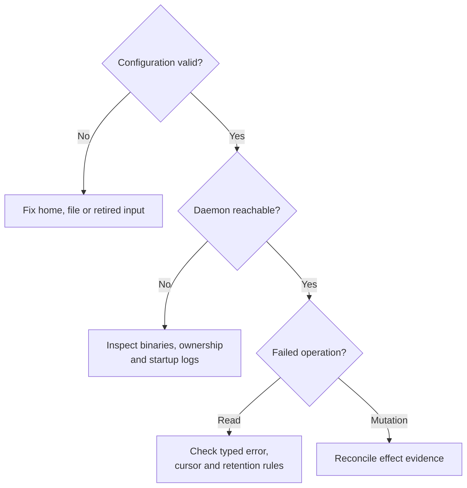

# Recover without losing the evidence of what happened

Use this guide when a local command fails, output is missing, or a session looks
stuck. You need the original OS user, selected home, and matching binaries.
Preserve the command result and stderr, stable session ID if known, and any
caller-retained attempt or delivery identity. The commands below run from any
directory and use `dev` as an example session name.

## Start with the failed boundary

Start with offline validation and a status probe. Neither starts an absent daemon:

```sh
uc config validate
uc daemon status
```

Expected: validation either succeeds or names a configuration failure; status
reports the selected daemon's reachability. If preserving a stopped installation
for offline analysis matters, stop here and inspect its files with the
[storage recovery guide](daemon/storage.md). Do not change ownership or remove locks
to force a successful probe.

Use the results to select the next boundary:



*Configuration, connection, and operation failures need different evidence.*
A successful connection or numeric exit code does not prove that an earlier
mutation had no effects.

## Gather the relevant facts

For an online investigation, choose the reads relevant to the failure below.
**`inspect` and `logs` can automatically start an absent daemon**; debug does not.

```sh
uc inspect dev --json
uc logs dev --max-bytes 32768 --json
uc debug reconciliation --json
```

Expected evidence includes the stable ID, lifecycle and revisions, retained
output or explicit gap, and a startup reconciliation summary. None of these
reads is a universal application-completion receipt. Debug cannot enumerate
every current unknown attempt or recover an arbitrary lost CLI request ID.

| Symptom | What to check and how to recover |
| --- | --- |
| Ambiguous configuration or retired setting | Keep one main filename, remove retired selectors deliberately, and validate again. See [configuration](configuration/README.md). |
| Legacy layout error | Check permissions as well as actual markers. Use [home-layout diagnosis](configuration/diagnose.md#resolve-a-legacy-home-rejection); do not create a dummy current database. |
| Missing helper | Restore matching `uc`, `uc-daemon`, and `uc-session-host` together. |
| Owned but unreachable endpoint | Check the owner and home-specific startup log. A stale-looking pathname is not proof the owner is gone. |
| Same-user authentication or protocol failure | Check OS user, selected home, and build compatibility. No remote or unauthenticated fallback is supported. |
| Persistence/open failure | Preserve the database, sidecars, and private host evidence together. See [storage recovery](daemon/storage.md). |
| Start reply lost | Query the original unique name/labels and inspect the returned stable ID. An empty read is not universal proof of no effect. Repeating the CLI command creates a new mutation identity. |
| Input timed out | Look for an application acknowledgment, not just PTY echo. Delivery receipt, input consumption, and completed work are different facts. |
| `exec` reply or output unavailable | Reconcile the command's external effects. Rerunning it just to recover output can duplicate work. |
| `wait` timed out | Inspect current state/output and choose a new observation or an explicit stop. Wait timeout does not stop work. |
| Foreground or health unknown | Inspect `explain`, effective profile and process evidence. Missing evidence is not success or failure. |
| Output gap or missing earlier screen history | Record loss, then restart at available bytes or request a current screen as appropriate. See [output recovery](cli/status-and-output.md). |
| Group is busy or pending | Detach the owning view and follow [group reconciliation](cli/groups.md). Do not delete group locks or replay pending starts. |
| Stop/shutdown timed out | Recheck the same session/installation and ownership before escalation or replacement. See [daemon operation](daemon/README.md). |

## Reconcile a mutation before repeating it

A timeout or lost response does not prove that a process never started, input
was never delivered, or shutdown never began. Use the requested operation's
explicit evidence:

| Effect evidence | Next action |
| --- | --- |
| Known absent | Correct the cause and check the operation-specific retry contract. |
| Known applied | Recover the retained result and inspect current state. |
| Unknown or omitted | Inspect the exact session and retained evidence. Recover the result only when that evidence proves the outcome; otherwise keep it unresolved and avoid a duplicate effect. |

[SDK recovery](../sdk/recovery.md#reconcile-the-mutation) owns the exact replay and
reconciliation rules. Reconnecting alone does not establish retry safety.

## Repair an identified durable attempt

`uc debug reconciliation` shows a bounded current sample of blocking attempt IDs,
operations, and session targets. A session's unresolved input does not block
mutations in unrelated sessions. If that session is still active, stopping it
remains available. After verified exit and input quiescence, background recovery
can retire uncertain input from admission blocking while preserving its Unknown
outcome and audit. This never permits replaying the input. See the
[retirement conditions](../../crates/undercurrent-daemon/docs/internals/requests/effects-and-recovery.md#retire-uncertain-input-after-verified-exit).


When diagnostics or your integration supplies an exact durable unknown
operation-attempt ID, `uc debug repair-attempt ATTEMPT_ID` requests evidence-backed
repair. Replace the placeholder with that retained ID. The daemon uses its own
evidence; the command does not accept your assertion that an effect happened.
It can return known absent/applied with current unresolved readiness information,
or reject repair because evidence is insufficient. It does not rerun an arbitrary
lost CLI command.

Attached integrations have separate authorized runtime-attempt and cancellation
status operations. They require exact identity, request digests and authority;
ordinary local transport authentication does not supply that authority. Follow
[SDK recovery](../sdk/recovery.md) instead of guessing fields or polling a private
host endpoint. Unknown effects may correctly remain unresolved.

## Finish the investigation

Preserve enough evidence to explain partial effects, but omit terminal contents,
environment values, and private paths from shared diagnostics unless needed and
authorized. The [error reference](../reference/errors.md) maps categories to
their owners; [maintainer verification](../development/verification.md) links
focused regression scenarios. Do not use reset as a generic repair.

If you created disposable sessions for diagnosis, stop and clean only those
sessions. Stop a dedicated diagnostic daemon before removing its temporary home.
Leave uncertain state intact so that later reconciliation can still use it.

[Documentation index](../README.md)
