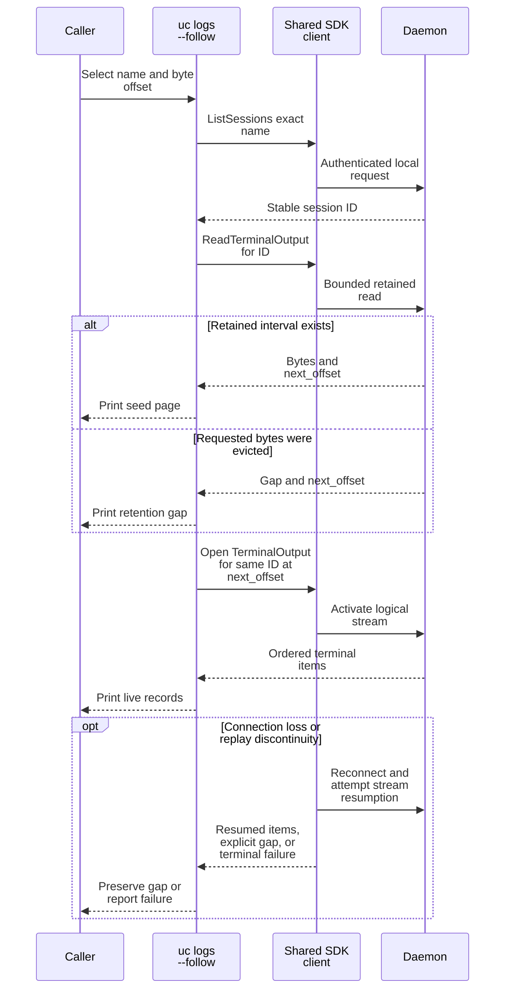
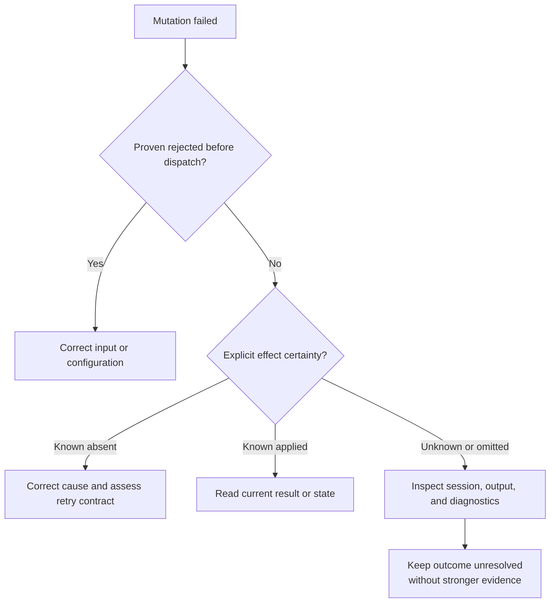

# Consume CLI output and interpret failures

Use this reference when scripting `uc` or diagnosing a partial result. It
describes package `0.1.0-beta` and the native presentation layer. The supported Rust
integration boundary is [undercurrent-sdk](../../crates/undercurrent-sdk/README.md),
whose calls block; the [Python package](../../python/README.md) provides an
async interface through its own bridge. Parsing human CLI tables is not a
replacement for either SDK.

Jump to [output shapes](#choose-the-matching-output-shape),
[stream fields](#stream-record-shapes), [retained reads and follow](#read-retained-output-without-assuming-complete-history),
[exit codes](#exit-categories-and-machine-errors), or
[mutation recovery](#reconcile-a-failed-mutation-before-repeating-it).

The authoritative CLI encodings are
[CliPresenter and CliFailureReport](../../crates/undercurrent-cli/src/presentation/mod.rs),
[stream records](../../crates/undercurrent-cli/src/presentation/stream.rs), and
[finite terminal records](../../crates/undercurrent-cli/src/presentation/terminal.rs). Their data payloads
come from the [protocol DTOs](../../crates/undercurrent-protocol/src/dto.rs).
Package versions, product-contract versions, configuration schema generations,
and stream sequences are separate concepts; `uc --version` reports the package
version.

## Choose the matching output shape

| Operation | Supported output |
| --- | --- |
| Ordinary finite commands, including `wait` | Text or pretty `--json`, newline-terminated. Success is the command's typed result, without a universal success envelope. |
| `watch`, `top`, `logs --follow` | Text or compact `--jsonl`, one record per line. |
| `attach`, `start --attach`, interactive group views | Terminal text only, with terminal stdin/stdout required. |
| `exec`, `completion`, `init --print`, `context --name`, `peek --raw` | Text only. Exec forwards validated child stdout and stderr. |
| Failures | Stderr, formatted according to the selected text/JSON/JSONL mode. |

For example, run `uc ls --json` from any directory in the intended local home.
The result is a session page with `items`, `next_cursor`, `snapshot_revision`,
and `total`; it is not the illustrative `sessions` wrapper used by the generic
presenter golden test. `uc watch --jsonl` emits `session_snapshot` and
`session_delta_batch` records for one bounded query window.

Keep stdout and stderr separate in automation. `--diagnostic` adds JSON Lines
diagnostic records to stderr even when stdout or a failure uses another format.
Consequently stderr with `--diagnostic --json` is not one JSON document.
Quiet suppresses ordinary text, including terminal logs and finite raw screens,
but preserves machine results and failures. Completion documents, printed shell
hooks, and explicit exec output also survive quiet.

Human session values escape control characters. Explicit terminal logs and raw
screens preserve arbitrary bytes, including non-UTF-8 and terminal controls.
Plain `peek` reconstructs the screen through the VT parser and prints text;
checkpoint updates in text mode remain ANSI patches or replacement bytes.

## Stream record shapes

| `record` | Fields after the discriminator |
| --- | --- |
| `session_snapshot` | `sequence`, `page` |
| `session_delta_batch` | `sequence`, `batch` (revision transition and ordered deltas) |
| `session_event` | `sequence`, `event` |
| `agent_event` | `sequence`, `event` |
| `terminal_output` from a live subscription | `sequence`, `start_offset`, `end_offset`, `bytes` |
| `terminal_screen` | `sequence`, `output_offset`, `columns`, `rows`, `cursor_row`, `cursor_column`, `cursor_visible`, `alternate_screen`, `contents` |
| `gap` | `stream_id`, `first_missing`, `last_missing`, `reason`, `recovery` |
| `terminal_output` from the finite `logs --follow` seed | `start_offset`, `end_offset`, `next_offset`, `has_more`, `bytes`; no stream sequence |
| `terminal_output_gap` from that seed | `requested_offset`, `available_from`, `next_offset`, `recovery`; no stream sequence |

This table describes the renderer's vocabulary. Current watch/top commands open
query streams; they do not subscribe to every possible session or agent event.
Terminal bytes serialize as JSON arrays of unsigned byte values, not UTF-8 or
base64. The following is illustrative, not output observed during authoring:

```json
{"record":"terminal_output","start_offset":4,"end_offset":6,"next_offset":9,"has_more":true,"bytes":[255,120]}
```

Treat terminal byte offsets, stream-local sequences, session revisions, and
query snapshot revisions independently. A seed record has no sequence because
it came from a finite read. Generic stream consumption writes each item before
receiving the next, preserves per-stream order, and blocks through SDK recovery.
It does not provide a total order across streams.

## Read retained output without assuming complete history

Finite `uc logs NAME --json --from-offset OFFSET --max-bytes LIMIT` returns
`TerminalOutputPageDto`, whose `result` is `data` or `gap`. Substitute decimal
offset and byte limit values; begin at 0 for the oldest requested history.
The owning fields are defined by `TerminalOutputPageDto` in the
[protocol](../../crates/undercurrent-protocol/src/dto.rs).

| Field or result | Meaning |
| --- | --- |
| `from_offset`, `to_offset` | Inclusive start and exclusive end of the returned byte interval |
| `next_offset` | Producer head at this read; it can be ahead of `to_offset` |
| `has_more` | More retained bytes existed beyond this page at the time of the read |
| `bytes`, payload digest, optional truncation | Returned payload and its integrity/truncation metadata |
| `result: gap` | Requested bytes are unavailable; includes `available_from` and a recovery instruction |

Use the [retained-transcript procedure](../guides/cli/status-and-output.md#save-a-retained-transcript)
for interval validation, checkpointing, and gap handling. Reconnection cannot
reconstruct evicted bytes.

### Bound encoded responses

The actual `cli.logs_max_bytes` default is 65,536 raw bytes. A full page can
exceed the standard encoded product response ceiling because each byte becomes
a JSON integer. For standard settings, pass `--max-bytes 32768` (including for
the follow seed); use less with lower custom limits or larger envelope overhead.
An oversized page currently surfaces as generic `Internal`, even in human output
mode. Reduce the bound and retry the read from the same unconsumed offset.
See [encoded-response budgeting](protocol/streams.md#budget-the-encoded-response).

### Follow one seed with a live stream

This sequence shows why `logs --follow` uses one stable session ID across the
transition from a finite page to a stream:



*Takeaway: name changes cannot redirect the continuation, but neither the page
nor reconnection guarantees that all prior output remains retained.* In the
current implementation, follow opens at the producer's `next_offset` after only
one seed page. If that page has `has_more: true`, retained bytes between its
`to_offset` and that head are skipped. For a complete retained capture, page
finite reads using `to_offset`, or use an SDK reader that preserves the actual
returned interval. Increasing `--max-bytes` only changes the bounded seed and
does not eliminate the limitation in general. These are
reads and subscription changes; the CLI performs no durable state commit here.
See [native logs routing](../../crates/undercurrent-cli/src/native.rs) and
[stream executor](../../crates/undercurrent-cli/src/streams.rs).

The default page bound applies only to the initial finite page, not to the total
duration of follow. Follow does not mean “exit when the program exits”; interrupt
the observer when finished. A write failure cancels its logical subscription.
The scoped signal adapter converts Unix SIGINT/SIGTERM or Windows console signals
into local subscription cancellation and joins its worker on cleanup. The
outer invocation then closes its SDK client. Cancelling this observer does not
cancel a runtime attempt or stop the managed session.

## Exit categories and machine errors

The authoritative mapping is [error.rs](../../crates/undercurrent-cli/src/error.rs), with numeric values in
[cli_support.rs](../../crates/undercurrent-cli/src/cli_support.rs).

| Exit code and category | Examples |
| --- | --- |
| 0: `success` | A finite result or successful local UI exit. A returned gap or invalid profile lint report can still be a successful request. |
| 1: `failure` | Missing session, name conflict, failed precondition, process/terminal/persistence rejection. |
| 2: `invalid_input` | Parser, configuration, output-shape, or local input validation failure. |
| 3: `incomplete` | Timeout, capacity rejection, cursor/replay unavailable, partial bulk report, unavailable exec output, busy reset. |
| 10: `denied` | Product authentication or permission rejection. |
| 11: `approval_required` | Missing confirmation for clean/reset. |
| 70: `runtime` | Transport/protocol failure, failed output integrity, invalid pagination, local IO or runtime error. |
| 130: `interrupted` | Typed cancellation or local stream interruption. |

`exec` is the exception to interpreting a numeric process code as a CLI
category: a successfully retrieved child result returns the child's portable
code. Diagnostics classify child code 0 as success and other child results as
failure. An exec process code of 3, for example, can therefore be the child's
own code rather than a CLI incomplete-output error. Check stderr and the
requested command's behavior.

### Structured failure fields

Structured failure fields are:

| Field | Meaning |
| --- | --- |
| `command` | Parsed command if available; omitted for early parser failure. |
| `result_category` | Stable CLI exit category above. |
| `product_error_category` | Exact server category if the error came from a product response. |
| `error_disposition` | Exact server disposition when supplied, or a typed local classification. Absent legacy dispositions remain absent. |
| `effect_certainty` | Explicit finite server evidence: `known_absent`, `known_applied`, or `unknown`. Omitted when unproven, local, or legacy. |
| `message` | Public diagnostic text; nested source errors are not serialized. |

The CLI failure envelope does not expose every product error field. In
particular, do not expect retry hints, request IDs, or an operation-attempt ID to
be added by the presenter. Bulk failure entries retain only stable session ID,
CLI category, and message. Preserve the report and inspect current state when
more evidence is needed.

## Reconcile a failed mutation before repeating it

The [SDK recovery implementation](../../crates/undercurrent-sdk/src/resilient.rs)
restores connections and logical subscriptions, but does not automatically
replay ambiguous in-flight finite requests. The CLI generates fresh mutation
keys from a UUID, PID, command, and sequence; keys are not persisted for reuse
by the next `uc` process. Repeating `start`, `send`, `restart`, or `exec` is a
new action, even if the earlier reply was lost. A timeout, local writer failure,
or transport error alone does not prove the action had no effects.

This decision tree separates failure classification from effect evidence:



*Takeaway: the exit code classifies the failure, while evidence determines
whether repeating an effect is appropriate.* For a lost start reply, inspect
the unique name and returned session details before attempting another start.
For input, inspect session/output and any application acknowledgment; a delivery
receipt does not establish that the application finished processing input.
For exec, reconcile the external effect or use a supported SDK operation with
the required identity. Do not rerun an ambiguous shell command just to recover
its output. If you have a durable Unknown attempt ID, use
[`debug repair-attempt`](cli-commands.md#repair-a-durable-unknown-attempt) to ask
the daemon to resolve it from retained evidence. Apply a proved `known_absent`
or `known_applied` result using the branches above; if repair fails, preserve
the unresolved outcome. Repair neither accepts an operator's effect claim nor
reconstructs an arbitrary lost command identity.

## Diagnostics and verification evidence

`uc events --json` lists the linked CLI and SDK vocabularies. Registration does
not prove every event is emitted on every route. The native diagnostic sink
is enabled by `--diagnostic` and writes a fixed set of safe fields: event,
command, optional operation, result category, and elapsed microseconds.
Emission is best effort and cannot change command success. It does not log
request bodies, environment values, terminal content, or nested OS errors.
Normal requested inspection/output can still contain commands, metadata,
directories, and terminal contents; diagnostic redaction is not a promise that
all result data is secret-free.

[Machine-output goldens](../../crates/undercurrent-cli/tests/machine_output_golden.rs) cover command names,
serialization, stable exit classes, legacy omission, and explicit effect
certainty. [Stream dispatcher tests](../../crates/undercurrent-cli/src/stream_dispatch.rs) cover ordered
output before a terminal failure and writer-failure cancellation;
[terminal presentation tests](../../crates/undercurrent-cli/src/presentation/terminal.rs) cover non-UTF-8
bytes and replay gaps. The generic golden fixture is a renderer test, not an
end-to-end schema assertion for every command.

[Back to crate overview](../../crates/undercurrent-cli/README.md) · [Command reference](cli-commands.md)
