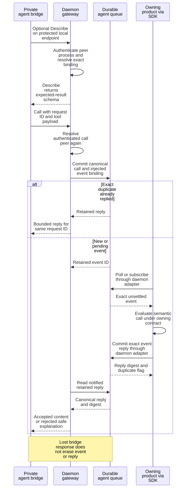

# Exchange events with one fenced agent attempt

Understand which party owns agent-event meaning and how the daemon preserves
exact delivery/reply identity. This explanation covers the current product
contract and private agent-bridge generation `1`. It is for attached-runtime
integrators and maintainers, not instructions to connect a general SDK client
to the private bridge.

[agent.rs](../../../crates/undercurrent-protocol/src/agent.rs) owns these DTOs and canonicalization helpers.
[AgentEventsSpec](../../../crates/undercurrent-protocol/src/dto.rs) describes the public logical stream. The daemon's
[bridge gateway](../../../crates/undercurrent-daemon/src/agent_bridge_gateway.rs) and
[finite adapters](../../../crates/undercurrent-daemon/src/application_adapter/finite.rs)
implement transport, authentication, queue admission, polling, and reply handling.
Undercurrent retains and routes bounded technical events; the owning application
decides whether a submitted semantic result is acceptable.

For the public integration path, [retain the binding](#retain-the-complete-binding)
and [poll or reply](#poll-reply-and-handle-interruptions). For bridge changes, read
[durable exchange ordering](#durable-call-and-reply-ordering) and [bounds](#bounds-and-canonical-material).

## Retain the complete binding

An attached start can carry `RuntimeDispatchBindingDto.agent`. Its
`AgentRuntimeBindingDto` groups the following caller-owned evidence:

| Binding group | Purpose |
| --- | --- |
| Tenant, source product, actor/authority references | Scope event access and preserve caller context without bearer credentials. |
| Provider ID/generation, dispatch ID, attempt ID | Select the exact provider and runtime dispatch. |
| Operation, plan, grain, cell, attempt revisions; recovery epoch; fence | Prevent a delayed event or reply from crossing into a newer owner/recovery attempt. |
| Request/plan/action-lock/action-definition/implementation/prepared-action/instruction digests | Pin the caller's immutable semantic inputs. |
| Expected-result schema ID, document and digest; output classification | Present the exact expected result shape without making the daemon its semantic owner. |
| Input manifest and digest | Bind presented input material. |
| Maximum steps/tokens/cost and expiry | Retained caller policy; these fields alone do not prove enforcement by a workflow executor or OS adapter. |

Fields are opaque to Undercurrent except for structural/domain validation and
exact binding checks. Canonicalizing the object does not independently verify
that every embedded digest matches its referenced content. Use the owning
admission checks and result-schema digest helper. `grain_id` can be null; its
current Serde definition also defaults an omitted field to `None`.

## Understand calls and events

Calls use the `tool` discriminator:

| Call | Payload and interpretation |
| --- | --- |
| `begin` | Explicit start signal with no semantic result. |
| `progress` | Bounded progress message. |
| `submit` | JSON semantic result for the owning product to evaluate. |
| `need_input` | Question with optional answer schema and optional choices. |
| `turn_boundary` | Positive turn ordinal supplied by the caller; not exposed as an agent-facing tool. |

The gateway injects `AgentEventDto` routing: event ID, durable sequence, session
and process incarnation, attempt/revision, recovery epoch, fence, request/call
digests, and receive time. A model-visible bridge call carries only bridge
version, request ID, and call—no caller-selectable attempt route.

## Durable call and reply ordering

This diagram shows both transport boundaries and the two durable commits.

*Notifications wake readers; the retained queue is the authority for event and
reply identity.* A new call commits before it becomes externally available, and
a reply commits before notification/acknowledgement. There is no atomic
transaction spanning the owning product's business decision, the public reply,
and delivery back to the bridge. The diagram groups public daemon adapters with
the queue for readability; clients do not access the database directly.

`Describe` returns the dynamic expected-result schema after resolving the
protected peer process. The gateway supports Linux/macOS peer credentials and
Windows peer-process identity paths in current source; actual deployment and
qualification belong to the platform/runtime owners. These DTOs do not establish
a new remote agent transport or replace public authenticated local SDK IPC.

## Poll, reply, and handle interruptions

Use an authenticated product client with authority for the retained binding.
The public exchange has three steps:

1. **Receive.** Send `GetAgentEventRequest` with the poll fields below. Set the
   maximum wait to zero for an immediate poll or up to 30,000 ms for a bounded
   wait. Handle `Event` and `None { next_sequence }`; `None` does not indicate
   task completion or process exit. The daemon checks cancellation during the wait.
2. **Retain and evaluate.** Preserve the complete event before advancing your
   durable checkpoint. Evaluate the call under the owning product's contract.
3. **Reply and verify.** Send `ReplyAgentEventRequest` with the reply fields below.
   Choose `Accepted { content }` or `Rejected { code, safe_message, retryable }`.
   Match the receipt's session, event ID, sequence, and reply digest to the saved
   exchange, and handle its `duplicate` flag using the outcome table.

| Request | Required routing and context |
| --- | --- |
| Both poll and reply | Tenant/source/actor/authority references, provider identity/generation, session, exact attempt/revision/recovery epoch/fence, and caller request digest. |
| Poll additionally | Last consumed sequence and maximum wait. |
| Reply additionally | Current mutation contract, exact event ID, event sequence, process instance, and call digest. |

A stream alternative uses the same exact target in `AgentEventsSpec` with
`after_sequence`, yielding `ProductStreamItem::AgentEvent`. It carries unsettled
calls for that attempt. Its stream-local delivered sequence does not establish
that your business result was committed.

A `Rejected` reply is a semantic answer to the tool, separate from failure of
the Undercurrent request itself.

The daemon authorizes the reply, canonicalizes its outcome, and admits it to the
durable repository before returning the receipt.

| Reply outcome | Meaning and next action |
| --- | --- |
| Receipt with `duplicate: false` | Reply was newly retained. Save its identity and digest. |
| Receipt with `duplicate: true` | Identical reply was already retained. Do not treat it as a new semantic action. |
| Changed reply for the same event | Conflict. Preserve the original reply and investigate. |
| Stale target, expired binding, or missing event | Explicit failure. Do not alter the fence or invent an event identity to bypass it. |

The private gateway deduplicates a request ID and canonical call against the
resolved target. An identical pending call can wait on the same event; an
identical replied call can recover its retained reply; changed calls conflict.
While waiting it checks shutdown, binding expiry, and peer liveness. Lost public
or bridge responses do not prove absence: preserve the exact binding/call/reply
and use that operation's duplicate behavior. Closing a public subscription
releases observation resources, not the agent runtime; explicit runtime
[cancellation](cancellation.md) is separate.

## Bounds and canonical material

| Value | Bound and owner |
| --- | --- |
| Encoded agent frame | 256 KiB protocol constant, enforced on private bridge read/write; public traffic must also fit negotiated product codec limits. |
| Inline submitted result | 192 KiB gateway limit on encoded result JSON. |
| Progress/question text | 8 KiB gateway bound, nonempty and no NUL. |
| Expected-result schema canonicalization | 64 KiB canonical document bound. |
| Complete canonical runtime binding at daemon admission | At most 128 KiB, checked by domain `AgentRuntimeBinding::new` after protocol canonicalization. |
| Need-input answer schema and choices | Gateway checks optional schema ≤64 KiB, at most 128 choices, encoded choices ≤192 KiB. |
| Private call request ID | 1–128 bytes, no control characters. |
| Public reply event ID / sequence | 1–256 bytes without control characters / nonzero sequence at the daemon adapter. |
| Event poll wait | At most 30 seconds per public poll; caller response timeout remains separate. |

Protocol structs mostly enforce strict field shape; constants alone do not run
these per-field checks on generic Serde decoding. The private bridge uses a
four-byte big-endian nonzero JSON length, bounded by its frame constant. It is
neither UCMP nor the Python bridge's JSON-lines framing.

`canonical_agent_runtime_binding`, `canonical_agent_tool_call`, and
`canonical_agent_event_reply_outcome` use bounded Foundation canonical JSON with
a 256 KiB document limit. `canonical_agent_schema_document` and
`canonical_agent_result_schema` use 64 KiB;
`canonical_agent_result_schema_digest` hashes that exact canonical document.
All retain the Foundation default depth/string/collection bounds and return a
redacted `CanonicalPayloadError` on failure. The binding helper includes the
complete serialized binding, unlike the product-request helper that removes
mutation metadata.

The 256 KiB protocol binding helper does not establish admission under the smaller
128 KiB retained-binding ceiling. See [domain binding validation](../../../crates/undercurrent-domain/docs/internals/attempts-and-recovery.md#agent-binding-validation);
negotiated product limits and the other canonicalization bounds also apply.

The gateway verifies retained reply bytes against both their digest and their
canonical re-encoding before delivery. Tool content and accepted results remain
private; safe diagnostics should record kind, lengths and stable outcomes, not
schema documents, manifests, questions, or submitted content.

See [agent queue tests](../../../crates/undercurrent-store-sqlite/tests/agent_channel.rs)
for fencing, duplicate/conflicting calls and replies, expiry, capacity, and
restart retention, and [protocol stream tests](../../../crates/undercurrent-protocol/tests/protocol_contract.rs)
for exact stream specification round trips. Maintainer changes must update
both public and private boundaries where affected; see
[extension guidance](../../../crates/undercurrent-protocol/docs/README.md#extend-a-contract).
