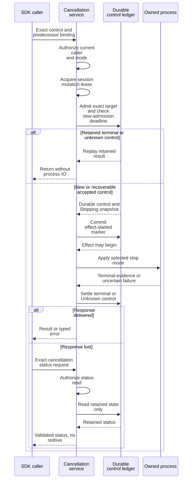

# Bind and reconcile an exact runtime cancellation

Use this guide to stop one attached runtime attempt with durable control identity
and to recover its result after response loss. It targets product contract
`0.1.0-beta`; standalone session stop and SDK request/subscription cancellation are
[different operations](recovery.md#cancellation-and-deadlines).

Prerequisites are an authenticated product client, authority for the selected
control mode, and a saved, verified predecessor start binding. Obtain the exact
session and revisions from [runtime attempt status](recovery.md#read-an-attached-runtime-attempt),
retain its caller request digest and fencing generation, and retain the selected
provider ID/generation from the original dispatch. Do not discover a cancellation
target by a human-readable session name.

The authoritative DTO and digest rules are in
[runtime_cancellation.rs](../../../crates/undercurrent-protocol/src/runtime_cancellation.rs); the complete
[current fixture](../../../crates/undercurrent-protocol/tests/fixtures/runtime_cancellation.json) illustrates request,
status request, and results with synthetic identities. Its timestamps and
identities are fixture values, not commands to send to a real daemon.

For a response already lost, go directly to [status reconciliation](#reconcile-a-lost-response).
For a new control, follow the construction steps below and retain their material.

## Construct a complete control

1. Build `RuntimeCancellationTargetBindingDto::new` with exact target attempt ID,
   caller request digest, target fence, caller cell, session ID, expected aggregate
   and lifecycle revisions, and provider identity/generation. Expected revisions
   are an admission precondition; they are not merely diagnostic hints.
2. Build `RuntimeCancellationCommandDigestMaterial::new` with a **distinct**
   control ID, idempotency key, mode, bounded reason, `TargetOnly` propagation,
   positive absolute deadline, source product, tenant, actor-context and authority
   references. Retain this complete material for reconciliation.
3. Compute `material.canonical_digest_sha256()` and pass both material and digest
   to `CancelRuntimeAttemptRequest::attached`. This constructor supplies the
   current mutation contract and an attempt whose ID is the control ID, whose
   fence is the predecessor fence, and whose payload digest is the complete
   product-request fingerprint.
4. Send through the SDK's blocking `cancel_runtime_attempt(request, timeout)`.
   Validate its result with `.validate()` and compare target and control fields
   to your retained material before [interpreting state](#interpret-the-result). The SDK checks operation
   correlation; it does not substitute for this semantic validation.

The maintained [inspect_cancellation example](../../../crates/undercurrent-protocol/examples/inspect_cancellation.rs)
performs those construction and validation steps entirely in memory, including a
shape-valid changed reason that fails semantic validation. With the pinned Rust
toolchain and checkout dependencies, run from the repository root:

```sh
cargo run --locked -p aixand-undercurrent-protocol --example inspect_cancellation
```

Expected output (not a recorded run):

```text
cancellation: valid round trip; command and product digests differ
changed reason: decoded shape, rejected semantic digest
status: exact lookup constructed; no command was sent
```

It requires no daemon, sends no control, and leaves only Cargo build artifacts;
no runtime cleanup is needed. Failed assertions identify a changed contract or
fixture assumption. Missing dependencies/toolchain must be resolved through the
repository setup; do not drop `--locked` to conceal a dependency mismatch. For
live use, replace **all** synthetic target and caller material with retained,
authorized values; construction alone does not authenticate them.

The explicit command modes are `Graceful` and `Force`. Graceful is cooperative-only:
the application persists `no_escalation` before process IO, and timeout cannot
trigger forced termination. Force is a separately authorized command with a
different control identity and semantic digest. Target-only propagation never
expands either request to other sessions, cells, grains, or an entire operation.

[ADR 0003](../../architecture/decisions/0003-runtime-cancellation-graceful-authority.md)
records this authority policy and its recovery behavior. An Unknown graceful
result remains uncertain; changing it to Force requires a new authorized control.

### Required field constraints

| Fields | Validation in `undercurrent-protocol` |
| --- | --- |
| Control ID, target attempt ID, caller cell | 1–128 ASCII bytes; letters/digits plus `.`, `_`, `-`, `:`. Control and target IDs must differ. |
| Session ID | 1–256 bytes, no whitespace or control characters; Unicode and `/` are allowed. |
| All SHA-256 fields | Exactly 64 lowercase hex characters without an algorithm prefix. |
| Target fence, provider generation | Nonzero. |
| Expected/result revisions | Nonzero; lifecycle revision ≤ aggregate revision. Result revisions cannot regress below target pins. |
| Provider ID / tenant ID | `prv_` / `tenant_` followed by canonical lowercase hyphenated UUIDv7 with the standard UUID variant. |
| Idempotency key | 1–256 ASCII bytes without control characters. Whitespace-only ASCII keys are accepted by the current validator; do not trim or rewrite a retained key. |
| Reason, actor-context reference, authority reference | At most 512 bytes, nonblank after trimming, no control characters. |
| Absolute deadline | Positive Unix-epoch milliseconds; constructor validation does not establish freshness. Server checks new admission against its clock. |
| Source product | At most 128 bytes, `product` or `namespace/product`. Each segment is 1–64 lowercase ASCII letters/digits/hyphens, begins with a letter, and ends alphanumeric. Namespaces are caller-owned. |
| Mutation metadata | Exact current contract, nonempty valid key, matching attempt identity/fence/fingerprint, and **empty** compatible-unknown map. |

`GetRuntimeCancellationStatusRequest::attached` needs the exact control/digest,
predecessor attempt/digest, session, provider identity/generation, and current
source/tenant/actor/authority context. It carries a direct current contract and
no mutation context. Its authority is a current status-read decision, not a
reused grant that bypasses revocation.

## Two different digests

`canonical_runtime_cancellation_command_digest_sha256` canonicalizes a JSON object
with `digest_domain = "undercurrent.runtime.cancel.command/v0.1.0-beta"` and these
semantic fields: control ID, target attempt/request/fence, caller cell, session,
expected session/lifecycle revisions, expected provider ID/generation, mode,
reason, and propagation policy. The domain separates this hash from unrelated
JSON documents. The four unsigned numeric pins (target fence, expected aggregate
revision, expected lifecycle revision, and provider generation) are encoded as
canonical decimal **strings in digest material**, preserving every u64 value.
Wire DTOs retain their existing numeric fields. Key order and whitespace are
canonical; integer pins never pass through binary64 formatting in 0.1.0-beta.

Although digest material retains them, the caller command digest **excludes**
idempotency key, deadline, source product, tenant, actor, authority, mutation
metadata, and product contract. These envelope values remain independently
retained and checked; exclusion from this digest does not permit changing them
under the same exact control identity.

`product_request_fingerprint_sha256()` hashes the complete product operation/input
with `mutation` removed. For a verified 0.1.0-beta command it adds
`digest_domain = "undercurrent.runtime.cancel.product-request/v0.1.0-beta"` to the
fingerprint envelope and encodes those four pins plus `absolute_deadline_millis`
as decimal strings. Thus adjacent large deadlines remain distinct even though
deadline is excluded from the caller command digest. Other request fields retain
their existing representation. The constructor stores this fingerprint in
`mutation.attempt.payload_digest_sha256`.

### Namespace cutover and retained state

Product contract 0.1.0-beta accepts only the current Undercurrent command and product
fingerprint domains. Older domains are rejected even when every integer pin is
small. The [current fixture](../../../crates/undercurrent-protocol/tests/fixtures/runtime_cancellation.json)
pins both hashes independently.

Use matching current-release clients and daemon. Preserve original control IDs and hashes
when inspecting old state; recalculating them under the same identity would
change the command's meaning. Reconcile old work using its matching build and
use a fresh product home for this cutover. No automatic conversion of retained
identities or protocol downgrade is provided. Old state must stay with its
matching build because daemon startup recovery can act before client admission. See the
[compatibility policy](../compatibility.md#matching-state-and-builds).

## Interpret the result

Match the returned `RuntimeCancellationStateDto` to its required snapshot:

| State and required session snapshot | Reader action |
| --- | --- |
| `AcceptedStopping`<br>Lifecycle exactly `Stopping`. | Admission is durable; termination is pending. Read status. |
| `AppliedTerminated`<br>`Stopped`, `Failed`, or `Exited` with exact code. | Control's termination effect is established. This does not imply semantic task success. |
| `AlreadyTerminal`<br>Same terminal lifecycle set. | The exact target was terminal at admission; no new termination is claimed. |
| `Unknown`<br>Any otherwise valid coherent lifecycle snapshot. | Effect remains unresolved; do not infer absence from the snapshot or redrive automatically. |

Result validation checks the target and control's independent field grammars,
recomputes the command digest, requires matching session ID, nonregressing
revisions, and consistent state/lifecycle. `Exited { code: None }` is invalid
here even though general lifecycle DTOs can represent it. An individual control
binding's `.validate()` checks its shape; complete result validation also checks
its semantic hash against the target.

## Durable ordering and returned states

The application and store enforce ordering, while `undercurrent-protocol` validates the
outward evidence. This sequence focuses on the durable marker before process IO.



*Durable admission is not termination. The effect-started marker prevents an
ambiguous retry from applying process control again.* An already-terminal target
can be durably admitted as `AlreadyTerminal` without process IO; the diagram's
process branch applies to an accepted Stopping target. Failed admission or a
failed marker prevents this branch. After a marker is durable, replay/restart
must preserve unknown effect when termination cannot be established.

The [application service](../../../crates/undercurrent-application/src/runtime_cancellation.rs)
checks authority before replay and holds session mutation ownership across
admission and stop. The [store tests](../../../crates/undercurrent-store-sqlite/tests/runtime_cancellation.rs)
cover exact replay, pre-marker recovery, restart uncertainty, revision coherence,
and terminal commits racing settlement. The daemon deliberately excludes this
operation from its ordinary request cache so cached replies cannot bypass fresh
authorization.

## Reconcile a lost response

1. Build `GetRuntimeCancellationStatusRequest::attached` using the saved control,
   command digest, predecessor, session, and provider pins. Supply current
   source/tenant/actor/authority context for the status-read decision.
2. Call `get_runtime_cancellation_status` with a bounded response timeout.
   Validate the result and compare its bindings with the saved control before
   using the [state table](#interpret-the-result). This read performs no process IO.
3. If still accepted or unknown, preserve the record. Bound further read-only
   polling with your own deadline and backoff; DTOs provide no polling scheduler.
   Not-found, denied, or inconsistent state is a typed error and gives no
   `KnownAbsent` guarantee.

A retained exact replay can remain readable after the original admission deadline.
A new command cannot use that fact to admit an expired request. An exact command
retry may resume a live accepted control **before** the effect-started marker;
once marked, unknown effects must not be redriven. Let the ledger decide this
under current authority rather than synthesizing a fresh control or changing
force/deadline fields in a retry.

For field/digest errors, correct construction before sending. For target revision
or fence conflicts, reread authoritative state and decide whether a separately
authorized new control is warranted. For accepted/unknown outcomes, preserve the
control record and inspect status and reconciliation diagnostics. Closing the
SDK client cleans up the connection only; this operation already concerns a
persistent runtime target, so there is no automatic “undo” cleanup.

Verification should include the fixture round trips, changed semantic digest,
strict UUID/text grammars, result revision regression, authorization-first access,
and effect-marker ordering tests linked above. See
[maintainer verification](../../../crates/undercurrent-protocol/docs/README.md#verification) for commands.
