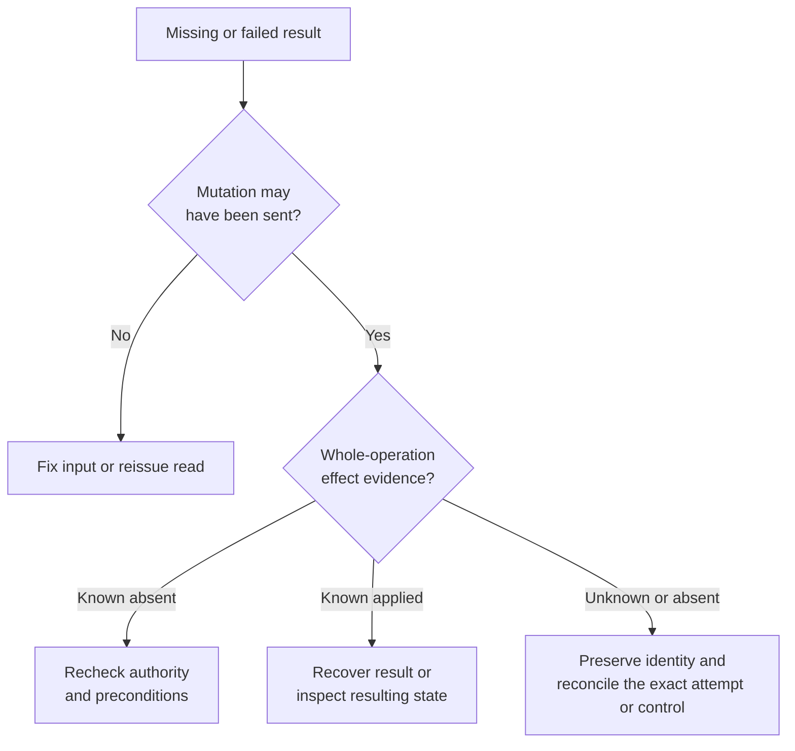
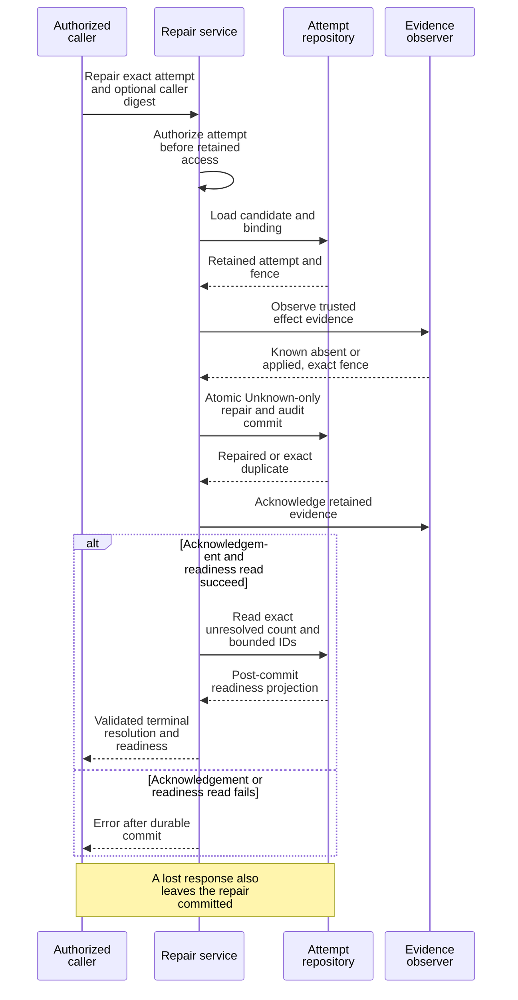
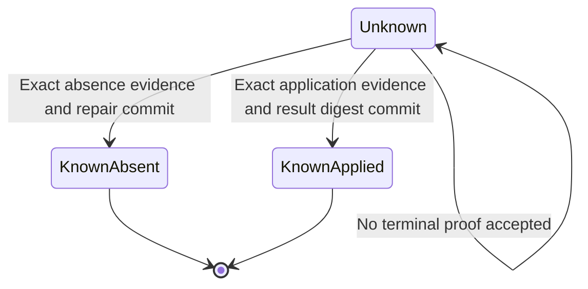

# Determine a mutation's outcome before retrying

Use this guide after a typed rejection, timeout, cancellation, or lost response.
It applies to current contract `0.1.0-beta`. You need the original request identity,
any attempt/delivery/control binding you supplied, and an authenticated client
with authority to inspect that target. A connection failure alone cannot tell
whether a mutation committed.

The owning definitions are [ProductError and resynchronization DTOs](../../../crates/undercurrent-protocol/src/dto.rs),
[effect certainty](../../../crates/undercurrent-protocol/src/contract.rs), [error registries](../../../crates/undercurrent-protocol/src/registry.rs),
[attempt status](../../../crates/undercurrent-protocol/src/runtime_attempt_status.rs), and [repair](../../../crates/undercurrent-protocol/src/repair_attempt.rs).
Runtime cancellation has a [separate recovery contract](cancellation.md).

## Choose the next action

If effect evidence is unknown or missing, use the identity you saved:

| Saved identity | Next action |
| --- | --- |
| Attached start attempt and caller request digest | [Read exact attempt status](#read-an-attached-runtime-attempt); repair only an eligible Unknown attempt. |
| Runtime cancellation control and command digest | [Read cancellation status](cancellation.md#reconcile-a-lost-response); use its returned state without automatic redrive. |
| Ordinary mutation | Inspect the target and its operation-specific evidence. Attached status is not a universal lookup by idempotency key. |

This decision tree separates delivery recovery from mutation reconciliation.

*Reconnection and a retryable error do not authorize repeating an uncertain
mutation.* The [Rust resilient client](../../../crates/undercurrent-sdk/src/resilient.rs)
recovers the connection and resumes streams; it does not automatically replay
ambiguous finite requests. [Python bridge calls](../../../python/src/undercurrent/_transport.py)
also remove the waiting future on timeout/cancellation without replaying the
mutation. Closing a client detaches; it does not undo a session or its command.

## Keep failure and effect evidence separate

| Observation | What it tells you | What it does not establish |
| --- | --- | --- |
| Local codec/contract rejection before sending | This encoding/validation attempt failed locally. | The status of an earlier request with the same identity. |
| Typed `ProductError` | Identified operation when available, stable category, safe explanation, and optional guidance. | No effect, merely because the response is an error. |
| `effect_certainty: known_absent` | Owner evidence establishes that the complete operation's effect is absent. | That unchanged preconditions/authority will permit a later attempt. |
| `effect_certainty: known_applied` | The complete effect is known applied, even if a later step failed. | Application-level completion or that a response body was retained. |
| `effect_certainty: unknown` or absent | No usable absence guarantee. Absence is preserved on older capability agreements. | Permission to repeat a mutation. |
| Request timeout, cancellation frame, connection loss | The caller did not obtain its expected terminal result. | Rollback or confirmed process termination. |

`retryable` and `retry_after_millis` are hints about whether another request may
succeed; they do not replace effect evidence or an operation-specific replay
contract. The optional `disposition` classifies the high-level failure and can
be `unknown_inconclusive`. It is distinct from whole-operation effect certainty.
Both optional fields are emitted only when their respective connection
capabilities were negotiated. Preserve absence rather than synthesizing values.

### Registered server errors

Use the authoritative [product categories and default dispositions](../errors.md#product-categories)
to look up all 19 categories. Those are producer defaults, not values a consumer
may infer when metadata is absent. The [disposition reference](../errors.md#read-the-evidence-fields-independently)
also includes `unknown_inconclusive`, which has no ordinary category mapping.

[Effect-certainty tests](../../../crates/undercurrent-protocol/tests/error_effect_certainty.rs) and
[disposition tests](../../../crates/undercurrent-protocol/tests/uref_034_error_taxonomy.rs) explicitly preserve omitted
metadata and unknown-effect overrides. `ProductStreamError` has stream context
and resynchronization hints but no finite-operation effect-certainty field.

### Attempt outcomes and process truth

`OperationAttemptDto` carries attempt ID, nonzero target fence, and canonical
semantic payload digest. `OperationAttemptOutcomeDto` adds whole-attempt certainty,
optional result digest, and `reconciliation_required`. These plain DTOs describe
owner evidence; constructing or decoding them does not execute ledger admission
or enforce all consistency rules. Dedicated status and cancellation types below
provide stricter validators and discriminated states.

`ProcessTruthDto` is a separate observation vocabulary, tagged `truth`: Running,
Exited with exact code, Missing (confirmed absence), Lost (owned process lost),
Orphaned (process without attributable ownership), and Unknown. Every variant
carries its observation time. It does not convert “missing now” into “a prior
mutation never happened”, and is not an application-level result or a complete
session lifecycle transition machine. These distinctions prevent process
observations from erasing durable uncertainty about an earlier effect.

## Replay identities and their limits

Different deduplication mechanisms have different owners:

| Identity | Owner and limitation |
| --- | --- |
| `MutationContext.idempotency_key` | Daemon's bounded request/response cache, scoped by client identity and keyed against exact request bytes. Retention/expiry and restarts bound it; it is not an unlimited durable exactly-once promise. |
| Operation attempt ID, fence, semantic fingerprint | Durable process-attempt services. A fence prevents obsolete owners from applying effects; a matching digest alone is not permission to execute. |
| Terminal input `delivery_id` | Semantic input delivery deduplication; a duplicate receipt must not be treated as fresh application acknowledgment. |
| Cancellation control ID and command digest | Durable authorization-first cancellation ledger; it bypasses the ordinary cache. |
| Agent event ID/sequence/call digest | Durable exact event and reply binding. |

See [daemon cache admission](../../../crates/undercurrent-daemon/src/dispatch.rs),
[durable process admission](../../../crates/undercurrent-application/src/durable_process.rs),
and [input delivery](../../../crates/undercurrent-application/src/commands/terminal.rs).
After an uncertain ordinary standalone start, inspect sessions and diagnostics;
the attached status endpoint is not a universal lookup by a chosen idempotency key.
Keep the original request available and let the operation's contract determine
whether exact replay, repair, or a separately authorized new action is appropriate.

## Read an attached runtime attempt

1. Construct `GetRuntimeAttemptStatusRequest::attached(attempt_id, request_digest)`
   using the saved **caller runtime-start request digest**. The internal product
   fingerprint and result digest identify different things. The constructor
   supplies the exact current direct contract.
2. Send `ProductRequest::GetRuntimeAttemptStatus` through the connected client's
   finite request API. The server authorizes the attempt before reading retained
   state; it neither probes a live process nor repairs the attempt.
3. Validate the returned `RuntimeAttemptStatusResultDto` with `.validate()`.
   Compare its attempt ID, fence, and binding pins with the saved dispatch, then
   interpret the snapshot below. A successful match identifies the retained
   attempt; observation time remains its durable update time.

- **`Unknown`** — Durable evidence is insufficient; no nullable session guess is returned.
- **`KnownAbsent`** — Durable evidence establishes the start effect did not occur.
- **`KnownApplied`** — Exact result digest and a coherent session snapshot are available.
  Inspect lifecycle to distinguish a running from a terminal session.
- **`Compensated`** — A superseded start was cleaned up under an exact newer fence.
  It is not an active start result.

The returned binding includes caller cell, caller request, launch profile,
environment binding, and input digests, without commands, environment values,
runtime policy, or output.

| Status field | Required rule or meaning |
| --- | --- |
| Attempt/cell IDs | 1–128 ASCII bytes from letters, digits, `.`, `_`, `-`, `:`. |
| Digests | 64 lowercase hexadecimal characters without a prefix. |
| Fence | Nonzero. |
| Session ID | 1–256 bytes without whitespace or control characters. |
| Revisions | Nonzero; lifecycle revision cannot exceed aggregate revision. |
| Exited snapshot | Exact exit code is required. |
| Observation time | Represented durable update time, not a new liveness probe. |

A missing, unverifiable, or inconsistent retained record can yield a typed error;
that is not `KnownAbsent`. The
[status service](../../../crates/undercurrent-application/src/runtime_attempt_status.rs)
and [store tests](../../../crates/undercurrent-store-sqlite/tests/runtime_attempt_status.rs)
cover the distinction. Status DTO tests are in
[runtime_attempt_status.rs](../../../crates/undercurrent-protocol/src/runtime_attempt_status.rs).

## Repair an Unknown attempt

Repair resolves durable uncertainty from **server-retained trusted evidence**.
It does not execute the original command and does not accept the caller's effect
claim, replacement fence, or result digest. Use `RepairOperationAttemptRequest::new`
for an eligible standalone/operator attempt or `::attached` with the exact caller
request digest for an attached attempt. The JSON member `request_digest_sha256`
is required-present even when standalone repair represents it as `null`.

### Request constraints

The repair ID validator allows 1–128 ASCII bytes from letters, digits, `.`, `_`,
`-`, `:`, and `/`; status/cancellation identity validators are narrower. Do not
assume every protocol reference uses one global grammar. Both constructor and
`.validate()` check the request; generic deserialization alone is insufficient.

### Submit and verify a repair

1. Construct the applicable request above and call `.validate()` before sending
   `ProductRequest::RepairOperationAttempt` through the finite request API.
2. Validate the returned `RepairOperationAttemptResultDto` and match its attempt
   ID. Success resolves it to `KnownAbsent` or `KnownApplied`; an error is not
   proof that the repair failed to commit.
3. Check the [readiness fields](#check-the-repair-result) and investigate remaining
   unresolved IDs. After a lost response, preserve the exact repair request and
   use the service's exact duplicate recognition under current authority.

This sequence shows why an error can follow a successful durable repair.

*The repair transaction, evidence acknowledgement, readiness refresh, and response
are separate steps.* Authorization denial, mismatched attached digest, Accepted
rather than eligible Unknown state, stale evidence/fence, or conflicting terminal
or audit data fails closed. An inconclusive observation is not a successful repair.
The [service](../../../crates/undercurrent-application/src/repair_attempt.rs) allows exact
already-committed repair to be recognized without reexecution; do not change its
identity/evidence semantics simply because the response was lost.

The repair state view includes only evidence-backed terminalization of an
already retained Unknown attempt; it is not the entire attempt lifecycle.

*Terminal here means this repair resolved effect uncertainty; it does not mean
the target process exited. Rejection itself makes no state transition.* Another
owner can still advance a record concurrently, so reread its evidence. The
successful repair shape excludes Unknown for this reason.

### Check the repair result

Successful `RepairOperationAttemptResultDto` has only `KnownAbsent` or
`KnownApplied { result_digest_sha256 }`; it cannot return an Unknown success.

| Readiness field | Required rule |
| --- | --- |
| `unresolved_count` | Exact number of unresolved attempts. |
| `unresolved_attempt_ids` | At most 256 unique IDs, in strictly ascending order. |
| `readiness_complete` | True exactly when the count is zero. |
| `unresolved_truncated` | True when the count exceeds the page length. |

Validate both booleans against the count/page. Ready here means the
unresolved-attempt readiness projection is clear, not that an application task
succeeded or a session is idle.

Inspect `GetDiagnostics` with the reconciliation section if readiness remains
blocked. Preserve the named unresolved attempts for authorized investigation;
do not clear durable records manually or rerun effects to make readiness green.
No process cleanup is inherent in a status read or repair request. Any later
process stop must be an explicit operation with its own authority.

## Cancellation and deadlines

| Action | What it establishes | What to do next |
| --- | --- | --- |
| `PendingProductRequest::cancel()` | A cancellation frame entered the local outbound queue. | Wait for the correlated terminal result; a normal result can win the race. |
| Subscription cancellation | Releases one observation channel. | Follow [stream cleanup](streams.md#open-and-close-a-subscription). |
| Runtime cancellation | Durable control of one exact attached attempt. | Follow [control status reconciliation](cancellation.md#reconcile-a-lost-response). |

The relative SDK response wait, absolute execute deadline, cancellation admission
deadline, agent poll wait, graceful-stop timeout, and shutdown drain deadline
have different owners. None is implemented by `ProductCodec`. In particular,
shutdown returns acceptance and a drain deadline; loss of the physical connection
cannot substitute for proof of a particular process outcome.

Verify these paths with [repair ordering and acknowledgement-loss tests](../../../crates/undercurrent-application/tests/repair_attempt.rs),
[durable process-attempt tests](../../../crates/undercurrent-application/tests/durable_process_attempts.rs),
and [protocol contract tests](../../../crates/undercurrent-protocol/tests/refactoring_contract.rs). For a stream gap,
use [stream recovery](streams.md#recover-and-verify); it cannot resolve a mutation's effect.
