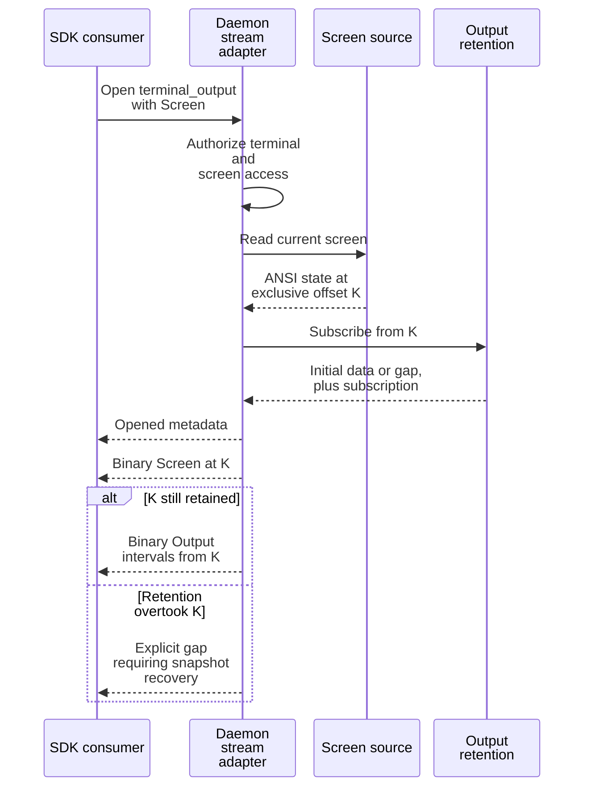
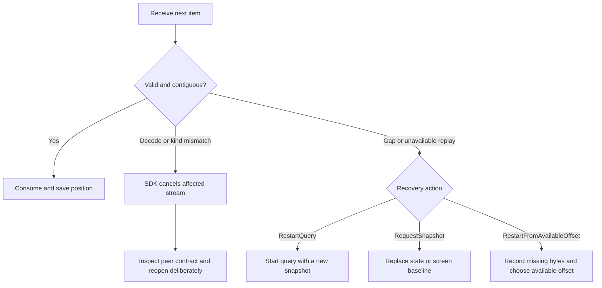

# Consume streams and retained output without losing position

Use this guide to keep a local view or terminal transcript consistent across
bounded reads, reconnection, and retention gaps. It targets the current Rust
protocol and SDK. You need an authenticated, connected product client and access
to the selected session/query. The protocol crate itself owns no subscription,
retention queue, connection, or background thread.

The owning shapes are [ProductStreamSpec and output DTOs](../../../crates/undercurrent-protocol/src/dto.rs),
[terminal.rs](../../../crates/undercurrent-protocol/src/terminal.rs), and the [stream registry](../../../crates/undercurrent-protocol/src/registry.rs).
The [SDK subscription implementation](../../../crates/undercurrent-sdk/src/product/subscription.rs)
handles stream-kind checking and recovery envelopes. A product JSON codec alone
cannot decode a transport gap or correlate a stream.

For a bounded transcript, start with [finite terminal pages](#read-finite-terminal-pages).
For a live view, [select a stream](#select-the-right-stream) and use the appropriate
checkpoint. Wire adapter authors can jump to the [binary layout](#binary-terminal-layout).

## Select the right stream

| Stream, specification, and items | Position and recovery |
| --- | --- |
| `session_watch` `SessionWatchSpec` wraps a list query; initial `SessionSnapshot`, then `SessionDeltaBatch`. | Catalog revisions plus authoritative page order; restart the query after a discontinuity. |
| `session_events` Session IDs and event-kind filters; `SessionEvent` items. | Global event sequence in the bounded journal; optional `after_sequence` is last consumed. Absence starts at journal head without retained replay. |
| `terminal_output` Exactly one session with an initial mode; binary Output or Screen items. | Session-relative byte offsets; resume at consumed exclusive end, or request a replacement screen. |
| `agent_events` Full caller/provider/attempt/recovery/fence binding; `AgentEvent` items. | Durable agent sequence for that exact attempt; [event exchange](agent-events.md) governs replies and expiry. |

### Open and close a subscription

1. Open through `ProductClient::open_subscription` and inspect `metadata`: kind,
   initial stream-local sequence, resumable flag, and optional available position.
   A rejected activation uses `ProductStreamError` with a stream kind.
2. Install the stream's baseline, then consume items and save the appropriate
   [position](#four-kinds-of-position). Successful activation permits delivery;
   it does not prove retained history is complete.
3. On a discontinuity, follow the supplied [recovery action](#recover-and-verify).
   When finished or exiting early, cancel/close the subscription as described below.

The Rust SDK `recv()` blocks across recovery; `recv_timeout(Duration)` imposes
one caller wait deadline. Cloned clients and subscriptions share one resilient
connection.

`subscription.cancel()` wakes receivers and cancels only that stream;
`close(self)` closes its handle. `ProductClient::close()` closes the shared
connection and stops recovery. None of these actions is a session stop.

In Python, use the async iterators and `aclosing` pattern in
[Python output/subscriptions](../../sdk/python/streams.md)
when exiting early. Python's bridge and Rust's stream handle are different APIs.

### Four kinds of position

| Position | What it tracks | Discontinuity |
| --- | --- | --- |
| SDK stream-local sequence | Items delivered on one logical stream | Transport gap or replay unavailable |
| Global session-event sequence | Published journal position, shared across event filters | `EventGapDto` for missing journal history |
| Catalog revision | A watched query's state baseline | Restart the query and replace its snapshot |
| Terminal byte offset | Bytes within one session's output source | Terminal `Gap` for missing bytes |

A screen checkpoint is an opaque client-scoped baseline, separate from these
numbers. A server epoch change can invalidate transport replay. The current
[daemon composition](../../../crates/undercurrent-daemon/src/composition.rs) supplies a
bounded **in-memory** session-event journal fed from durable outbox events;
publication can lag commits and restart can discard published history. A saved
global sequence identifies a position, not a promise of replay after restart.

### Apply a session watch

1. Install the initial snapshot as the baseline.
2. Apply each coalesced batch's added/updated/removed deltas.
3. Apply its **complete authoritative `order`** and optional total, even when
   the delta list is empty.
4. Replace the view after a revision discontinuity or gap.

Watches are coalesced state views. Use the event feed when intermediate changes
matter, while respecting its journal retention limits.
The 16 [event kinds](../../../crates/undercurrent-protocol/src/registry.rs) cover creation, rename, configuration,
removal, lifecycle, ownership, foreground/evidence, health/evidence, work,
restart scheduling/cancellation/state/exhaustion, and resize. They do not carry
terminal output. Event-time observations are versioned snapshots, not current
session state reconstructed later; request them explicitly on finite event reads.

## Read finite terminal pages

For a lossless bounded read, send `ReadTerminalOutputRequest` with a saved byte
position and an accepted positive `max_bytes`. Start with **32768** under the
standard configuration and check the [encoded response budget](#budget-the-encoded-response)
when limits differ. Match both result variants:

1. On `Data`, verify `payload_digest_sha256` against exactly `bytes` with
   `verify_execution_output_payload_digest`. Check that the returned interval
   is the one your consumer expects before appending it.
2. Consume `[from_offset, to_offset)` and save **`to_offset`** as the next read's
   `from_offset`. `next_offset` is the source's exclusive end at extraction time,
   which can be beyond this bounded page. While `has_more` is true, continue
   paging from the consumed end.
3. An empty page at the current end is valid. It is not an EOF or process-exit
   notification. Lifecycle and process results are separate.
4. On `Gap`, record that `[requested_offset, available_from)` is unavailable.
   Follow the supplied recovery action; deliberately resume at `available_from`
   or acquire a screen snapshot. Never silently join pre-gap and post-gap bytes
   into a supposedly complete transcript.

For example, a page can deliver offsets 0–3 with `next_offset = 9` and
`has_more = true`. The next request starts at **3**. The
[daemon presentation mapping](../../../crates/undercurrent-daemon/src/presentation/feed.rs)
preserves these distinct positions from
[OutputReplay](../../../crates/undercurrent-application/src/terminal_output.rs).
The current [Python client](../../../python/src/undercurrent/client.py) omits
`to_offset`; its maintained [output examples](../../sdk/python/streams.md#read-retained-output)
validate the page and compute the delivered end as
`page.from_offset + len(page.data)`.

The finite mapping currently emits a digest and `truncation: None` for ordinary
bounded retained pages. Pagination/`has_more` describes that bound; optional
`OutputTruncationDto` supports explicit source/delivered-size evidence in
contracts that use it. Missing truncation metadata does not prove all session
history was delivered. A request beyond the current end is a future-offset
error, not an empty read that advances the stream.

### Budget the encoded response

`max_bytes` bounds raw terminal bytes. The product codec's response limit bounds
the **entire encoded JSON response**, including the envelope, offsets, digest,
and metadata. [TerminalOutputPageDto](../../../crates/undercurrent-protocol/src/dto.rs) uses `Vec<u8>`, serialized
as decimal integers in an array, not base64. For example, 65,536 `x` bytes alone
encode to 262,145 bytes (`[120,120,...]`), before the envelope. The standard
`requests.response_bytes = 5242880` in
[configuration defaults](../../../crates/undercurrent-config/src/document.rs)
and the standalone SDK's matching response codec cover this expansion, including
full screen history and the default 1 MiB retained-output page allowance.

The Python SDK's `read_output` default and the CLI's `cli.logs_max_bytes` default
are both **65536** and fit the default response budget. They are raw-byte bounds.
Use **32768** for smaller pages
(`client.read_output(..., max_bytes=32768)` or `uc logs NAME --max-bytes 32768`).
Use a smaller value when custom lower limits or envelope overhead require it;
32768 is not a universal negotiated maximum. Raising the bridge line ceiling or
changing CLI output format does not enlarge the product response budget.

[ProductCodec](../../../crates/undercurrent-protocol/src/codec.rs) rejects oversized encoded responses. The current
[daemon fallback](../../../crates/undercurrent-daemon/src/dispatch.rs) converts an encoding
failure to a generic `Internal` response. For this read-only operation, reduce
the page bound and read again from the same unconsumed offset. Retention can
advance meanwhile, so still handle an explicit gap. An increased page bound
also does not fix the CLI's [follow seed continuity limitation](../cli-output.md#read-retained-output-without-assuming-complete-history).

## Seed a live terminal view

`TerminalInitialModeDto` selects `None` (live from current end), `Tail { max_bytes }`,
`Screen`, or `Resume { after_offset }`.

Despite the name, `after_offset` is the
next unread exclusive checkpoint and is used directly; do not add one.

`Screen` first supplies the complete ANSI rendering at its exact output offset,
then output following that offset. A screen is current display state, not the
complete historical byte transcript. Opaque capture does not maintain this
terminal interpretation.

This sequence shows the checkpoint boundary and its retention failure branch.

*The screen and output are joined by a byte checkpoint; retention can still
expire between capture and delivery. This flow has no durable output commit.*
The adapter queues the screen before initial replay and then polls its output
subscription; see [OutputSource](../../../crates/undercurrent-daemon/src/application_adapter/streams.rs).
Raw retention is bounded separately from transport replay. Do not infer durable
transcript storage from durable session events or from a live subscription.

### Apply finite screen updates

1. Save the snapshot's returned `checkpoint` and pass it to `read_terminal_screen_diff`.
2. On `Diff`, apply the ANSI patch only to its own baseline and retain the new
   checkpoint. Its byte length is not the raw-output offset advance.
3. On `Snapshot`, replace the baseline entirely. An expired or incompatible
   checkpoint requires a fresh screen.

## Binary terminal layout

`TerminalOutputCodec` owns this layout; it is a product payload **inside** a
transport frame, not UCMP itself. All integer fields are unsigned big-endian.
Offsets below are byte indices in one complete encoded item.

| Field | Output kind 1 | Screen kind 2 |
| --- | --- | --- |
| Magic | Bytes 0–3: ASCII `UCTO` | Same |
| Kind | Byte 4: `1` | Byte 4: `2` |
| Offset | Bytes 5–12: start offset, u64 | Bytes 5–12: screen's exclusive output checkpoint, u64 |
| Geometry | Absent | Columns at 13–14, rows 15–16, cursor row 17–18, cursor column 19–20; each u16 |
| Flags | Absent | Byte 21: bit 0 cursor visible, bit 1 alternate screen; other bits rejected |
| Raw length | Bytes 13–16: u32 | Bytes 22–25: u32 |
| Raw bytes | From byte 17 | From byte 26, complete ANSI rendering |

### Validate a binary item

| Check | Rule |
| --- | --- |
| Codec raw-data limit | Nonzero and representable as `u32`. |
| Item length | Empty data is permitted; declared length must exactly equal remaining bytes and fit the raw-data limit. |
| Output interval | `start_offset + length` must fit `u64`. |
| Screen geometry | Nonzero dimensions and an in-grid, zero-based cursor. |
| Framing | Unknown kinds, bad magic, truncation, extra bytes, and invalid flags are rejected. |
| Complete item budget | Add the 17-byte output or 26-byte screen header **on top of** the raw-data limit. |

`decode()` accepts only Output; use `decode_item()` when a stream may seed a Screen.

### Allocation and integrity boundaries

Chunks retain `Arc<[u8]>` allocations. Constructors do not impose the codec's
byte limit, and `TerminalOutputChunk::end_offset()` can be `None` before validation.

The hidden `encode_output_parts` seam accepts ordered borrowed slices, checks
their sum against the declared length, and produces byte-identical encoding.
It still allocates the encoded output; it avoids joining source slices first.

Binary items do not embed a digest. Finite output pages and inline execution
output do; their integrity helpers do not add authentication to the transport.

## Command output

`ExecutionOutputDto` describes bounded `Inline`, immutable `ContentReference`,
or logical `Stream` output. Inline carries raw bytes, their exact digest, and
optional source/delivered truncation counts. A content reference carries opaque
URI, complete size, and digest; resolution requires the daemon's configured
content adapter. A stream carries its ID and available/current byte bounds.
These are representations, not a promise that every execution adapter emits or
can fetch every variant. Inspect the selected adapter and returned variant.

`ExecuteInSessionResultDto` separates stdout and stderr and includes attempt
certainty and optional portable exit code. An inline digest proves byte integrity,
not that output was untruncated or that a command succeeded. Preserve any
truncation evidence and interpret success using the owning application's contract.

## Recover and verify

This decision tree applies to a reader with a saved checkpoint.

*Reconnection can restore delivery; it cannot recreate evicted history.* Verify
success by checking contiguous byte intervals, appropriate revisions or event
sequences, and output digests. Avoid asserting global contiguity from filtered
event IDs alone. Cleanup is the subscription close/cancel call, not a daemon or
session shutdown. For ambiguity in a finite **mutation**, follow
[attempt recovery](recovery.md) instead of this stream procedure.

Relevant evidence includes [binary/stream contract tests](../../../crates/undercurrent-protocol/tests/protocol_contract.rs),
[terminal retention tests](../../../crates/undercurrent-application/tests/terminal_output.rs),
[screen tests](../../../crates/undercurrent-application/tests/terminal_screen.rs), and
[event feed tests](../../../crates/undercurrent-application/tests/event_feed.rs).
