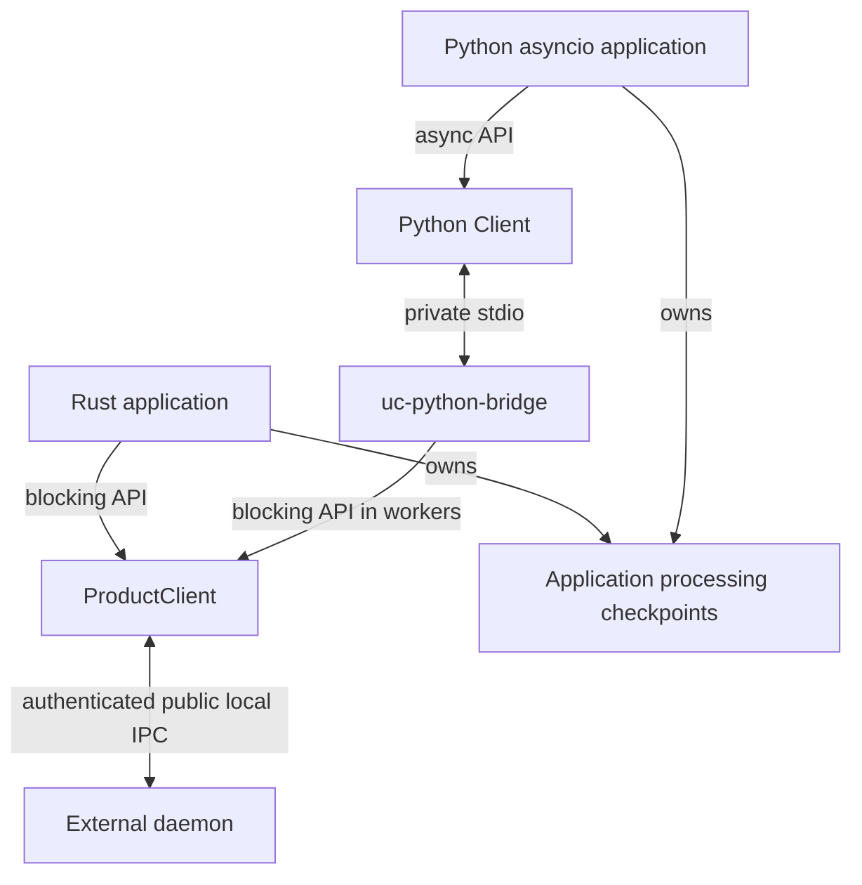

# Choose the supported SDK boundary

Integrate with an already-running external daemon through the public client
API. The daemon owns sessions and runtime effects; the client owns connection
resources and its application's processing checkpoints. No SDK starts the
daemon implicitly or offers an embedded runtime.

| Decision | Rust | Python |
| --- | --- | --- |
| Package in this checkout | `undercurrent-sdk` 0.1.0-beta plus `undercurrent-protocol` 0.1.0-beta | Distribution `aixand-undercurrent-sdk` 0.1.0b0, import `undercurrent` |
| Execution model | Blocking calls and receives; cheaply cloned shared client | Asyncio coroutines and generators on one event loop |
| Connection setup | Explicit absolute endpoint and client profile | Home plus matching `uc-python-bridge` executable |
| Scope | Full typed finite operation and logical stream contract | Focused start/list/inspect/input/stop, output reads, watch/events, and state waits |
| Sharing | Clones share one connection/recovery supervisor; one consumer per subscription | Tasks share one client/bridge, bounded pending calls and serialized writes |
| Close | Releases client resources; does not stop sessions | Closes bridge/connection; does not stop sessions |
| Recovery | Reconnects and attempts stream resume; never automatically replays finite mutations | Rust recovery while bridge lives; failed bridge requires a new Python client |
| First task | [Connect and query from Rust](rust/README.md) | [Verify an input round trip from Python](python/README.md) |

Rust needs the repository's pinned Rust 1.95.0 toolchain and native dependencies
for source builds. Python needs 3.11+ and separately built matching executables;
pip installation does not provide them. Use [installation](../getting-started/installation.md)
and [platform scope](../reference/platforms.md), keeping native Rust support
separate from Python live-integration qualification.

This comparison concerns client boundaries, not runtime ownership changes.

*Takeaway: Python changes the calling model through a client adapter; it does
not move daemon state into the Python process.* Private bridge messages and
private process-host IPC are not additional public product protocols.

Start with [lifecycle and identities](../architecture/lifecycle.md), then use the
language-specific guide. Every integration that mutates or consumes streams
also needs [recovery and cancellation](recovery.md). Exact DTOs, registries,
schemas, and generated API documentation are indexed in
[protocol reference](../reference/protocol/README.md), keeping symbol inventories in
their owning source/generated documentation.

Only SDK and protocol are supported external Rust library surfaces under
[architecture policy](../../tests/architecture/allowed-graph.json). Runtime,
store, daemon, and application crates remain internal even where symbols are
public. External workflow/identity/credential adapters remain their callers'
responsibility; no first-party application integration should be inferred from
a leftover directory or historical plan.

[Documentation index](../README.md)
