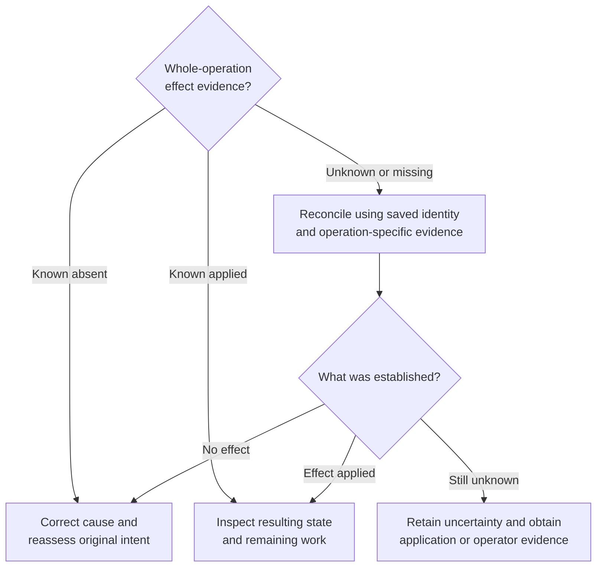

# Recover connections and reconcile uncertain effects

Use this guide when a Python SDK 0.1.0-beta call fails, times out, or is cancelled.
Keep the runtime home, stable session ID, intended operation, and any caller-owned
delivery ID available. An unavailable connection says nothing by itself about
whether a process started, input was written, or a stop took effect.

## Choose the next action

1. Save the call context before closing anything: runtime home, session ID or
   unique start name, intended operation, delivery ID, and any structured error
   fields. Use [exception fields](#classify-the-failure) to interpret them.
2. [Restore access](#restore-access-to-the-same-runtime) if the bridge failed.
3. Repeat a read only with its snapshot or retention-gap handling. For a mutation,
   use the effect evidence below and [the operation's recovery steps](#reconcile-a-mutation).

Correct local validation errors before resubmitting. For a mutation whose
response is missing, use this decision tree after restoring access if needed.



*Restoring a connection is a prerequisite for investigation, not permission to
repeat a mutation.* A `known_applied` operation can still have failed subsequent
bookkeeping; it is not necessarily a successful application task.

## Restore access to the same runtime

1. Check the selected `client.home`, executable path, and daemon status. Set
   `UNDERCURRENT_HOME` to that exact home, then run:

   ```sh
   uc daemon status
   ```

   If the daemon is intentionally stopped, an operator can explicitly run
   `uc daemon start`. Use matching binaries, the same local user,
   and the same home. Keep socket files and the database intact during recovery.
2. Save the failed client's `connection_options`, close that instance, and
   construct `Client(**saved_options)`. Enter it with `async with` so the new
   bridge is closed when your investigation finishes. This starts a bridge;
   daemon startup remains explicit.
3. Read `await client.inspect(saved_session_id)`, or
   `await client.list(name=saved_unique_name)` if start lost its response.
   A successful read confirms access. A name lookup returns a list: check the
   intended labels and identity before choosing an ID. Never redirect pending
   input to a session merely because it reused an old name.

While a healthy bridge is running, its Rust client manages bounded physical
reconnection and stream resumption. A bridge reader failure is different:
Python latches the error permanently. `connect()` on that instance will raise
again. A failed ready handshake closes the instance too. A missing executable
before process creation does not latch this failure, but constructing a fresh
client after correcting setup is straightforward.

## Reconcile a mutation

### Start

1. Before calling `start`, save a unique name, run label, and intended launch.
   Save the stable ID immediately on success.
2. If the response is lost, list by the saved name/labels and inspect the ID.
   Check that the result belongs to the intended run.
3. Establish the original request's disposition before deciding to start again.
   An empty list is only a current observation while that request may still be
   executing. Repeating with an autogenerated name can create another process.

An ordinary Python start carries no pinned dispatch or attempt metadata. Its
`idempotency_key` has only the [bounded cache behavior below](#limits-of-duplicate-suppression).

### Input or key delivery

1. Before sending, save the exact session ID, `delivery_id`, input items
   (including paste and Enter choices), and observation policy.
2. After an uncertain result, inspect application acknowledgments and
   [retained output](streams.md#read-retained-output). Python has no delivery-status query.
3. Consider a same-ID retry only under the retained delivery contract below.
   Completed delivery can return `duplicate=True` without another write.
   An ambiguous reservation/write refuses duplication; changed input under the
   same ID is rejected. Do not evade either protection with a new ID.

Deduplication happens **after** revision, lifecycle, process, and profile checks.
An exact retry with an old `expected_revision` can fail before returning the
retained receipt; a process that stopped can fail its lifecycle check. Keep those
guards while reconciling the original effect. Removing them to obtain a receipt
would change the conditions under which another write could be admitted.

### Stop

1. Inspect the same stable ID. A terminal lifecycle means that process ended.
   A separate stop of an already-terminal session is supported without process IO.
2. If it is `stopping` or still live, observe and reconcile the original stop
   against current intent. Choosing a new force request changes the operation.
3. Keep the session record while the outcome is uncertain. Stopping does not
   delete it, and closing your client does not stop the process.

### Limits of duplicate suppression

#### Request-result cache

The daemon has a bounded **in-memory request-result cache**, scoped by
logical client identity and mutation key, with exact request-byte comparison.
Within that scope and retention window, an exact completed start request can
replay its cached response; an in-progress request or changed payload is rejected.

A generated name changes the request even if you reuse its key. A newly launched
bridge chooses a new client identity, and a daemon restart loses this cache.

Neither its retention window nor original encoded bytes are exposed as Python
recovery handles. This cache therefore does not replace identity reconciliation
or authorize automatic start retries after a failed connection. Its owner is
[daemon dispatch](../../../crates/undercurrent-daemon/src/dispatch.rs), backed by the
[bounded idempotency store](../../../crates/undercurrent-transport-core/src/engine/idempotency.rs).

#### Terminal delivery records

For terminal input, retain the delivery ID and exact original typed input and
observation policy. The daemon commits a private semantic digest before IO and
retains the outcome in SQLite through restart. A delivered replay returns the
original timestamp; an unresolved reservation remains indeterminate, including
when a crash happened before the write. It never authorizes resending input.
Changed input or policy conflicts. Normal lifecycle/revision/ownership checks
still apply before lookup.

Records have no TTL or automatic eviction. Capacity rejects new IDs; terminal
session deletion ends their retention. The first upgrade from the old in-memory
adapter cannot recover its lost records, so do not retry pre-upgrade ambiguous
input on the strength of the new policy. A delivery receipt confirms a terminal
write, not target-application acceptance or command completion. See the
[storage policy](../../../crates/undercurrent-store-sqlite/docs/reference/storage-format.md#semantic-input-delivery-retention).

### Revision rejection

A `revision_precondition_failed` rejection means the guarded operation failed
before mutation/delivery effects. Inspect current state, decide whether the
original action still makes sense, and only then use a current revision for a
new attempt. If the peer did not negotiate revision guards, Rust rejects that
request before transmission; Python retains the client category.

## Deadlines and cancellation

`request_timeout` is not an all-inclusive wall-clock budget. Connection startup
waits for bridge `ready` within that timeout after spawning. Each call first
connects, then waits for one of 16 Python slots and the write lock. Slot waiting and writing are outside the reply timer.

After writing, Python waits up to `request_timeout + 1` seconds for the reply.
The bridge uses `request_timeout` for the Rust request/open operation. Bridge
worker pressure can still reject work after cancelled Python tasks release
their slots.

Wrap a whole operation in `asyncio.timeout(total_seconds)` if you need an overall
caller budget. For `wait`/`wait_for_stability`, the helper already supplies such
an overall timeout covering event reads, watch updates, and inspections. Cleanup
may take additional time. A deadline does not make a partially executed mutation
safe to retry.

| Cancellation boundary | Effect |
| --- | --- |
| Python finite task | Removes its local pending future. There is no private bridge command cancelling that finite Rust request; the worker may finish and its late response is ignored. |
| Python wait helper | Cancels its next-item task and closes its logical watch; it does not stop the runtime process. Peer work has the close-pressure caveat below. |
| `aclose()` on `watch`/`events` | Removes the local queue and attempts `unsubscribe`; the bridge cancels that logical subscription and joins its worker. No process stop occurs. |
| `Client.close()` | Tears down the bridge/shared connection, affecting all its calls and streams. It is not a graceful drain of your application tasks or session shutdown. |
| `stop()` | Explicit process termination operation; unrelated to cancellation of a request or subscription. |
| Runtime-attempt cancellation | A separate attached-runtime product contract supported by Rust, not exposed by Python 0.1.0. |

Peers normally remain active after a logical close. If the bridge's Rust SDK
cannot enqueue `CloseStream`, it closes the shared physical connection; peer
calls and streams then follow normal failure/recovery. See the owning
[close-pressure explanation](../rust/streams-and-recovery.md#close-pressure-can-affect-peers).

## Classify the failure

Python's public exception definitions live in
[`errors.py`](../../../python/src/undercurrent/errors.py). The bridge maps Rust
[`ProductClientError`](../../../crates/undercurrent-sdk/src/product/error.rs) into
`UndercurrentError` with a message and optional fields. Compare structured fields
when available rather than parsing message text.

### Python exceptions

- **`ValueError`, `TypeError`**: Local argument validation, such as invalid wait conditions, durations, command form, or input type. Some invalid values instead reach bridge/product validation.
- **Built-in `TimeoutError`**: Python ready handshake, reply wait, wait-helper deadline, or caller's outer timeout expired. Effects are not rolled back.
- **`asyncio.CancelledError`**: The Python task was cancelled. It is not an `UndercurrentError` and is not caught by `except Exception` on Python 3.11.
- **`SessionEnded`**: Wait encountered a terminal snapshot incompatible with its predicate; `.session` retains the snapshot.
- **`SessionRemoved`**: Watch saw the exact ID absent or removed; it has no extra fields. Not every `not_found` error is converted to this subclass.
- **`OutputGap`**: Output retention loss; `.available_from` is the first available offset. Follow [output gap handling](streams.md#read-retained-output).

### Structured error fields

#### `UndercurrentError.category`

Bridge/Rust category using Rust Debug spelling: `InvalidArgument`, `Unavailable`, `Overloaded`, `Timeout`, `Cancelled`, `ServerRejected`, or `ProtocolViolation`. Python-generated errors can leave it `None`.

#### `product_category`

Optional exact snake-case daemon category, such as `not_found`, `revision_precondition_failed`, `name_conflict`, or `failed_precondition`.

#### `disposition`

Optional exact daemon disposition, such as `semantic_rejection`, `access_rejected`, `runtime_failure`, `infrastructure_failure`, or `unknown_inconclusive`. Do not infer a missing value from category.

#### `effect_certainty`

Optional whole-operation evidence: `known_absent`, `known_applied`, or `unknown`. Absence is not evidence of no effect. The bridge supplies it for finite server errors, not arbitrary transport failures.

The authoritative complete daemon taxonomies are the
[product registry](../../../crates/undercurrent-protocol/src/registry.rs) and
[effect-certainty contract](../../../crates/undercurrent-protocol/src/contract.rs).
The bridge does not expose the full product error, retryable flag, retry delay,
operation, or target ID as Python attributes. Retain your own call context.
A typed `ServerRejected` error can describe an infrastructure failure after an
effect, so that category alone cannot authorize a retry. The SDK also permits
ordinary subprocess/IO exceptions to escape some connection and write paths.

## Common symptoms

| Symptom | Next action |
| --- | --- |
| `uc-python-bridge was not found` | Set an absolute executable path, or fix `PATH`; pip does not install it. |
| Startup `Unavailable` or handshake timeout | Check same home/user, daemon status, bridge execution permission, and matching revision. Bridge stderr is discarded by Python; daemon diagnostics and the structured exception are the available evidence. |
| `Invalid product request` / `InvalidArgument` | Check argument types, key DTO shape, supported options, and encoded payload size. Domain validation still applies after Python accepts an argument. |
| `Overloaded` / `capacity_exceeded` | Bound caller concurrency and close unused subscriptions; cancelled finite workers may still occupy bridge slots. |
| `cursor_expired` from `list` | Start a fresh read query and discard the failed partial traversal. |
| Readiness timeout | Inspect independent axes, detection/profile, revision floor, and application evidence; use [wait diagnostics](state.md#diagnose-a-wait-and-release-its-resources). |
| Gap or `resynchronized=True` | Restore current state explicitly and invalidate continuity; a snapshot does not restore missing history. |
| Digest mismatch or operation mismatch | Do not trust that response or advance checkpoints; check binary compatibility and investigate the protocol fault. |

Cleanup is successful only when your intended process termination is confirmed
and your iterators/client are closed. Retain records while effects remain
uncertain. The [isolated tutorial](quickstart.md#4-handle-failures-and-clean-up)
shows process, daemon, and file cleanup as distinct steps. Return to the
[Python entry point](../../../python/README.md).
