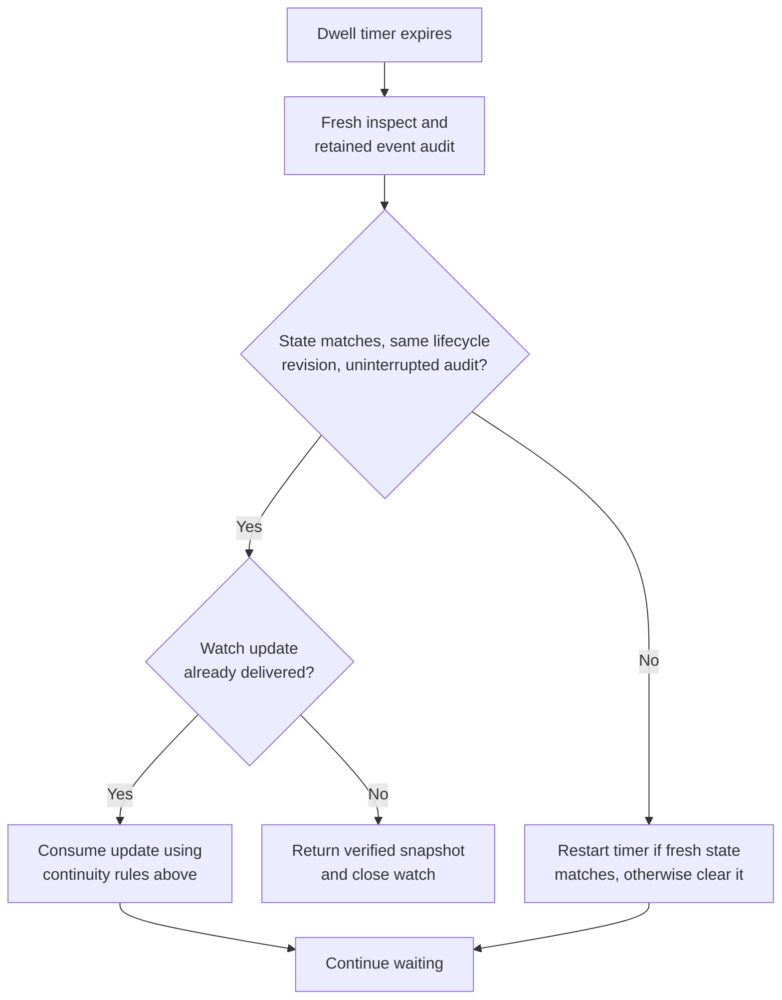

# Wait for observed state without inferring task success

Use Python SDK 0.1.0-beta's waits to coordinate against observed lifecycle and
foreground conditions. They require a connected daemon and an existing stable
session ID; see [setup](quickstart.md) and [session selection](operations.md#start-and-identify-a-process).
A session is a durable identity; its current process and observations can change.
A revision orders changes to that session, not application messages or wall time.

## Run a bounded wait

From the repository root after setup, replace `SESSION_ID` with your existing
session's ID. The maintained [wait_state.py](../../../python/examples/wait_state.py) leaves
the process running and closes its watch and client on success or failure:

```sh
python python/examples/wait_state.py SESSION_ID \
  --condition lifecycle=running --condition interaction=available \
  --stable-for 2 --timeout 30
```

Success prints the observed ID, revision, and all five axes. Failure propagates
its exception and a nonzero exit; see [wait diagnostics](#diagnose-a-wait-and-release-its-resources).

| To wait for… | Change the example to… |
| --- | --- |
| Termination, including when no profile classifies input availability | `--condition lifecycle=stopped,exited,failed` in place of both conditions |
| The first match | `--stable-for 0` |
| A match at or above a saved revision | Add `--after-revision REVISION`, replacing `REVISION` with your receipt or snapshot revision |

## Choose state axes

The accepted condition vocabulary is owned by `STATES` in
[`client.py`](../../../python/src/undercurrent/client.py) and corresponds to the
[state DTOs](../../../crates/undercurrent-protocol/src/dto.rs).

| Axis and accepted strings | What the observation establishes |
| --- | --- |
| **`lifecycle`**: `starting`, `running`, `stopping`, `stopped`, `exited`, `failed` | Runtime lifecycle; `stopped`, `exited`, and `failed` are terminal to these Python waits. |
| **`execution`**: `active`, `quiescent`, `unknown` | Best-effort foreground activity, not task completion. |
| **`interaction`**: `none`, `available`, `requested` | Mechanical input availability or an interaction request, not semantic acceptance of prior input. |
| **`constraint`**: `clear`, `present` | Whether a profile-owned runtime constraint is observed. |
| **`health`**: `healthy`, `unhealthy`, `unknown`, `no_check` | Independent configured health result; `no_check` does not mean healthy. |

The axes are independent. A running process can have unknown execution state,
an available input surface, and no health check. Do not replace `unknown` with
`quiescent` in business logic. Detection is sampled, depends on the effective
profile and evidence, and cannot prove that no transition occurred between
samples. `Session.raw` retains provenance and timestamps in the observation
basis; the convenience properties return only the state strings.

## Choose a predicate and deadline

`await client.wait(session, timeout=300.0, after_revision=None, **conditions)`
returns the first matching observation. `wait_for_stability` has the same
conditions and defaults, adding `stable_for=2.0`. It requires an observed dwell
of that duration. `wait` is implemented as `stable_for=0`.

Pass at least one axis. A string is one accepted value; an iterable of allowed
strings means **OR within that axis**. Different axes combine with **AND**.
For example, `lifecycle=("starting", "running"), interaction="available"`
requires both predicates.

Unknown axes, empty value sets, and unknown states fail
with `ValueError` before IO.

Durations must be finite numbers excluding bools;
`timeout` must be positive and `stable_for` can be zero. These wait durations
have no 300-second ceiling; the separate client request timeout does.

`after_revision` must be a nonnegative integer, excluding bools. It is an
**inclusive floor** (`current.revision >= after_revision`), not a demand for a
strictly later change.

Use `receipt.foreground_revision` when present to exclude
older pre-input observations. `None`, including from a duplicate input receipt,
imposes no floor. A floor alone cannot prove the application accepted input.
For a complete example that checks an application acknowledgment, run the
[input round trip](../../../python/examples/input_roundtrip.py).

If a terminal snapshot does not match the state predicate, the wait immediately
raises `SessionEnded` with that snapshot. Matching terminal predicates are
allowed: `lifecycle=("stopped", "exited", "failed")` waits for termination.

The terminal check precedes the revision-floor test, so a terminal state matching the
predicate but below the floor can wait until timeout. Terminal here describes
the observed process outcome; a separate actor using the Rust/CLI API may later
restart the session.

## How the stability timer works

A **dwell** is the interval for which this wait has observed matching state.
For `stable_for=0`, `wait()` returns its matching watch snapshot immediately.
For a nonzero dwell, Python first reads an event-tail checkpoint, then opens the
watch and tracks continuity:

| Watch evidence | Effect on the dwell |
| --- | --- |
| First matching observation | Start the timer at observation time. |
| Predicate or inclusive revision floor fails | Clear the timer and wait for another match. |
| Replacement snapshot, watch gap, or changed `lifecycle_revision` | Reset continuity; start a new timer only if the new snapshot matches. |
| Unrelated aggregate revision or evidence refresh still matching | Keep the timer. |

This diagram focuses on the extra evidence required **after a nonzero timer
expires**. It describes Python's wait algorithm, not runtime lifecycle states.



*Elapsed time alone cannot satisfy a stability wait.* A delivered update must
be evaluated before returning; it does not unconditionally reset the timer.
Failures, timeout, and cancellation also close the watch without stopping the
managed session.

When the timer expires, `inspect()` reads current state and `_audit_stability`
reads retained event pages after the saved checkpoint. It checks observations
newer than the dwell's starting revision, looking for predicate contradictions,
lifecycle revision changes, missing event-time observations, and retention gaps.
Any such uncertainty prevents success for that dwell. A paginated replay that
fails to advance its checkpoint raises `UndercurrentError` instead of looping.
An already-delivered watch update is consumed before a successful return.

These checks close the common hole where a coalesced watch omits a brief
away-and-back transition. They are separate reads, not an atomic transaction or
a promise that the process remains ready after return. `wait()` performs neither
the event audit nor the final fresh inspection.

The daemon serves these event reads from a bounded in-memory publication journal
fed by durable outbox events. The audit sees retained published observations;
it is not a synchronous read of every durable commit, and publication can lag.
It cannot certify unpublished transitions or reconstruct history lost on daemon
restart. See the [event publication path](../../../crates/undercurrent-application/docs/internals/recovery/events-and-outbox.md).

## Diagnose a wait and release its resources

If readiness never matches, inspect each axis independently and check the
selected profile, detection setting, revision floor, and the actual application
screen. A program with detection disabled may never produce your desired
foreground predicate. Use lifecycle for process supervision and an
application-specific acknowledgment for task success.

An outer wait deadline raises built-in `TimeoutError`; a bridge request may
instead raise `UndercurrentError(category="Timeout")`. Removal from a watched
snapshot/delta raises `SessionRemoved`; failure of a gap-triggered inspect can
instead be a server `not_found` error. Task cancellation raises
`asyncio.CancelledError`. The wait cancels its outstanding `anext` task and
closes its stream without stopping the session. Peer waits normally continue,
subject to the shared-connection [close-pressure caveat](../rust/streams-and-recovery.md#close-pressure-can-affect-peers).
See [deadlines and cancellation](recovery.md#deadlines-and-cancellation).

The [wait tests](../../../python/tests/test_wait.py) cover transient contradictions, coalesced
transitions, evidence refresh, gaps, inclusive revision floors, terminal states,
disconnection, and cleanup. Continue with [streams](streams.md) or return to the
[Python entry point](../../../python/README.md).
