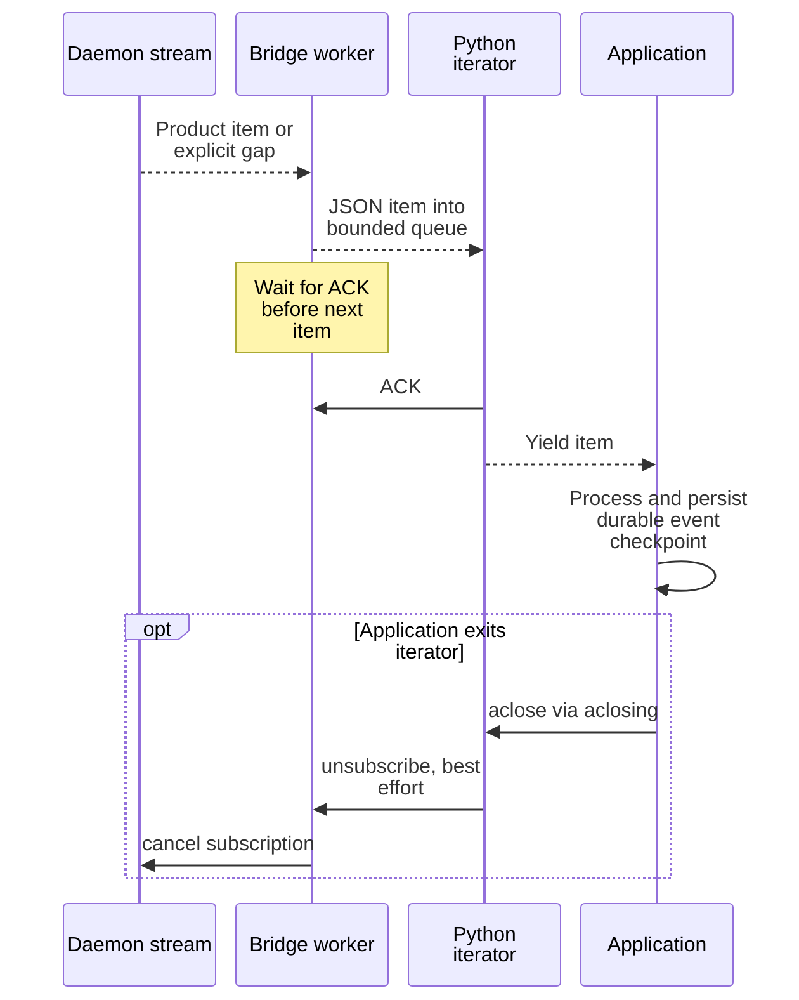

# Read output and consume bounded subscriptions

Use this guide with Python SDK 0.1.0-beta after [connecting](quickstart.md). All targets
are stable session IDs or `Session` snapshots. Output bytes, current screens,
query updates, and durable session events answer different questions; none is
an application-level result protocol.

| Need | Use | Saved position |
| --- | --- | --- |
| Copy terminal bytes | [Retained output](#read-retained-output) | Exclusive end of bytes actually copied |
| Read the current display | [Screen snapshot](#read-the-current-screen) | No checkpoint exposed by Python |
| Track current summary | [Watch](#watch-the-current-session-summary) | Reset continuity on resynchronization |
| Process published events | [Session events](#consume-durable-session-events) | Durable global event sequence after application processing |

## Read retained output

The maintained [read_output.py](../../../python/examples/read_output.py) copies bytes to
stdout and prints checkpoints on stderr. Run from the **repository root** after
[setup](quickstart.md).

### 1. Copy the currently retained output

Replace `SESSION_ID` with an ID in the selected runtime:

```sh
python python/examples/read_output.py SESSION_ID > transcript.bin
```

The file receives raw terminal bytes. Stderr prints `Next byte offset: N`
after each written page; the final `N` is the continuation checkpoint when
the command succeeds. The command exits when it reaches the current output
head, even if the session is still running.

### 2. Continue from the printed checkpoint

To append later output, replace `CHECKPOINT` with that final offset and use
the **same session and destination file**:

```sh
python python/examples/read_output.py SESSION_ID --from-offset CHECKPOINT >> transcript.bin
```

Use `--allow-gap` only if an incomplete capture is acceptable; the example
reports skipped offsets. If either invocation fails after copying some bytes,
use the last checkpoint printed after a written page, not the original offset,
and reconcile the destination before appending. File durability and checkpoint
persistence are the application's responsibility.

Remove the sample file with `rm -f -- transcript.bin` when finished. The example
never stops the session.

### Continue at the end of the returned bytes

`read_output(session, from_offset=0, max_bytes=65536)` returns a bounded
`OutputPage`. Offsets count raw bytes. Continue from
`page.from_offset + len(page.data)`, the exclusive end of the bytes actually
returned. `page.next_offset` is the producer head at that read; a short page
can end earlier. Advancing to the head would skip retained bytes. Request
another page while `has_more` is true. A false value means
there was no further retained output at that read, not that a live process will
never emit more. Poll from the saved offset with an application deadline if you
need later output; Python has no terminal-output subscription method.

The SDK verifies SHA-256 over exactly the returned bytes before exposing the
page. A mismatch raises `UndercurrentError("Output digest mismatch")`; do not
advance your checkpoint using that page. This check verifies payload integrity,
not application truth.

### Choose a page size

Product and runtime bounds still apply when you request large pages; the bridge's configurable line ceiling is not an allowed product payload
size. The SDK default is 65,536 raw bytes. The standard daemon and SDK allow
5 MiB encoded responses, covering the 1 MiB retained-output page allowance and
screen history even though bytes serialize as JSON integer arrays.
The maintained examples request **`max_bytes=32768`** for smaller pages.
Use smaller pages if custom lower response limits or envelope overhead require
them.

If a page cannot be encoded, the current daemon returns a generic `Internal`
error. Retry this read at the same offset with a smaller bound.
See the [encoded page budget](../../reference/protocol/streams.md#budget-the-encoded-response)
for the owning limits and calculation.

### Handle retention gaps and invalid intervals

`OutputGap(available_from)` means the requested prefix is no longer retained.
Decide explicitly whether losing it is acceptable. Resume from `available_from`
only after recording that loss; never concatenate the remainder as if it were
a complete transcript.

The wrapper omits other protocol metadata such as the
page's `to_offset` and optional truncation evidence. For consumers needing that
metadata, the full Rust product interface is the appropriate surface.

The copier and the
[input acknowledgment example](../../../python/examples/input_roundtrip.py) use the same
[interval check](../../../python/examples/_output_interval.py): the returned start must
match the requested offset, the byte interval must not exceed the producer
head, and `has_more` must agree with that interval. An empty page with more
bytes advertised fails instead of looping or skipping data. An empty page
at the head is valid: the copy ends, while the acknowledgment example polls
within its deadline. Validation precedes writing bytes or accepting a marker.

### Decode text across page boundaries

`OutputPage.text()` defaults to UTF-8 with replacement. A multibyte character can
span pages, so decoding each page independently can introduce replacement
characters. Preserve bytes or use an incremental decoder for a textual stream.
Terminal bytes may include ANSI controls; the copy example writes a file rather
than treating the stream as ordinary text.

## Read the current screen

`read_screen(session)` returns the current ANSI screen **as bytes**. It is a
rendered snapshot, not the transcript. Python discards the screen checkpoint,
output offset, dimensions, and cursor metadata and does not expose screen diffs.

The public contracts are `TerminalOutputPageDto`, `TerminalScreenSnapshotDto`,
and the stream DTOs in [dto.rs](../../../crates/undercurrent-protocol/src/dto.rs).
The byte handling and digest check live in [client.py](../../../python/src/undercurrent/client.py).

## Watch the current session summary

`watch(session)` is a lazy async generator for an exact ID. It opens an
operational query watch with page size one. It first yields the matching
snapshot with `resynchronized=True`; ordinary delta summaries yield
`resynchronized=False`. Updates describe current query state and can coalesce
intermediate revisions. They are unsuitable as an exhaustive event log.

A gap causes an `inspect()` read and a resynchronized update. Replacement
snapshots also mark resynchronization. Reset any caller-maintained continuity
assumption when that flag is true.

If a snapshot lacks the target, or a delta removes it, `SessionRemoved` is raised. A gap read can fail as a typed server
error instead. A terminal lifecycle does not by itself end the iterator.

Always use `contextlib.aclosing()` when breaking or cancelling your own iterator.
The complete [observe.py](../../../python/examples/observe.py) example demonstrates this:

```sh
python python/examples/observe.py SESSION_ID --mode watch --timeout 10
```

Expected output prints ID, revision, lifecycle, and resynchronization flags.
Timeout exits the example cleanly, closes the stream and bridge, and leaves the
session running. A stream fault is reported as a failure, not a clean timeout.

## Consume durable session events

`events(session, after_sequence=None)` yields dictionaries rather than model
objects. With `None` it subscribes from the journal head without retained replay.
A saved `after_sequence` asks for events after that **durable global event
sequence**. It is neither a session revision nor a byte offset. Sequence jumps
are normal when filtering to one session; other sessions use the same journal.

Events originate in the durable outbox, but current reads and subscriptions use
a bounded in-memory publication journal. Replay covers its retained published
history, not a complete durable archive; daemon restart and publication lag
limit what is available. See [event publication](../../../crates/undercurrent-application/docs/internals/recovery/events-and-outbox.md).

| Envelope | Payload and required handling |
| --- | --- |
| `{"item": "session_event", "value": {...}}` | Value contains `sequence`, `session_id`, `session_revision`, `kind`, `occurred_at_millis`, and possibly `observation`. Process the event, then persist its durable `sequence` with your application progress. Do not require optional historical observations to exist. |
| `{"item": "gap", "value": {...}}` | Value contains `reason` and `recovery`. Invalidate continuity and reconcile; the bridge does not expose the Rust stream's missing sequence interval or stream ID. |

Gap reason strings are `live_queue_overflow`, `replay_evicted`,
`replay_unavailable`, `server_epoch_changed`, and `source_retention_evicted`.
Recovery values are `request_snapshot`, `restart_query`, and
`restart_from_available_offset`; these are owned by the
[Rust subscription contract](../../../crates/undercurrent-sdk/src/product/subscription.rs).
For session events, an inspection can restore current state but cannot recreate
missing history. An application requiring every event must stop that workflow or
recover missing evidence elsewhere. The observer example exits on an event gap.

```sh
python python/examples/observe.py SESSION_ID --mode events --timeout 10
```

This live observation omits the checkpoint. For replay, replace `SAVED_SEQUENCE`
with a **nonzero** durable sequence from an event your application previously
processed successfully:

```sh
python python/examples/observe.py SESSION_ID --mode events --after-sequence SAVED_SEQUENCE --timeout 10
```

The daemon rejects zero; there is no public “earliest retained history” sentinel.
The example prints events/checkpoints but does not durably process them. Persist
a checkpoint alongside successful application handling and tolerate duplicates
on replay. Do not automatically retry mutations from an event reconnect loop.

## Backpressure and connection recovery

This diagram shows the ordering of delivery across the private bridge. The ACK
releases bridge flow control before your application finishes processing.



*Flow-control acknowledgment is not durable application acknowledgment.* The
bridge allows one unacknowledged item per stream; Python allocates a queue of
two. A queue overflow or malformed bridge message fails the shared reader,
including other pending calls and streams. Slow consumers can also encounter
bounded upstream retention gaps; bounded memory does not promise lossless history.

Release iterators promptly so capacity is returned. For the separate request
and subscription limits, see [connection invariants](../../../python/docs/internals/connection.md#connection-invariants).

While the bridge remains alive, its Rust resilient client can reconnect the
physical daemon connection and resume logical streams using consumed transport
checkpoints. That does not replay finite mutations or persist your application's
checkpoint. If the bridge exits, Python latches a failure, fails pending requests,
discards queued stale observations, and signals every stream. It does not restart
the bridge. Create a fresh client and reopen from saved application state; see
[recovery](recovery.md). Return to the [Python entry point](../../../python/README.md).
