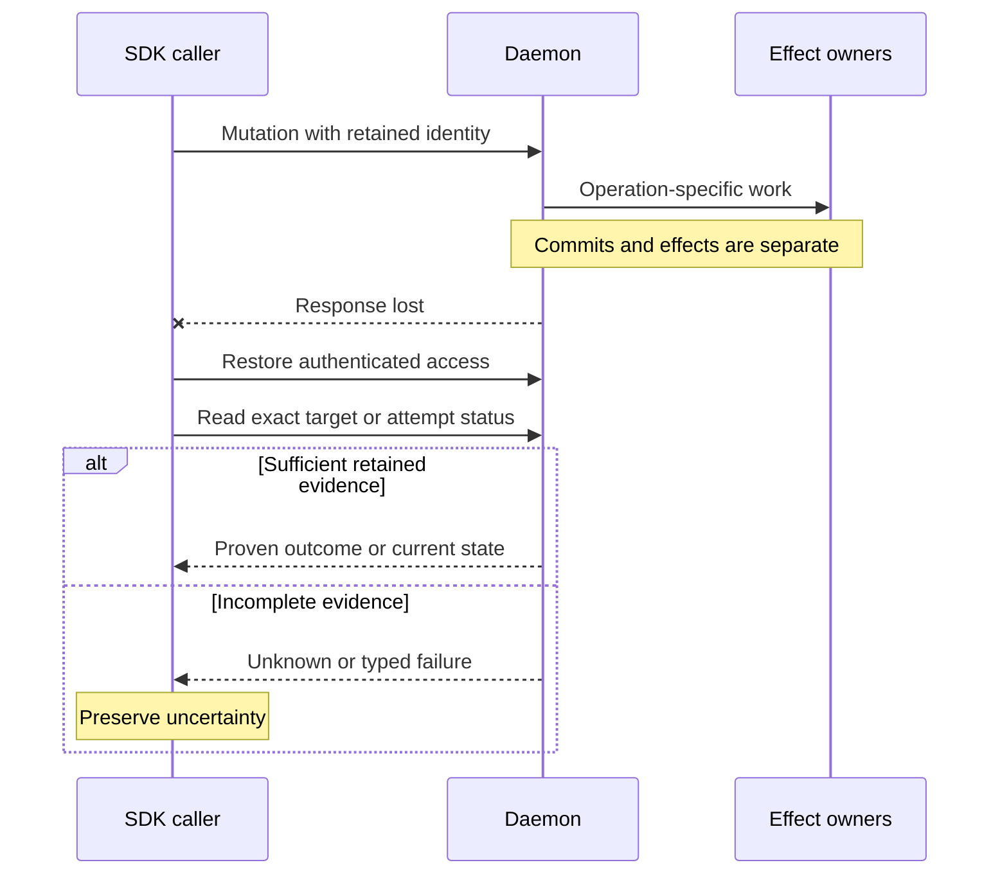

# Recover requests and streams without duplicating effects

Use this guide after a Rust SDK 0.1.0-beta or Python SDK 0.1.0-beta failure. Retain the
original target ID, semantic input, home/endpoint, and any request, delivery,
attempt, or control identity you own. Reconnection restores access; it does
not establish whether a mutation happened.

## Keep identities and evidence separate

| Evidence | What it establishes | What it does not establish |
| --- | --- | --- |
| Transport request ID | Correlation on one physical connection | Durable duplicate suppression or successful effects |
| Client-scoped mutation key | Bounded request-byte/result caching while retained by this daemon | Replay after daemon restart, a new client identity, changed bytes, or expiry |
| Session ID and revision | Exact aggregate and optimistic precondition | A process incarnation or retained mutation response |
| Input delivery ID | Same-session semantic reservation/result retained through daemon restart | Application acknowledgment or permission to retry an indeterminate effect |
| Durable attempt ID/fence/digests | Operation-specific binding and settlement evidence | Universal authorization or permission to rerun an unknown effect |
| Stream sequence | Transport delivery/replay position | Terminal byte offset, durable event position, or committed application processing |

The daemon retains semantic input delivery records in SQLite for the owning
session lifetime. Unresolved outcomes never expire or allow a second write.
Request-result caching is separately bounded and in memory. Durable attached attempts and cancellation controls are
separate ledgers. [Implementation differences](../reference/compatibility.md)
records the implications without promoting them into new contracts.

## Reconcile the mutation

1. Keep the original identity and input. Distinguish rejection proven before
   dispatch, a typed product error, and a missing response or transport failure.
2. Inspect optional `effect_certainty` and disposition independently of category.
   `known_applied` can include failed later bookkeeping; omitted certainty is
   not `known_absent`. Use the [error reference](../reference/errors.md) to
   interpret those fields.
3. Choose the operation-specific evidence below before considering another
   mutation. Generic retry hints do not override its effect contract.

### Choose the evidence for the operation

| Interrupted operation | Reconciliation path |
| --- | --- |
| Ordinary start | Discover the saved unique name/labels, verify the candidate identity, and retain its ID. [Python start recovery](python/recovery.md#start) gives the concrete discovery path. |
| Terminal input | Reconcile application acknowledgments and the exact delivery semantics. A receipt alone does not prove application processing. [Input recovery](python/recovery.md#reconcile-a-mutation). |
| One-shot execution | Inspect the command's external effects. Do not execute again merely to recover output. [Rust operations](rust/operations.md). |
| Session stop | Inspect that exact session and incarnation before deciding whether another action is required. [Session control](../guides/cli/sessions.md). |
| Attached start or runtime cancellation | Use the retained attempt/control binding with the [status operations below](#attached-attempt-and-control-status). |

### Why a lost response leaves uncertainty

This view shows a failure after a durable boundary, not a transaction rollback.

*Loss of the response does not undo earlier work. Restore access, then reconcile
the original operation using evidence specific to its contract.*

### Limits of retained duplicate results

The daemon's request cache compares exact encoded request bytes under client
ID plus mutation key. Pending/conflicting entries reject rather than duplicate.
A new Python bridge creates a new client ID; ordinary CLI invocations generate
fresh keys. Neither provides a general persisted retry handle.

Input duplicate lookup occurs after revision/lifecycle/process/profile
preconditions, so an old revision may reject before a retained receipt is
returned. Do not drop a guard just to obtain a receipt.

### Attached attempt and control status

These operations require retained attached bindings and their own authority;
they are not a recovery API for every ordinary session command.

**Start status.** `GetRuntimeAttemptStatus` reads an exact retained start
binding. Missing is a typed failure, not known absent. The read performs no live
observation, repair, acknowledgment, or redrive.

**Attempt repair.** `RepairOperationAttempt` is an explicitly authorized,
evidence-backed mutation. It is not an ordinary status read.

**Cancellation status.** `GetRuntimeCancellationStatus` reads retained state
using the cancellation's own control ID and binding. Unknown controls are not
automatically redriven.

Runtime cancellation bypasses the general request cache so current authorization
runs before durable replay. Force is separately authorized; a timeout does not
permit upgrading the mode. Follow the complete
[attempt status/repair procedure](../reference/protocol/recovery.md) or
[cancellation procedure](../reference/protocol/cancellation.md) for exact pins
and states. [Application controls](../../crates/undercurrent-application/docs/internals/execution/runtime-controls.md)
explains their failure windows.

## Restore a stream baseline

Rust reconnects the physical connection and attempts to resume live subscriptions
from consumed transport sequence positions. An in-flight finite request stays
with its original connection and fails; it is never replayed by that supervisor.
Python benefits from Rust recovery while its bridge lives. A failed Python
reader/bridge permanently fails that client; a fresh one must reopen interests
from application-owned state.

| Interest | Recovery after a gap |
| --- | --- |
| Session query watch | Discard stale membership/order and obtain a fresh initial snapshot before applying deltas. |
| Terminal view | Obtain a current screen seed/checkpoint for the same stable ID; missing history remains missing. Opaque output has no screen. |
| Raw terminal transcript | Record the missing byte interval, query availability, and resume at an explicitly accepted available offset. |
| Session events | Retain the durable global event sequence separately, inspect current state, and acknowledge that retained publication history may be incomplete after restart/eviction. |
| Attached agent events | Reconcile the exact durable queue and binding; missing tool-event delivery does not mean the tool completed. |

Follow the gap's typed recovery action. Do not apply dependent deltas to a view
already known incomplete. SDK transport consumption and Python bridge ACK happen
before your application durably processes an item, so persist your own cursor
after handling and tolerate duplicates on restart. No SDK delivery ACK supplies
exactly-once application processing.

## Distinguish cancellation and deadlines

| Action | Scope |
| --- | --- |
| Rust pending request `cancel` | Best-effort request cancellation on the original connection; still wait for the correlated terminal response. A normal result may win. |
| Rust receive timeout | Ends that wait, leaving the logical subscription active. |
| Python finite task cancellation | Removes its pending reply; the bridge's Rust work may still finish. |
| Subscription close/cancel/drop | Ends observation and recovery interest, not the managed process. |
| Client close | Ends shared connection/bridge resources, affecting peer calls and streams. |
| Session stop or runtime-attempt cancellation | Explicit product mutation with its own effects and authority. |

Rust response timeouts exclude initial setup and pre-wait work. Python slot and
write-lock waits precede its reply timer; wrap a whole operation in
`asyncio.timeout` when you need a caller-wide budget. Cancellation/cleanup can
take additional time. Use realistic bounded durations and one receiver per
Rust subscription; extreme duration overflow and mutex contention limit strict
wall-clock interpretation in the current implementation.

## Diagnose persistent lack of progress

Slow consumers can fill bounded mailboxes, tear down a shared physical connection,
and affect peer finite calls. Close unused interests, bound processing queues,
and tune compatible limits. Repeated reconnects do not enlarge source retention.
Automatic Rust resume validates product activation responses before installing
streams. Product rejections, malformed responses, and kind mismatches terminate
the affected subscription with a typed error while peers can remain usable.

The writer retries deferred flow credit after physical writes complete, without
requiring another data receive. A blocked transport still prevents progress.
Saturated close queues can close the whole physical connection. These behaviors
and limitations are detailed in the
[Rust stream guide](rust/streams-and-recovery.md).
Use [Python recovery](python/recovery.md) for bridge-specific errors
and [operator troubleshooting](../guides/troubleshooting.md) for local state.

[SDK choices](README.md) · [Error reference](../reference/errors.md)
