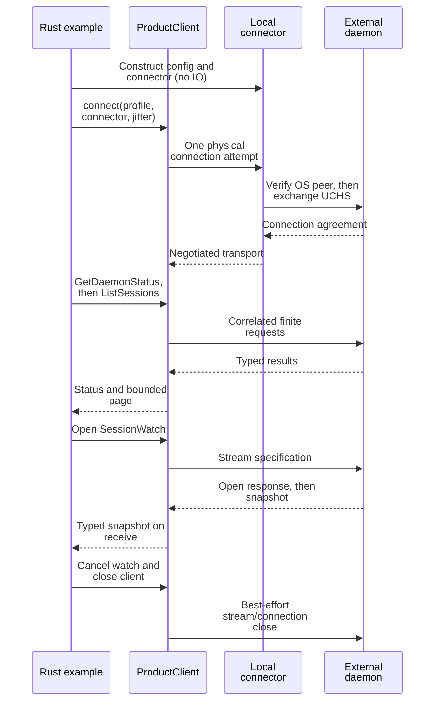

# Connect, query, and watch from Rust

Connect a Rust SDK 0.1.0-beta application to an existing daemon, read a page of sessions,
and consume a query snapshot over the same connection. This tutorial uses the
blocking Rust API. For Python async usage, start with the
[Python package guide](../../../python/README.md).

## Prerequisites

Run the commands below from the **repository root**, the directory containing
`Cargo.toml` and `rust-toolchain.toml`. Have the pinned Rust 1.95.0 toolchain,
platform linker, and this checkout's dependencies available. The
[workspace manifest](../../../Cargo.toml) is the build root; the SDK is not an
independent extracted workspace.

You also need an already running compatible daemon, its configured absolute
endpoint, and authorization for status/list/watch operations. Use a dedicated
test daemon home for examples. The SDK does not resolve `UNDERCURRENT_HOME`,
read CLI configuration, create the endpoint, or start a daemon. CLI configuration
resolution is a separate caller responsibility, illustrated by
[the CLI client factory](../../../crates/undercurrent-cli/src/client.rs).

Confirm that the selected endpoint meets the [platform requirements](#endpoint-requirements)
below. For daemon setup, follow [daemon operation](../../guides/daemon/README.md).

## 1. Build the maintained example

The complete source is [query_watch.rs](../../../crates/undercurrent-sdk/examples/query_watch.rs), with local
connection setup in [common/mod.rs](../../../crates/undercurrent-sdk/examples/common/mod.rs). It uses only the
SDK and protocol public surfaces and existing package dependencies.

```sh
cargo check --locked -p aixand-undercurrent --examples
```

This compiles examples without connecting. To use the SDK in a separate local
consumer, add the following to that consumer's manifest, replacing
`/absolute/path/to/undercurrent` with this repository's absolute path:

```toml
[dependencies]
undercurrent-sdk = { package = "aixand-undercurrent", path = "/absolute/path/to/undercurrent/crates/undercurrent-sdk" }
undercurrent-protocol = { package = "aixand-undercurrent-protocol", path = "/absolute/path/to/undercurrent/crates/undercurrent-protocol" }
```

These are checkout dependencies, not a claim that a registry release is
available. See the [public boundary](../../../crates/undercurrent-sdk/PUBLIC_API.md) for version axes.

## 2. Run against the selected daemon

On Linux or macOS, replace the endpoint placeholder with the **existing** test
daemon's socket, then run:

```sh
cargo run --locked -p aixand-undercurrent --example query_watch -- /absolute/test-home/run/control.sock
```

On Windows, use the identical path configured for the test daemon, for example
in PowerShell (replace the sample path):

```powershell
cargo run --locked -p aixand-undercurrent --example query_watch -- 'C:\uc-test\run\control.sock'
```

The example builds a distinct client identity and jitter seed, takes the standard
profile, authenticates/negotiates through `LocalClientConnector`, and executes
`GetDaemonStatus`, `ListSessions`, and `SessionWatch`. The query requests only 20
compact summaries; it does not subscribe to terminal bytes. It consumes the
watch's initial snapshot, cancels that subscription, and closes the client on
both successful and error returns.

An empty, otherwise idle test daemon could produce this **illustrative, not
observed** output:

```text
accepting=true managed_sessions=0
list_items=0 revision=0 more=false
watch_snapshot_items=0
phase=Connected
```

Counts and revisions depend on the daemon. A successful exit and a
`watch_snapshot_items` line verify finite responses and typed subscription
activation. The list and watch are separate observations and need not have the
same revision or count. `Connected` reports client connection state, not session
readiness or successful application execution.

## 3. Finish and choose the next task

The read-only example creates no sessions or persistent files. It releases its
own stream and client; do not stop an unrelated daemon as cleanup. Next, learn
[product operations](operations.md) or observe an existing session with the
[terminal output example](streams-and-recovery.md#observe-terminal-output).

## How the connection is used

This sequence shows the boundaries exercised by the example.



*One physical connection carries both request traffic and selective observation;
closing it leaves daemon-owned sessions intact.* No durable mutation is performed
by this example.

## Endpoint requirements

| OS | Endpoint |
| --- | --- |
| Linux | Absolute Unix socket path shorter than 108 bytes |
| macOS | Absolute Unix socket path shorter than 104 bytes |
| Windows | Absolute normalized path matching daemon configuration; a local named-pipe address is derived from it and the owner identity |
| Other targets | Compilation fails; no network fallback |

On Unix, the socket must be owned by your effective UID, have mode `0600`, and
have one link. Its parent directory must be owned by that UID with mode `0700`.
The kernel peer UID must match. On Windows, the adapter verifies the pipe server.

Unix ancestors must be owned by the current UID or root, cannot be symlinks,
and cannot be group/world writable except for a root-owned sticky directory.
The final parent still must be `0700`. Configuration rejects `..`, missing file
names, and non-absolute endpoints; Unix paths also reject NUL. These checks are
owned by [endpoint validation](../../../crates/undercurrent-transport-local/src/endpoint.rs)
and the [Unix](../../../crates/undercurrent-transport-local/src/unix.rs)/
[Windows](../../../crates/undercurrent-transport-local/src/windows.rs) adapters. A syntactically
valid endpoint does not prove that a daemon exists there.

## Diagnose setup failures

| Symptom | Check and recovery |
| --- | --- |
| `InvalidEndpoint` | Use the configured absolute path, remove `..`, shorten Unix paths; validation does no filesystem IO |
| Failure at `Connect` | Confirm the daemon and path, same OS owner, protected permissions, and supported platform; do not bypass ownership checks |
| Failure at `Negotiate` or `MissingCapability` | Match daemon/SDK versions and required capabilities; check frame/codec limits and the [0.1.0-beta contract](../../../crates/undercurrent-sdk/PUBLIC_API.md) |
| Call takes longer than five seconds | Five seconds is the example's response wait; initial connection retries have their own budget. See [deadline scope](streams-and-recovery.md#deadlines-and-ownership) |
| `ServerRejected` | Inspect the typed category and optional disposition, especially authorization and cursor errors |
| Watch times out or returns a gap | Inspect recovery phase; rebuild observation using the [stream recovery guide](streams-and-recovery.md#recover-after-a-gap) |

OS authentication failures inside `connect_local` currently surface under
`LocalTransportStage::Connect`; the presence of an `Authenticate` enum variant
does not mean every peer failure uses it. The retained source chain is useful
for controlled debugging, but should not be copied wholesale into logs.

[SDK entry point](../../../crates/undercurrent-sdk/README.md)
