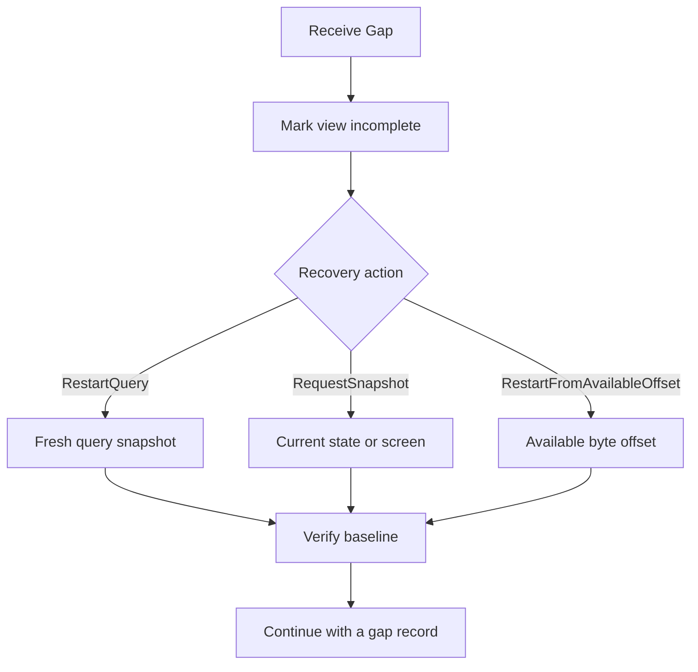

# Consume streams and recover from discontinuities

Use a Rust SDK 0.1.0-beta `ProductSubscription` to keep one logical interest across
physical reconnections. You need a connected client, authorization for the
selected source, and a plan for missing history. A **logical stream** is one
subscription on a shared connection; it is not a process, session, durable event
journal, or application task.

## Observe terminal output

The complete [terminal_output.rs](../../../crates/undercurrent-sdk/examples/terminal_output.rs) reads one bounded
retained page from offset zero, then observes a separate bounded tail/live stream
with a five-second receive budget. It prints offsets and sizes, not raw terminal content.
The finite page and tail can overlap; this example is not concatenating them into
a lossless log.

### 1. Run the bounded observer

Complete the [connection prerequisites](connect-and-query.md#prerequisites).
From the repository root, against an already running isolated test daemon, replace
the endpoint and `SESSION_ID` with an existing session's stable ID:

```sh
cargo run --locked -p aixand-undercurrent --example terminal_output -- /absolute/test-home/run/control.sock SESSION_ID
```

### 2. Check output and cleanup

Use the Windows configured absolute endpoint when running on Windows. No session
is created or stopped by this example. Successful output contains a `retained=`
line or `retained gap:` line and, if bytes exist, `sequence=... offset=... bytes=...`
lines. An idle stream can time out without an item and still exit successfully.


A printed gap is a discontinuity, not complete history; follow [gap recovery](#recover-after-a-gap).
For rejected opens, check the stable session ID and authorization; for setup
errors, use [connection troubleshooting](connect-and-query.md#diagnose-setup-failures).
These are expected shapes, not observed results.

Cleanup closes the subscription
and client, leaving the existing session intact.

## Select a stream and decode its items

The four kinds and specifications are owned by the
[protocol stream registry](../../../crates/undercurrent-protocol/src/registry.rs) and
[DTOs](../../../crates/undercurrent-protocol/src/dto.rs). The daemon's
[stream policy](../../../crates/undercurrent-daemon/src/stream.rs) owns delivery and gap
recovery choices; the SDK maps them to product-facing values.

| Stream kind | Items | Application cursor |
| --- | --- | --- |
| `SessionWatch` | `SessionSnapshot`, then<br>`SessionDeltaBatch` | Catalog revision and page membership/order |
| `SessionEvents` | `SessionEvent` | Durable global event sequence |
| `TerminalOutput` | `Output` or `Screen` | Byte offset, or screen state and offset |
| `AgentEvents` | `AgentEvent` | Exact attempt binding and durable event sequence |

Terminal items use `TerminalStreamItem`; the other three kinds use JSON.

Call `open_subscription(specification, timeout)` and retain both activation
metadata and the subscription. Metadata reports kind, initial stream sequence,
resumability, and an optional source availability boundary. It is the **initial**
activation metadata; the SDK does not return fresh typed metadata after each
physical resume. `recv()` blocks; `recv_timeout(duration)` lets an application
periodically inspect phase, react to shutdown, or detect lack of progress.

`ProductSubscriptionItem` has `Json`, `Terminal`, and `Gap` variants. JSON decoding
checks the activated kind. Terminal decoding uses compact binary UCTO payloads,
without JSON/base64 expansion; bytes may contain control sequences or non-UTF-8
data. Invalid codec data or a kind mismatch cancels the affected subscription.
Keep a single application consumer per subscription to preserve processing order;
use client clones for independent requests and streams.

## Choose a terminal starting position

| Initial mode | Starting point |
| --- | --- |
| `None` | New live output without a seed |
| `Screen` | Authoritative screen snapshot and its output checkpoint |
| `Tail { max_bytes }` | Bounded recent byte history |
| `Resume { after_offset }` | Application output byte checkpoint |

A terminal **byte offset** is different from the outer stream **sequence**. SDK
reconnection uses stream identity, prior server epoch, and stream sequence.
Opening a new terminal stream from retained bytes uses `after_offset`. Never copy
one number into the other field. The finite `ReadTerminalOutput` result is either
`Data` (with offsets, bytes, digest, and paging/truncation evidence) or `Gap`
(with the requested offset, earliest available byte, current end, and recovery).
A screen diff additionally requires a daemon-issued opaque checkpoint; a rejected
or expired checkpoint calls for a new screen snapshot.

The SDK advances its delivery cursor and queues flow credit before typed decode
and application processing. See the [delivery sequence](../../../crates/undercurrent-sdk/docs/internals/subscription-recovery.md#delivery-checkpoints-and-credit).
Persist your own domain checkpoint after processing if restart safety matters;
SDK handles are not stored in a persistent database. Output-source retention,
transport replay retention, and application storage are separate budgets.

## What automatic reconnection does

`ResilientClient` supervises the current physical `Client`; `ProductClient` wraps
it with codecs. The supervisor waits for a close notification rather than
polling. Connection failures, heartbeat expiry, and some capacity failures cause
it to capture live stream checkpoints and establish a replacement physical
connection within a bounded attempt policy. The supervisor attempts to resume each live subscription on that connection
with bounded parallelism. Existing handles retain their logical IDs and original trace context.

The following state view describes the persistent client, not session lifecycle.

```mermaid
stateDiagram-v2
    accTitle: Persistent SDK connection phases
    accDescr: Construction establishes the initial connection. A closed physical connection causes bounded recovery. Successful recovery installs a new generation; exhausted or incompatible recovery fails terminally. Explicit close stops recovery from every phase.
    state "Construction" as Connecting
    [*] --> Connecting
    Connecting --> Connected: Connected handle returned
    Connecting --> [*]: Constructor returns error
    Connected --> Recovering: Physical connection closes
    Recovering --> Connected: Replacement installed
    Recovering --> Failed: Recovery fails
    Connected --> Closed: Explicit close
    Recovering --> Closed: Close cancels recovery
    Failed --> Closed: Explicit close
    Closed --> [*]
```



Construction happens before a handle is returned; it is not a public phase.

*`Failed` is terminal for this client; creating a new client is a separate caller
choice after diagnosis.* A successful replacement increments `generation`.
A snapshot of `Connected` or an agreement can race with later closure.

During `Recovering`, new ordinary finite work fails promptly with
`ResilientClientError::Recovering` instead of entering an unbounded offline queue.
A prior in-flight request remains tied to its old physical connection and fails;
its mutation is never replayed. For capability-gated typed requests, the product
preflight can see no agreement during recovery and return `MissingCapability`
before reaching that phase check. Inspect `pressure().phase` before diagnosing a
permanent capability incompatibility.

A subscription's receive can wait across multiple connection generations without
resetting its caller deadline. Recovery uses the last consumed outer sequence,
not the newest enqueued sequence, so undelivered data remains eligible for replay.
Physical connection failure wakes existing waiters. The resumed peer may replay
retained items or issue an explicit gap if retention or epoch changed. Neither
reconnection nor a replay attempt guarantees complete history.

For retry bounds, jitter, cancellation, and the manual encoded-client helper, see
[bounded attempts and manual recovery](../../../crates/undercurrent-sdk/docs/internals/subscription-recovery.md#bounded-attempts-and-manual-recovery).
All connector errors consume the same bounded attempt policy, including permanent
configuration or authentication failures. Correct the cause before creating
another client.

## Recover after a gap

`Gap` is an explicit inclusive missing sequence interval, not an empty item.
`ProductSubscriptionItem::sequence()` returns its `last_missing` sequence. Gap
reasons distinguish live queue overflow, replay eviction, missing replay,
server epoch change, and source-retention eviction. The product-facing mapping
in [subscription.rs](../../../crates/undercurrent-sdk/src/product/subscription.rs) preserves all five reasons
and all three recovery actions.

Stop applying dependent deltas to an incomplete view. Follow the action carried
by the gap rather than guessing solely from the reason:



*Recovery builds a new trustworthy baseline; it cannot reconstruct bytes or events
that the source has already discarded.*

Use the shared [baseline recovery table](../recovery.md#restore-a-stream-baseline)
for query membership, screen snapshots, raw transcripts, session events, and exact
agent-event bindings. Close the old subscription before opening its replacement. A new subscription
requires current authorization; a failed refresh must leave the view marked incomplete. The SDK returns the gap but does
not perform these application-level recovery steps for you.

## Deadlines and ownership

| Boundary | Actual scope |
| --- | --- |
| Local connection attempt | Separate dial and handshake bounds, plus a combined startup wait; standard profile uses five seconds for each |
| Initial connect/reconnect | Up to the policy's attempt count plus backoff and worker setup; not bounded by a later request timeout |
| `request` / `PendingProductRequest::wait` | Timeout starts when waiting for the correlated response after request admission; encoding, setup, and time before `wait` are not included |
| Open/resume | Finite activation-response wait; each resume has its own timeout, so multiple worker batches take longer than one timeout |
| `recv_timeout` | One deadline across replacement waits and receive attempts; timeout leaves the logical interest live |
| Shutdown | Signals closure/cancellation; explicit `close` is not a remote close acknowledgment or a join of every worker. [Close notification](../../../crates/undercurrent-sdk/docs/internals/client-runtime.md#synchronize-close-notification) is synchronized with recovery-supervisor wait registration. |

Use bounded, realistic durations. Persistent receive computes deadlines with
`Instant::checked_add`; an unrepresentable duration becomes an unbounded wait in
the current implementation. Concurrent receivers also contend for the physical
subscription mutex before their receive wait; use one receiver per logical
stream rather than treating receive timeouts as strict multi-consumer wall-clock
budgets. Async task cancellation alone cannot forcibly stop a Rust blocking call.

Recovery cancellation stops queued checkpoint resumes and closes the replacement
to release active activation waits before joining workers. Some subscriptions may
already have opened; cancellation does not roll back their remote history. See [resume cancellation boundaries](../../../crates/undercurrent-sdk/docs/internals/subscription-recovery.md#cancellation-during-resume).

Requests may complete out of order. Wait for the required result before submitting
a dependent operation; cloning a client does not impose ordering. These calls
block, so async Rust applications need bounded blocking workers.

Client clones share ownership. Pending finite handles retain the physical client;
subscriptions retain the persistent owner. Dropping one client clone does not
close resources retained by another clone or subscription. Dropping a
subscription unregisters it from future recovery. Last-owner teardown closes
resources and joins SDK workers (avoiding self-join); local adapter shutdown is
signaled to its own worker. Prefer explicit close for deterministic application
shutdown intent, and join any caller-owned worker threads yourself.

Three cancellation scopes remain distinct:

| Action | Meaning |
| --- | --- |
| `PendingProductRequest::cancel` | Best-effort cancellation of one request, on its original connection; wait for the correlated terminal response |
| Subscription `cancel`, `close`, or drop | Stop that observation interest and remove recovery state; no runtime cancellation |
| `cancel_runtime_attempt` | Explicit authorized product mutation against an exact durable attached attempt |

## Pressure and current recovery limitations

### Slow consumers affect the shared connection

A bounded mailbox protects connection memory. If it fills, the SDK closes only
that logical stream and reports a typed overload, without advancing over unread
data. Other requests and subscriptions continue. The application may reopen the
stream from its own checkpoint after reducing pressure. If the stream-close
command cannot enter the bounded writer, physical teardown remains necessary.
`ResilientSubscriptionError::Overloaded` does not automatically resume the slow
consumer.

### Deferred credit is retried by the writer

Returned credit counts complete flow-controlled frame bytes. A full writer keeps
credit in one saturating numeric counter per affected stream. After a physical
write completes, the writer flushes deferred credit without requiring another
receive. The lower `Subscription` also exposes `flush_credit()` for explicit
retry. A physically blocked writer still needs transport progress before credit
can reach the server; use finite receives and telemetry to diagnose it.

### Close pressure can affect peers

Independent subscription close normally leaves peers active. If its `CloseStream`
command cannot enter the bounded writer, the current implementation closes the
physical connection to avoid leaving an untracked remote interest. Codec-error
cancellation inherits this exception.

### Automatic resume validates product activation

Initial and resumed product streams validate `ProductStreamOpenResponse` and
require the requested stream kind before accepting activation. Recovery installs
only responses accepted by the product validator. A rejected stream reports
`StreamRejected` with the server's details; a wrong kind reports
`StreamKindMismatch`, and malformed metadata reports a codec error. Other
subscriptions and the replacement connection can remain usable.

The encoded resilient API remains protocol-agnostic; callers using that layer
directly own validation of their encoded activation responses.

[Limits and diagnostics](limits-and-diagnostics.md) · [Operation reconciliation](operations.md#reconcile-a-mutation) · [Maintainer implementation](../../../crates/undercurrent-sdk/docs/README.md) · [SDK entry point](../../../crates/undercurrent-sdk/README.md)
