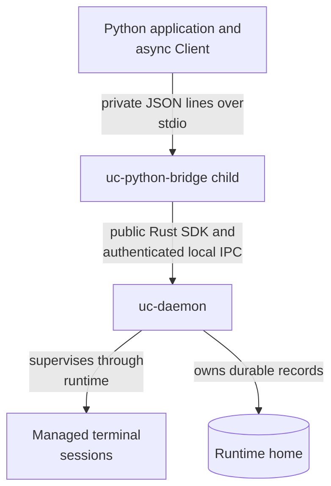

# Use Undercurrent from Python

The `undercurrent-sdk` package provides an **async Python 3.11+ client** for
starting local terminal sessions, delivering input, reading output, observing
state, and stopping processes. Import it as `undercurrent`. These pages describe
release **0.1.0-beta** in this checkout. Python packaging normalizes that same
release to **0.1.0b0**. Use the daemon and `uc-python-bridge` built
from the same revision.

Python owns the connection and observation helpers. The external daemon owns
sessions, durable state, and process supervision. Closing a client detaches;
stopping a session is an explicit operation. Application success, agent identity,
credentials, and workflow budgets remain the caller's responsibility.

`await client.stop(session_id, graceful_only=True)` requests a graceful stop
without automatic forced escalation. It requires a daemon supporting the
`graceful_only` stop field and cannot be combined with `force=True`. Inspect or
wait for terminal lifecycle before treating a process as stopped; a timeout
does not establish termination.

## Choose a reading path

| Reader | Start here | Continue with |
| --- | --- | --- |
| User running local tasks | [Install and run a complete example](../docs/sdk/python/quickstart.md) | [Recover and clean up](../docs/sdk/python/recovery.md) |
| SDK integrator | [Control sessions and deliver input](../docs/sdk/python/operations.md) | [Wait for observed state](../docs/sdk/python/state.md), [consume output and streams](../docs/sdk/python/streams.md) |
| Maintainer | [Trace the implementation and extend it](docs/README.md) | [Source owners](docs/README.md#ownership-and-source-map) and [SDK comparison](../docs/sdk/README.md) |

## Setup and examples

Follow the [Linux quickstart](../docs/sdk/python/quickstart.md) to install the
package, select matching native executables, and start an isolated daemon.
Installing the Python package alone does not install Rust binaries.

The maintained [input round trip](examples/input_roundtrip.py) demonstrates
`async with Client()`, starting a child, an application acknowledgment, output
pagination, and cleanup. [Wait for state](examples/wait_state.py),
[observe a session](examples/observe.py), and
[copy retained output](examples/read_output.py) without changing its process.

The API does not start a daemon, compile a bridge, or replay a failed mutation
automatically. Preserve session IDs and delivery IDs and follow the
[operation-specific recovery rules](../docs/sdk/python/recovery.md#reconcile-a-mutation).
The [repository overview](../README.md) and
[Rust SDK orientation](../crates/undercurrent-sdk/README.md) provide wider context.

## Connection ownership

This diagram shows the runtime boundaries relevant to a Python caller.

*The bridge is a client adapter; neither the Python package nor its bridge embeds
the daemon or reads its database.* See the [maintainer source map](docs/README.md#ownership-and-source-map).
