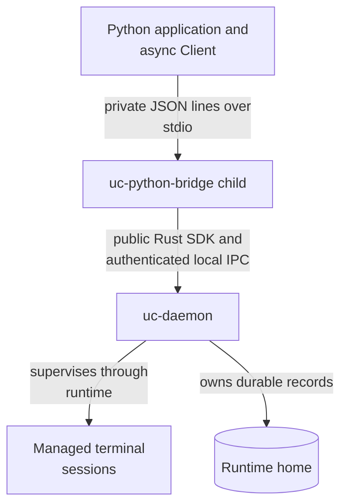

# Work on the Python SDK

Find the owner of a Python SDK 0.1.0-beta behavior, then follow the focused guide for
that change. Consumer tasks start in the [Python SDK reading path](../../docs/sdk/python/README.md).

| Maintainer task | Read |
| --- | --- |
| Trace startup, request correlation, or a failed reader | [Bridge connection](internals/connection.md) |
| Follow Python's part of start, input, output, or waits | [Request and observation conversion](internals/conversion.md) |
| Add an operation or choose checks | [Extend and verify](development/changes.md) |
| Locate the paired native adapter and its tests | [Bridge maintainer documentation](../../crates/undercurrent-python-bridge/docs/README.md) |
| Compare exposed Python and Rust features | [SDK comparison](../../docs/sdk/README.md) |

## Consumer behavior

The `aixand-undercurrent-sdk` PyPI release `0.1.0b0` uses matching
`0.1.0-beta` native executables. The asynchronous client owns connection and
observation helpers. The daemon owns sessions, durable state, and process
supervision. Closing a client detaches. Stopping a session is explicit.
Application success, agent identity, credentials, and workflow budgets belong
to the caller.

[`await client.stop(session_id, graceful_only=True)`](../src/undercurrent/client.py)
requests a graceful stop without automatic forced escalation. It requires a
daemon that supports the `graceful_only` stop field. `force=True` and
`graceful_only=True` are mutually exclusive. Inspect or wait for terminal
lifecycle before treating a process as stopped. A timeout leaves termination
unconfirmed.

The client does not launch a daemon, compile a bridge, or replay a failed
mutation automatically. Preserve session and delivery IDs and use
[operation-specific recovery](../../docs/sdk/python/recovery.md#reconcile-a-mutation).
The [input round trip](../examples/input_roundtrip.py) shows a client context,
child startup, application acknowledgment, pagination, and cleanup.
To observe a process without changing it, see [wait for state](../examples/wait_state.py),
[observe a session](../examples/observe.py), and [copy retained output](../examples/read_output.py).

## Connection ownership

This diagram shows the runtime boundaries relevant to a Python caller.

The bridge is a client adapter. The Python package and the bridge rely on the
external daemon and have no direct access to its database.

## Ownership and source map

The [connection diagram](#connection-ownership) shows runtime communication. Python launches
one bridge child per client. The bridge owns a public Rust `ProductClient` and
its connection workers, not the daemon's runtime. The daemon composes application
services, SQLite persistence, and runtime process supervision; session hosts and
their private IPC are behind that daemon boundary. They are not alternative
Python connection endpoints.

| Source | Responsibility and investigation path |
| --- | --- |
| [`__init__.py`](../src/undercurrent/__init__.py) | Public exports: `Client`, four models, base exception, and three specialized exceptions. Importing the SDK does not start a daemon. |
| [`client.py`](../src/undercurrent/client.py) | Product request construction/correlation check, model conversion, pagination, digest verification, watch adaptation, state validation, dwell/event audit. |
| [`_transport.py`](../src/undercurrent/_transport.py) | Executable/home resolution, subprocess lifetime, ready protocol, bounded request and stream bookkeeping, private JSON-lines framing and failure fan-out. |
| [`models.py`](../src/undercurrent/models.py) | Lightweight snapshots/receipts/output/update wrappers. No live ownership, deep immutability, or schema validation. |
| [`errors.py`](../src/undercurrent/errors.py) | Optional server metadata and the locally constructed ended/removed/output-gap errors. `from_wire` passes fields to the constructor. |
| [Bridge main](../../crates/undercurrent-python-bridge/src/main.rs) | Public SDK connection, mutation contract preparation, environment binding, Rust request threads, stream ACK gating, error serialization, unsubscribe and shutdown. |
| [Bridge envelope output](../../crates/undercurrent-python-bridge/src/output.rs) | Serialized stdout frames, including terminal fatal ordering. |
| [Rust product client](../../crates/undercurrent-sdk/src/product.rs) and [subscription decoder](../../crates/undercurrent-sdk/src/product/subscription.rs) | Typed product encoding, response/stream correlation and negotiation; [resilient client](../../crates/undercurrent-sdk/src/resilient.rs) owns physical reconnection and stream recovery. |
| [Protocol DTOs](../../crates/undercurrent-protocol/src/dto.rs), [registry](../../crates/undercurrent-protocol/src/registry.rs), [contracts](../../crates/undercurrent-protocol/src/contract.rs) | Authoritative data shapes, operation/stream/error vocabulary, mutation metadata and effect certainty. |
| [Daemon boundary](../../crates/undercurrent-daemon/src/boundary.rs), [finite adapter](../../crates/undercurrent-daemon/src/application_adapter/finite.rs), [read adapter](../../crates/undercurrent-daemon/src/application_adapter/reads.rs), [stream adapter](../../crates/undercurrent-daemon/src/application_adapter/streams.rs) | Validation and authorization, DTO/domain translation, application dispatch, outward responses. |

Python communicates through subprocess stdio, not Rust FFI. The
[project process view](../../docs/architecture/README.md#process-boundaries)
and [workspace dependency map](../../docs/architecture/dependencies.md#dependency-direction)
own the system and crate graphs. The local guides below own Python resource lifetime, correlation, conversion,
and extension behavior.

## Connection invariants

[Trace subprocess startup, bounded correlation, and failure fan-out.](internals/connection.md#connection-invariants)

## Create a session

[Follow start request construction into the shared creation walkthrough.](internals/conversion.md#create-a-session)

## Deliver input

[Find input conversion tests and the application delivery sequence.](internals/conversion.md#deliver-input)

## Trace terminal output and observations

[Follow digest validation, watch adaptation, and the stability audit.](internals/conversion.md#trace-terminal-output-and-observations)

## Python and Rust surfaces

[Compare supported surfaces before adding a Python wrapper for a Rust DTO.](../../docs/sdk/README.md)

## Extend at the owning boundary

[Place a change at its contract owner and preserve transport invariants.](development/changes.md#extend-at-the-owning-boundary)

## Verify a change

[Run focused tests and distinguish simulated observations from live qualification.](development/changes.md#verify-a-change)

[Python package overview](../README.md)
