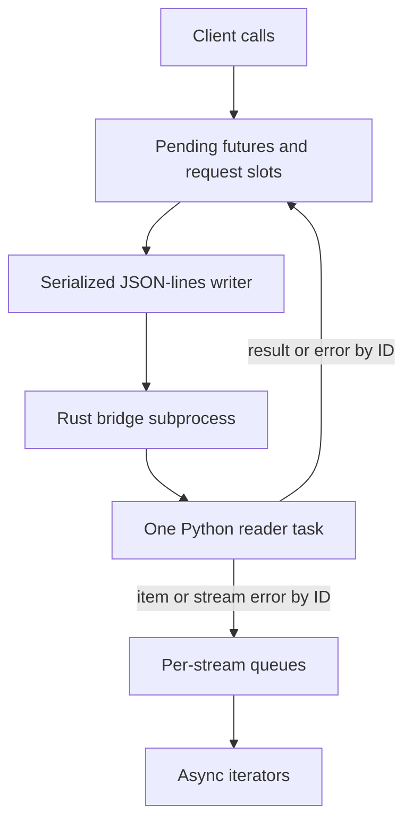

# Trace the Python bridge connection

Use this explanation when changing Python SDK 0.1.0-beta connection startup,
request correlation, stream buffering, or failure handling. Consumer setup and
sharing rules live in [operations](../../../docs/sdk/python/operations.md#connect-and-share-a-client).

## Connection invariants

*Finite correlation and stream buffering share a reader, but have separate
owners and cleanup paths.* [_transport.py](../../src/undercurrent/_transport.py)
implements those paths; [bridge stream delivery](../../../crates/undercurrent-python-bridge/docs/internals/operation-flow.md#stream-delivery-and-backpressure)
explains the Rust-side worker and acknowledgement ordering.

`Bridge.connect` serializes lazy startup, resolves the executable with
`shutil.which`, and spawns it with pipes and the selected `UNDERCURRENT_HOME`.
The bridge constructs `StandaloneClientProfile::standard`, authenticates local
IPC, and only then emits `{"type":"ready","protocol":"0.1.0-beta"}`. That release string is the
**private bridge protocol**, not the Python package version, product contract
version, environment `schema_version="0.1.0-beta"`, or public wire version. Mutation
metadata comes from `MutationContext::current` in the bridge; Python does not
construct a general pinned dispatch contract.

The Python reader correlates `result`/`error` with futures and
`item`/`stream_error` with stream queues. A write lock prevents interleaved JSON
lines. UUIDs correlate private calls; they are not semantic delivery IDs or
idempotency contracts. Python validates the returned operation again before
unwrapping its result.

Finite calls and subscription opens acquire one of 16 Python slots. Opening a
subscription releases its slot before iteration begins. The bridge separately
bounds request workers at 16 and active subscriptions at 64; subscription opening runs in the
bridge command loop and can delay later commands. JSON lines are bounded to
4 MiB, while the [standard Rust profile](../../../crates/undercurrent-sdk/src/profile.rs)
sets smaller product/frame/queue limits. Do not use the line limit to infer the
maximum accepted terminal prompt or output page.

The stream ACK protocol bounds buffering, as shown in the
[delivery diagram](../../../docs/sdk/python/streams.md#backpressure-and-connection-recovery). It is not a
transactional application acknowledgment. A reader protocol/queue failure is
connection-wide: the reader fails pending calls and clears stale observations
before waking streams with an error. This prevents an already-buffered ready
snapshot from masking a known bridge disconnection. Bridge stderr goes to
`DEVNULL`; Python has no configurable tracing/metrics interface. Keep safe
operation/session/revision/checkpoint metadata in caller logs rather than prompt
or terminal contents.

[Python maintainer documentation](../README.md)
